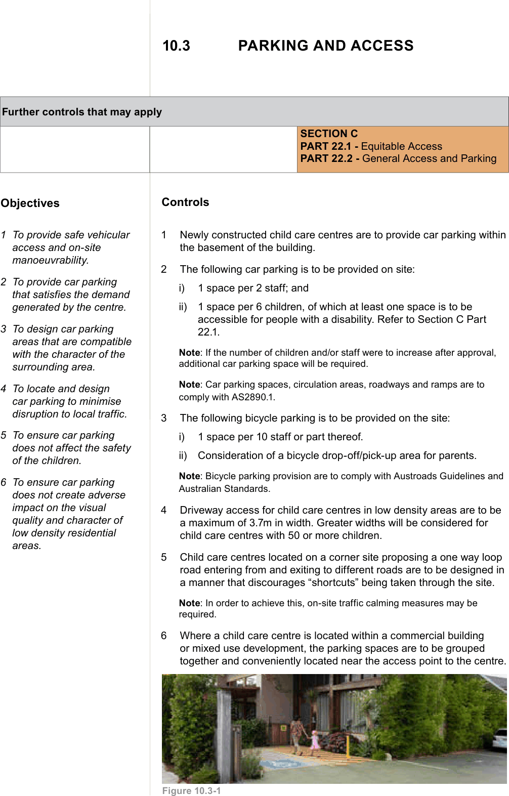

### 10.2 BUILDING HEIGHT AND SETBACKS

### (CONTINUED)

#### Controls

6 Where the child care site adjoins a low density residential area or

land approved for use for a low density residential purpose, deep soil

is to be provided within all as follows (refer to Figure 10.2-2):

i) a minimum of 1 metre of unrestricted deep soil area is to be

provided to each of the side boundaries; and

ii)	 a minimum of 2 metres of unrestricted deep soil area, to be used

by plants that require deep soil, is to be provided to the rear

iii)	 a minimum of 3 metres of unrestricted deep soil area, to be used

by plants that require deep soil, is to be provided to the primary

#### STREET

### STREET

### STREET

### STREET

### STREET

landscaped

landscaped

landscaped

landscaped

> [Picture on page 9: a map, saved as a picture (images/part-10-child-care-centres-page-9-1.gif, 150 dpi); the street names and other small labels are on the picture.]
> Words printed on the picture (title and legend, copied from the PDF):
> access and on-site
> that satisfies the demand
> generated by the centre.
> Note: If the number of children and/or staff were to increase after approval,
> additional car parking space will be required.
> areas that are compatible
> Note: Car parking spaces, circulation areas, roadways and ramps are to
> comply with AS2890.1.
> car parking to minimise
> disruption to local traffic.
> of the children.
> Note: Bicycle parking provision are to comply with Austroads Guidelines and
> does not create adverse
> impact on the visual
> quality and character of
> low density residential
> Note: In order to achieve this, on-site traffic calming measures may be

Figure 10.3-1
