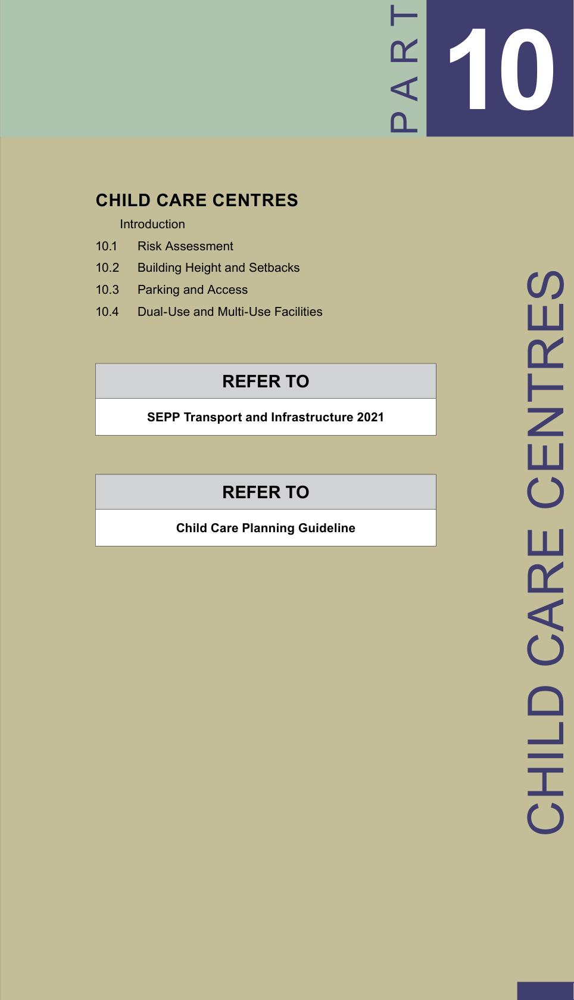

# Ku-ring-gai Development Control Plan - Part 10 Child Care Centres

> This chapter is split into 8 section file(s), one per numbered heading, in the order they appear in the PDF.

Source PDF: [kdcp-section-a-part-10-child-care-centres.pdf](kdcp-section-a-part-10-child-care-centres.pdf)

> [Picture on page 1: a picture, saved as a picture (images/part-10-child-care-centres-page-1-1.gif, 150 dpi).]
> Words printed on the picture (title and legend, copied from the PDF):
> Introduction

### 10A

### PART

### CHILD CARE CENTRES

<!-- sections -->
## Sections

1. [10.4 Dual-Use and Multi-Use Facilities](01-10-4-dual-use-and-multi-use-facilities.md)
2. [10.1 RISK ASSESSMENT](02-10-1-risk-assessment.md)
3. [10.1 RISK ASSESSMENT (CONTINUED)](03-10-1-risk-assessment-continued.md)
4. [10.1 RISK ASSESSMENT (CONTINUED)](04-10-1-risk-assessment-continued.md)
5. [10.2 BUILDING HEIGHT AND SETBACKS](05-10-2-building-height-and-setbacks.md)
6. [10.2 BUILDING HEIGHT AND SETBACKS](06-10-2-building-height-and-setbacks.md)
7. [10.3 PARKING AND ACCESS](07-10-3-parking-and-access.md)
8. [10.4 DUAL-USE AND MULTI-USE](08-10-4-dual-use-and-multi-use.md)
