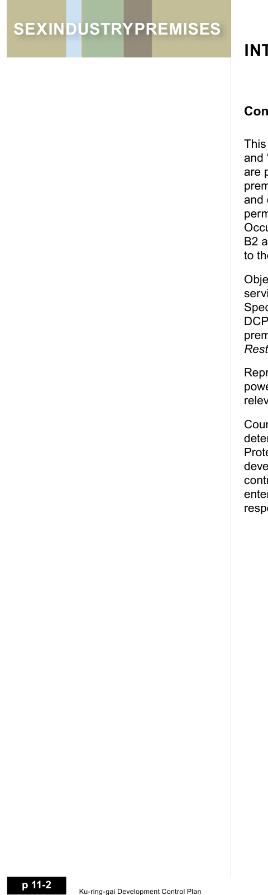

### 11.1 Submitting a Development Application

### 11.2 Initial limits on development consent

### 11.3 Sex Services Premises

### 11.4 Home Occupation (Sex Services) Premises

### SEX INDUSTRY PREMISES

### INTRODUCTION

> [Picture on page 2: a picture, saved as a picture (images/part-11-sex-industry-premises-page-2-2.gif, 150 dpi).]

#### Controls

This part of the DCP provides controls for both “Sex Services Premises”

and “Home Occupation (Sex Services) Premises”. These controls

are provided to ensure that the design and location of sex industry

premises do not result in a loss of amenity or create adverse social

and environmental impacts. Under KLEP, Sex Services Premises are

permissible with consent in all business zones. Additionally, Home

Occupation (Sex Services) Premises are permissible with consent in the

B2 and B4 zones. Clause 6.12 of the KLEP provides standards in relation

to the location of sex service premises. Objectives and controls in this part guide the development of sex

services premises in meeting the aims and objectives within the KLEP.

Specific planning controls are elaborated upon within this part of the

DCP. Additionally, Council will assess any application for a sex services

premises against the relevant matters set out in Section 17 of the

Restricted Premises Act, 1943. Representatives from various state and local authorities may have the

power to enter and inspect sex industry premises to ensure it meets all

relevant requirements. Council may undertake inspections of sex industry premises so as to

determine compliance with the NSW Public Health Act and Regulations,

Protection of the Environment Operations Act and conditions of

development consent made in accordance with the relevant planning

controls. Representatives from Council have the legislative powers to

enter and inspect premises to ensure it meets relevant requirements or in

response to a complaint.
