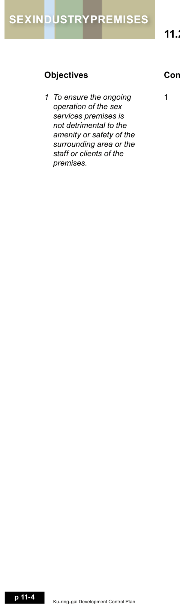

### 11.2	 INITIAL LIMITS ON DEVELOPMENT

### CONSENT

> [Picture on page 4: a picture, saved as a picture (images/part-11-sex-industry-premises-page-4-3.gif, 150 dpi).]
> Words printed on the picture (title and legend, copied from the PDF):
> operation of the sex
> services premises is
> not detrimental to the
> surrounding area or the
> premises.

#### Objectives

#### Controls

1 Development consent granted for sex services premises and home

occupation (sex services) premises may be initially limited to a

period of twelve (12) months, when Council will re-evaluate the

proposal in terms of any complaints received regarding the approved

operation, and compliance with any conditions of development

consent.

1	 To ensure the ongoing

amenity or safety of the

staff or clients of the
