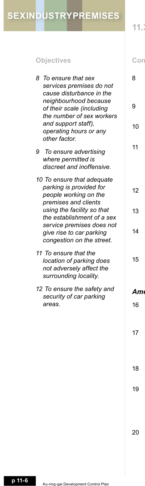
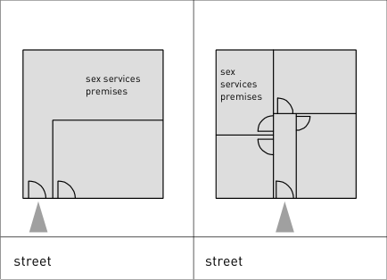
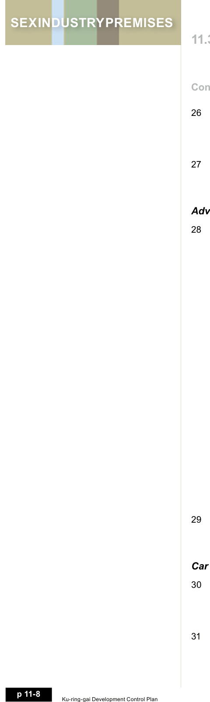

### 11.3	 SEX SERVICES PREMISES

#### Further controls that may apply

#### SECTION C

PART 23.6 - Building Services

#### Controls

#### Objectives

#### Location

1	 To avoid the clustering

of sex services premises

within Ku-ring-gai.

1 To avoid clustering, sex services premises are not to be located

within 500 metres of the entrance to a building which contains an

existing known sex services premises (measured from the building

entrance of the proposed sex services premises). Council may

also consider the presence of any sex services premises within a

neighbouring Local Government Area (LGA) immediately adjoining

the site.

2	 To ensure sex services

premises are located so

as not to impact adversely

on the environment, public

areas, and other sensitive

uses.

2 Sex services premises proposed to be situated at ground or street

level are to comply with the following:

i) The premises is to be located behind another tenancy which is

not a sex services premises;

ii)	 The premises is to be separate and independently operated from

3	 To ensure that the layout

and design of sex services

premises is such that their

potential impacts and

‘presence’ in the locality is

minimised.

the front tenancy; and

iii)	 The premises is not to be internally linked to the front tenancy.

4	 To ensure the privacy and

comfort of patrons.

#### Design of Premises

3 Works to existing buildings are to be carried out in such a way as

to avoid the creation of potential entrapment spots where intruders

may hide. This includes, but is not limited to, avoiding the creation

of recesses in the building form; and securing external storage

areas such as waste storage. For existing buildings where no new

works are proposed, appropriate lighting is to illuminate existing

entrapment spots.

5	 To ensure the design and

external appearance of

the premises and any

associated structure(s)

do not have an

adverse impact on the

architectural character

of the surrounding built

environment.

4 All premises are to have either an intercom or a duress alarm in

each working room that is used for sexual activity. Alarms are to

connect back to a central base (such as reception) that is to be

monitored at all times.

6	 To ensure adequate and

appropriate access to the

premises and its facilities

is provided for persons

with a disability.

5 Intruder alarm systems, security screens, door and window locks

and intruder resistant materials that comply with relevant Australian

Standards, are to be provided. 6 New development is not to create large blank walls facing or abutting

the street. Walls are to be modulated to avoid the creation of a large

flat surface susceptible to graffiti. 7 Any security grilles used on windows are to be openable from inside

in case of emergency.

7	 To maximise the safety

and security of staff,

clients and the general

public by upholding

principles of  Crime

Prevention Through

Environmental Design

(CPTED).

### SEX INDUSTRY PREMISES CONTROLS

> [Picture on page 6: a map, saved as a picture (images/part-11-sex-industry-premises-page-6-1.gif, 150 dpi); the street names and other small labels are on the picture.]
> Words printed on the picture (title and legend, copied from the PDF):
> services premises do not
> cause disturbance in the
> of their scale (including
> and support staff),
> operating hours or any
> 9	 To ensure advertising
> where permitted is
> discreet and inoffensive.
> parking is provided for
> people working on the
> premises and clients
> service premises does not
> congestion on the street.
> location of parking does
> not adversely affect the
> security of car parking

#### Objectives

#### Controls

8 The premises is to be provided with an adequate reception area/

waiting room with a minimum area of 20m2 to prevent clients from

loitering outside. 9 Not more than 5 rooms are to be provided in which acts of

prostitution are to take place. 10 The privacy of patrons is to be considered through the design and

internal layout of the premises.

8	 To ensure that sex

the number of sex workers

11 Staff facilities are to include a communal lounge or rest area and

a bathroom for staff use only. Staff facilities must include a staff

noticeboard. This noticeboard must include information about safer

sex, emergency contacts and other information required by NSW

Health or SafeWork NSW. 12 If food is provided for sale at the premises food handling areas must

comply with the requirements of the Australian Standard 4674. 13 Toilet and bathroom facilities are to be provided within the premises

and not be shared with any other premises within the building.

10	 To ensure that adequate

using the facility so that

the establishment of a sex

give rise to car parking

14 Every working room is to be provided with separate sanitary facilities

compromising a toilet, shower and hand basin directly accessible

from that room for the use of both sex workers and their clients. 15 All common areas, facilities and at least one (1) suite and its facilities

(including a toilet / en suite) are required to be designed to be

suitable for use by a person with a disability.

11	 To ensure that the

#### Amenity

12	 To ensure the safety and

16 The premises and its activities are not to have an adverse affect on

surrounding and adjoining land uses and business in the locality or

within the same site. 17 The premises and its activities are to avoid unacceptable visual

impact and possible offence to the public. Sex workers are not to

display themselves in windows, doorways or outside a sex services

premises. 18 The sex services premises is not to be of a colour which draws

undue attention. 19 To ensure the privacy of patrons and ensure no potential offence is

caused to adjoining or surrounding premises, the interior of a sex

services premises is not to be visible from adjoining or surrounding

premises or the public domain (which includes streets, parks and

footpaths). 20 Sex services premises are to be designed to minimise noise

transmission, measures include:

i) grouping room uses according to the noise level generated;

ii)	 using storage or circulation zones within the premises to buffer

### N

#### Controls

noise from adjacent apartments, mechanical equipment or

corridors and lobby areas; and

> [Picture on page 7: a map, saved as a picture (images/part-11-sex-industry-premises-page-7-5.gif, 150 dpi); the street names and other small labels are on the picture.]

#### Figure 11.3-1:

#### Acceptable front entries for sex services premises.

iii)	 incorporating appropriate noise shielding or attenuation

techniques into the design of the building where appropriate.

#### Accessibility and Entrances

21 Access for people with a disability is to be provided in accordance

with all relevant legislation and standards, including AS1428 –

Design for Access and Mobility and the Disability Discrimination Act

1992\. 22 Premises are to be designed so that there is only one (1) entrance

to the premises which is to be located at the front of the building

(or from the primary street access if the premises is located on a

corner). Examples of acceptable front entry designs are shown in

the Figure 11.3-1. 23 Casual surveillance of the entrance is essential to ensure the safety

of all workers and visitors to the premises. Accordingly, the entrance

to the sex service premises is to be designed to facilitate the privacy

of workers and clients, without compromising personal safety. 24 Adequate lighting of the entrance is essential to ensure the safety

of sex workers and clients who are leaving and arriving at the

premises, but not to the extent where it becomes a prominent

feature in the streetscape (eg. by high intensity lighting or the use of

excessively bright colours). To ensure the safety of all workers and

visitors any proposed landscaping is not to obstruct the visibility and

passive surveillance from public areas of the entrance. 25 External lighting is to be vandal resistant. Vandal resistance may

be achieved by being high mounted and/or protected. Lighting is

to be directed towards access / egress routes rather than towards

buildings (including the subject or neighbouring buildings). Note: External lighting is not to result in spillage of light onto adjoining

properties.

### SEX INDUSTRY PREMISES CONTROLS

> [Picture on page 8: a picture, saved as a picture (images/part-11-sex-industry-premises-page-8-1.gif, 150 dpi).]

#### Controls

26 Pathways are to be direct (i.e. straight) and blind corners are to be

avoided (including on stairs, in corridors or in other situations where

movement can be predicted). If blind corners cannot be avoided then

they are to be treated with mirrors to improve sightlines. 27 All barriers beside pathways are to be low in height or visually

permeable (i.e. ‘see-through’) including landscaping, fencing and the

like.

#### Advertising Signs and Structures

28 In addition to the provisions set out in Part 12, sex services premises

are to adhere to the controls set out below:

i) One (1) sign per premises only;

ii)	 Signage may identify only the name of the person who conducts

the business or the registered name of the business;

iii)	 A clearly visible street number is to be displayed;

iv)	 No merchandising relating to the sex services premises is to

be erected, displayed or exhibited at any entry or in an access

corridor (including any stairwell) to the premises;

v)	 No signs may display words or images, which are in the opinion

of the Council, sexually explicit, lewd or otherwise offensive.

Council is to be satisfied that the content, size, shape, and

lighting of the sign is not likely to interfere with the character or

amenity of the neighbourhood;

vi)	 Signs may be externally lit by spotlights only. Internally

illuminated signs or ‘flashing signs’ are not permitted;

vii)	 A clear and legible sign is required advising clients that ‘only’

persons over the age of 18 will be permitted’. ‘Proof of age may

be required’ must be clearly visible upon entry to the premises;

and

viii)	The sign is to be located at ground floor level outside the

entrance to the premises, with a maximum size of 0.25m2.

29 Where there is an inconsistency between this section and Parts 12

of this DCP, the controls set out above prevail to the extent of any

inconsistency.

#### Car Parking

30 On site parking must be provided for sex services premises at the

rate of 1 space per 2 employees working at any one time in the

premises, plus 1 space per room where acts of prostitution are

conducted. 31 Reduced parking requirements may be considered if it can be

#### Controls

demonstrated by the applicant that adequate on-street car parking

and/or public transport services exist close to the premises and

any public transport services operate at the times at which the

premises are proposed to be open. It will also be necessary to

demonstrate that a variation to the requirements for the provision of

on-site parking will not adversely affect the amenity of any adjoining

residential locality or properties. 32 On-site parking spaces are to be arranged in a grid pattern rather

than a herringbone configuration. 33 Car parking spaces, circulation areas, roadways and ramps are to

comply with AS2890.1. 34 Lighting is to be used in all outdoor car parks and in all vehicular and

pedestrian access ways to and from the development. Details of the

lighting, including its location, is to be provided with the development

application. Where casual surveillance cannot be provided (i.e.

carpark), electronic surveillance is to be installed.

#### Laundry Facilities

35 A properly constructed laundry room must be provided and

commercial/industrial laundry equipment must be used. 36 Designated storage spaces must be provided for the separate

storage of clean and used linen.

### SEX INDUSTRY PREMISES CONTROLS
