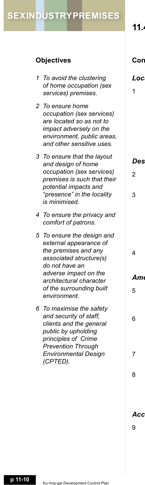

### 11.4	 HOME OCCUPATION (SEX SERVICES)

### PREMISES

> [Picture on page 10: a map, saved as a picture (images/part-11-sex-industry-premises-page-10-3.gif, 150 dpi); the street names and other small labels are on the picture.]
> Words printed on the picture (title and legend, copied from the PDF):
> of home occupation (sex
> 2	 To ensure home
> occupation (sex services)
> impact adversely on the
> environment, public areas,
> and other sensitive uses.
> and design of home
> occupation (sex services)
> potential impacts and
> “presence” in the locality
> comfort of patrons.
> external appearance of
> the premises and any
> do not have an
> adverse impact on the
> of the surrounding built
> and security of staff,
> clients and the general
> public by upholding
> principles of  Crime

#### Controls

#### Objectives

#### Location

1	 To avoid the clustering

are located so as not to

1 To avoid clustering, home occupation (sex services) premises are

not to be located within 150 metres of the entrance to a building

which contains an existing known home occupation (sex services)

premises (measured from the building entrance of the proposed

home occupation (sex services) premises. Council may also

consider the presence of any home occupation (sex services)

premises within a neighbouring Local Government Area (LGA)

immediately adjoining the site.

#### Design of Premises

2 Toilet and bathroom facilities are to be provided within the premises

and not shared with any other premises within the building.

3	 To ensure that the layout

premises is such that their

4	 To ensure the privacy and

3 Works to existing buildings are to be carried out in such a way as

to avoid the creation of potential entrapment spots where intruders

may hide. This includes, but is not limited to, avoiding the creation

of recesses in the building form and securing external storage

areas such as waste storage. For existing buildings where no new

works are proposed, appropriate lighting must illuminate existing

entrapment spots. 4 Any security grilles used on windows are to be openable from inside

in case of emergency.

#### Amenity

5	 To ensure the design and

5 The premises and its activities are to not have an adverse effect on

surrounding and adjoining land uses and business in the locality or

within the same site. 6 The premises and its activities are to avoid unacceptable visual

impact and possible offence to the public. Sex workers are not

to display themselves in windows, doorways or outside a home

occupation (sex services) premises.

6	 To maximise the safety

7 The home occupation (sex services) premises is not to be of a colour

which draws undue attention. 8 To ensure the privacy of patrons and ensure no potential offence is

caused to adjoining or surrounding premises, the interior of a home

occupation (sex services) premises is not to be visible from adjoining

or surrounding premises or the public domain.

#### Accessibility and Entrances

9 Casual surveillance of the entrance is essential to ensure the safety

of all workers and visitors in the premises. Accordingly, the entrance

of home occupation (sex service) premises is to be designed to allow

workers to see who approaches their dwelling without the need to

open the front door.
