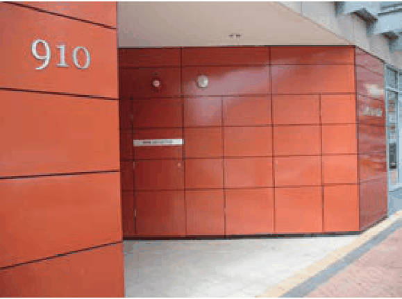

### 12.1	 SIGNAGE DESIGN

#### Controls

1 Signs are to be designed to integrate into the structure and

architecture of the building they are located on. Building façade

details, ventilated inlets/outlets and projecting features of the building

are to remain clear of any signage obstruction.

2 All signage is to be constructed of non-combustible, graffiti resistant

and easily cleaned materials.

3 The following signage is discouraged:

i) flashing signs, moving signs, balloon signs, inflatable signs or

the like;

ii)	 bunting, flag signs or those made of canvas, calico, textile or the

like;

iii)	 signs advertising a third party, activity or trade other than that

associated with the building to which the sign is attached;

iv)	 hoarding signs, painted bulletins, poster/sticker or advertisement

affixed to the exterior of a building;

v)	 signage above the awning level, except for building identification

signs in employment and mixed use areas;

vi)	 signage affixed to or attached to telephone booths, trees, poles,

signs, shelters, sheds, bins and the like;

vii)	 fluorescent colours on signs or buildings;

viii)	roof, sky, or fin signs;

ix)	 internally and externally illuminated signs, other than those

permitted within of this Part 12 of the DCP (and where internally

lit signs do not result in any light spill to neighbouring properties

particularly residential dwellings and bushland and proven not to

detract from the amenity of the locality);

x)	 painted signs.

> [Picture on page 3: a picture, saved as a picture (images/part-12-signage-advertising-page-3-56.gif, 150 dpi).]

### SIGNAGE & ADVERTISING

#### Figure 12.1-1:

#### Building identification sign

#### Objectives

1	 To enable way finding for

building users by clearly

identifying street numbers

and/or building names. 2	 To integrate signage with

the building design. 3	 To limit the number and

visual dominance of

signage on buildings.

> [Picture on page 4: a picture, saved as a picture (images/part-12-signage-advertising-page-4-11.gif, 150 dpi).]

#### Figure 12.2-1:

#### Street name and number

displayed prominently near

the building entry
