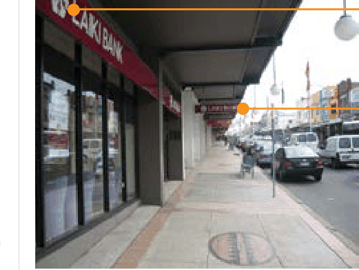

### 12.3	 BUSINESS IDENTIFICATION SIGNS

#### Objectives

#### Controls

1	 To encourage the

effective identification of

businesses and shops.

1 All business identification signs are to be of a size and shape

that relates to the architectural design of the building with which

they are associated/attached. The Signs must meet the minimum

requirements stated in this section with other standards assessed

on merit. The following signs may be utilised to identify business

premises:

2	 To control the number

and quality of business

identification signs.

i) Under awning signs.

ii)	 Top hamper signs.

iii)	 Fascia signs.

3	 To prevent physical and

visual clutter resulting

from multiple signs.

iv)	 Wall signs.

v)	 Free pole signs.

vi)	 Window signs. 2 Under awning signs are to:

i) be either illuminated or non-illuminated;

ii)	 be limited to one sign for each ground floor tenancy;

iii)	 have a minimum 2.6m clearance from ground/pavement to the

underside of the sign;

iv)	 be in a horizontal location at a right-angle to the building facade;

v)	 be set back at least 600mm from the face of the kerb and do not

project beyond the awning fascia.

3 Top hamper signs are to:

i) be non-illuminated;

ii)	 be attached flat to a wall surface for its entire length;

iii)	 not extend below the top level of the head of the doorway or

display window above which it is located;

iv)	 not be more than 3.7m above the finished ground level;

v)	 have a maximum length of 4m;

vi)	 not project more than 150mm from the building façade;

vii)	 allow a proportion of wall surface area of the top hamper to be

exposed.

4 Fascia Signs are to:

i) be non-illuminated;

ii)	 fit within the awning fascia;

### SIGNAGE & ADVERTISING

iii)	 be limited to one sign per business per street frontage. 5 Wall Signs are to:

i) be non-illuminated;

ii)	 be a maximum of one sign per building elevation;

iii)	 be no more than 25% of the wall surface;

### (continued)

#### Controls

iv)	 not project beyond the building walls. 6 Free-standing poles/pylon signs are to:

i) be non-illuminated;

ii)	 have only one free standing sign per property per street frontage;

iii)	 be located outside the Tree Protection Zone of adjacent trees;

iv)	 be completely located within the boundary of the property to

which the sign relates.

7 Window Signs are to

i) be non-illuminated;

ii)	 be a maximum of one sign per premises;

iii)	 have the following window coverage:

a)	 cover no more than 25% of the window area between the

window sill and the level of the door lintel where the sign is a

permanent window sign; or

b)	 cover no more than 60% of the window surface area, where

the sign is temporary in nature (up to a fortnight).

#### Employment and Mixed Use Zones

8 A maximum of two business identification signs are permitted for

each shopfront. 9 A co-ordinated presentation of signs is required where there are

multiple occupancies or uses within a single building. 10 No pole/pylon signs are permitted in these locations (except in

service station sites).

> [Picture on page 6: a picture, saved as a picture (images/part-12-signage-advertising-page-6-26.gif, 150 dpi).]

#### Top hamper sign

#### Under awning sign

#### Figure 12.3-1:

#### Two signs allowed for each

shopfront.

### (continued)

#### Controls Residential, Environmental, Recreation Zones

11 All business identification signs are to be non-illuminated. 12 A maximum of one business identification sign is permitted per site. 13 A business identification sign is not to be located more than 3m

above the existing ground level. 14 Any pole/pylon sign is to be located:

i) wholly within the property boundary of the site to which the sign

relates; and

ii)	 at a maximum height of 2m.

### SIGNAGE & ADVERTISING

#### Objectives

1	 To prevent physical and

visual clutter. 2	 To maintain Ku-ring-gai’s

high quality suburban

character.

3	 To ensure that signs

complement the

architectural style and use

of buildings.
