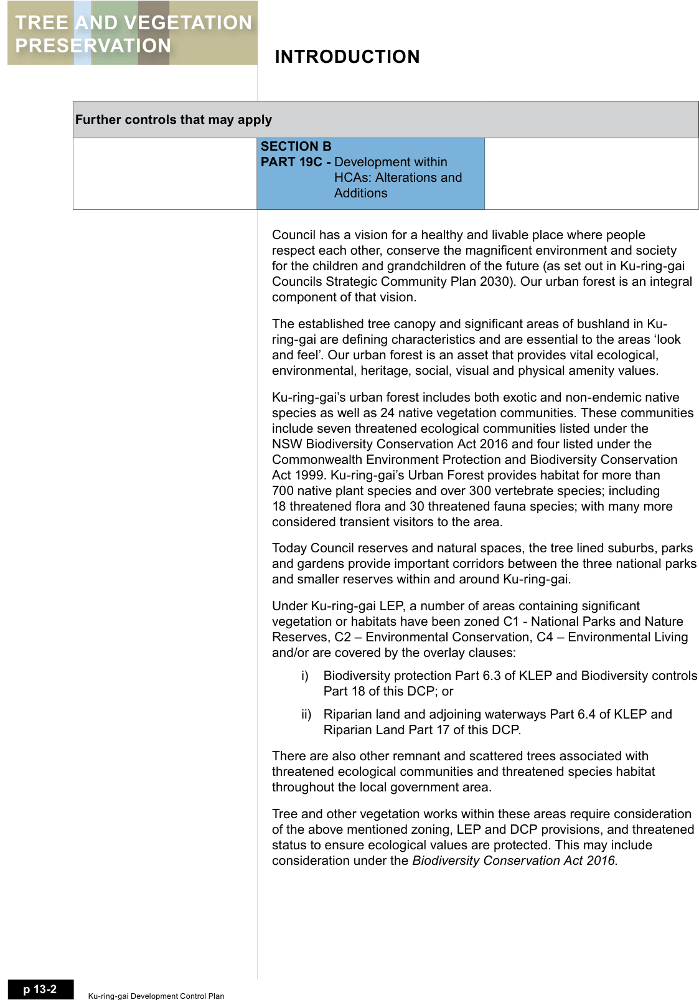

### 13.1 Tree and other vegetation works

### 13.2 Exemptions for tree and other vegetation works

### 13.3 Heritage items or heritage conservation areas

### 13.4 Application for tree and other vegetation works

### TREE &  VEGETATION  PRESERVATION

> [Picture on page 2: a picture, saved as a picture (images/part-13-tree-vegetation-preservation-page-2-1.gif, 150 dpi).]
> Words printed on the picture (title and legend, copied from the PDF):
> HCAs: Alterations and
> Additions

### INTRODUCTION

#### Further controls that may apply

#### SECTION B

PART 19C - Development within

Council has a vision for a healthy and livable place where people

respect each other, conserve the magnificent environment and society

for the children and grandchildren of the future (as set out in Ku-ring-gai

Councils Strategic Community Plan 2030). Our urban forest is an integral

component of that vision. The established tree canopy and significant areas of bushland in Ku-

ring-gai are defining characteristics and are essential to the areas ‘look

and feel’. Our urban forest is an asset that provides vital ecological,

environmental, heritage, social, visual and physical amenity values. Ku-ring-gai’s urban forest includes both exotic and non-endemic native

species as well as 24 native vegetation communities. These communities

include seven threatened ecological communities listed under the

NSW Biodiversity Conservation Act 2016 and four listed under the

Commonwealth Environment Protection and Biodiversity Conservation

Act 1999. Ku-ring-gai’s Urban Forest provides habitat for more than

700 native plant species and over 300 vertebrate species; including

18 threatened flora and 30 threatened fauna species; with many more

considered transient visitors to the area. Today Council reserves and natural spaces, the tree lined suburbs, parks

and gardens provide important corridors between the three national parks

and smaller reserves within and around Ku-ring-gai. Under Ku-ring-gai LEP, a number of areas containing significant

vegetation or habitats have been zoned C1 - National Parks and Nature

Reserves, C2 – Environmental Conservation, C4 – Environmental Living

and/or are covered by the overlay clauses:

i) Biodiversity protection Part 6.3 of KLEP and Biodiversity controls

Part 18 of this DCP; or

ii)	 Riparian land and adjoining waterways Part 6.4 of KLEP and

Riparian Land Part 17 of this DCP.

There are also other remnant and scattered trees associated with

threatened ecological communities and threatened species habitat

throughout the local government area. Tree and other vegetation works within these areas require consideration

of the above mentioned zoning, LEP and DCP provisions, and threatened

status to ensure ecological values are protected. This may include

consideration under the Biodiversity Conservation Act 2016.

### INTRODUCTION (continued)

This Part defines requirements and responsibilities with respect to the

protection, retention and replacement of trees and other vegetation in Ku-

ring-gai by:

iii)	 providing controls in relation to the management and long term

survival of Ku-ring-gai tree and other native vegetation resource;

and

iv)	 establishing a framework for the submission of applications for

tree and other vegetation works in Ku-ring-gai.

This part is made pursuant to Part 3 of State Environmental Planning

Policy (Biodiversity and Conservation) 2021, Chapter 2, Vegetation in

Non-Rural Areas, Part 2.3 and prescribes the trees and other vegetation

to which these clauses apply. A person who contravenes, or causes or permits to be contravened,

the provisions the Act and of this Part are guilty of an offence under the

provisions of the State Environmental Planning Policy (Biodiversity and

Conservation) 2021, Chapter 2, Vegetation in Non-Rural Areas. Injuring a tree or other vegetation does not require consent under

this Part where actions are required and have been authorised under

separate legislation. This Part will continue to apply where authorisations

under other legislation have not been obtained. This includes:

- bush fire hazard reduction work authorised by the Rural Fires

Act 1997. Under Clause 5.11 of the KLEP, these works may be

carried out without consent under this Part.

- Vegetation clearing under the 10/50 Vegetation Clearing Code

of Practice (Rural Fires Act 1997 Part 4, Division 9). Note: To determine if you are in a 10/50 area refer to the RFS

website https://www.rfs.nsw.gov.au (this excludes Critically Endangered Ecological Communities).

- works prescribed by the Electricity Supply Act 1995, Roads

Act 1993, Biosecurity Act 2015 or the Surveying and Spatial

Information Act 2002.

- approval to harm marine vegetation is provided under Part 7

of the Fisheries Management Act 1994.

- a license provided under the Biodiversity Conservation Act

2016.

- works required as part of other works for which a

development application is required, the works will be

assessed as part of the Development Application (approved

under Part 4 of the Environmental Planning and Assessment

Act 1979).

- works required as State Significant Infrastructure (approved

under Part 5.1 of the Environmental Planning and Assessment

Act 1979).

### TREE & VEGETATION PRESERVATION
