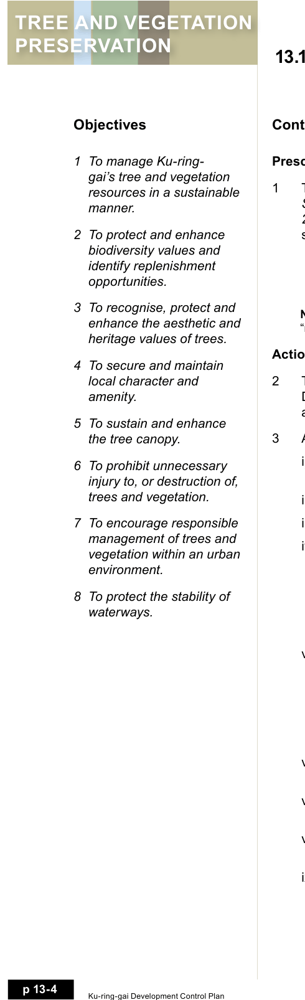
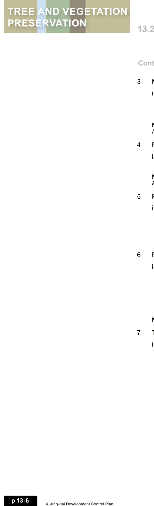

### 13.1	 TREE AND VEGETATION WORKS

> [Picture on page 4: a map, saved as a picture (images/part-13-tree-vegetation-preservation-page-4-2.gif, 150 dpi); the street names and other small labels are on the picture.]
> Words printed on the picture (title and legend, copied from the PDF):
> 1	 To manage Ku-ring-
> gai’s tree and vegetation
> resources in a sustainable
> biodiversity values and
> enhance the aesthetic and
> heritage values of trees.
> local character and
> the tree canopy.
> 6	 To prohibit unnecessary
> trees and vegetation.
> 7	 To encourage responsible
> management of trees and
> vegetation within an urban

#### Objectives

#### Controls

#### Prescribed Trees and Vegetation

1 The prescribed tree and vegetation that are protected by Part 3 of

State Environmental Planning Policy (Biodiversity and Conservation)

2021, Chapter 2, Vegetation in Non-Rural Areas, Part 2.3 and this

section of the DCP include

2	 To protect and enhance

- tree

- other vegetation

- native vegetation: Note: Refer to Part 1B Dictionary for definitions of “tree”, “other vegetation”,

“native vegetation”, “clearing”.

3	 To recognise, protect and

#### Actions that cause injury

4	 To secure and maintain

2 The injury of any tree(s) or other vegetation protected under this

DCP is prohibited without the written consent of Council. Except in

accordance with the exemptions prescribed in Part 13.2. 3 Actions that cause injury to tree(s) or other vegetation include:

5	 To sustain and enhance

i) removing including cut down, take away, clearing or transplant a

tree(s) or other vegetation from its place of origin;

injury to, or destruction of,

ii)	 pruning, damaging / tearing live branches and roots;

iii)	 lopping (height reduction) a tree;

iv)	 drilling or poisoning a tree or vegetation, including but not limited

to:

- the application of substances damaging to trees and other

8	 To protect the stability of

vegetation such as herbicides, other toxic chemicals; or

- spilling and or directing contaminants such as oil, petroleum,

paint, cement and similar to the root zone;

v)	 ringbarking, or otherwise damaging the bark, which may result in

a detrimental impact on the tree health including but not limited

to:

- the attachment of objects using invasive fastenings, tree

climbing spikes;

- the fastening of materials around the trunk of trees.

vi)	 exotic vines growing to the trunk and branches of trees which is,

or will result in, a detrimental impact on tree or vegetation health;

vii)	 damaging the root zone of a tree or other vegetation by way of

compaction, including storage and stockpiling of materials;

viii)	changing of ground levels within the root zone of a tree or other

vegetation by way of excavation, trenching, filling or stockpiling;

ix)	 severing tree or other vegetation roots with a diameter of 50mm

or greater.

### WORKS

#### Controls

This section explains when approval from Council is required to carry

out tree or vegetation works, pursuant to Part 3 of State Environmental

Planning Policy (Biodiversity and Conservation) 2021, Chapter 2,

Vegetation in Non-Rural Areas. These exemptions do not apply on land

that is a heritage item or within a heritage conservation area. Works on

heritage items and within heritage conservation areas are addressed

within Part 13.3. Note: This exemption does not apply to clearing of:

- Threatened Ecological Communities as per mapping available on

Council’s web site (https://www.krg.nsw.gov.au).

- Native vegetation that is on land included on the Biodiversity

Values Map, available through the Biodiversity Values Map

and Threshold tool (https://www.lmbc.nsw.gov.au/Maps/index.

html?viewer=BOSETMap). A copy of the vegetation mapping and

biodiverity values map and threshold (BOSET) report (as generated from the tool) should be retained as proof of consideration.

#### Exemptions

The following are exempt works: Tree branches directly over roof lines

i) removal of tree branches which directly overhang the roof of a

residence or commercial building, if pruned back to the nearest

branch junction or collar to remove from the roofline;

ii)	 detached garages, carports and ancillary buildings are not

included in this exemption. Note: Pruning is to be consistent with the Australian Standard for Pruning of

Amenity Trees (AS4373-2007), and is not to result in a detrimental impact to

the future health or stability of the tree or compromise the form of the tree.

For example, removal of all branches from one side of a tree over a roof line

would not be exempt. 1 Trees and other vegetation within 3m of an existing dwelling

i) trees and other vegetation within 3m of any existing dwelling on

the same property are exempt. The 3m distance is measured

from the centre of the trunk of the tree / base of the plant at

ground level to the external wall of the dwelling.

- provided the owner of the land on which the trunk of the tree

is located is in agreement and gives consent prior to the tree

works.

Note: Trees (Disputes between Neighbours) Act 2006 may apply

ii)	 trees and other vegetation within 3m of verandahs, carports,

detached garages, and ancillary buildings, cantilevered and pier

supported structures such as balconies and decks are excluded

from this exemption.

2 Removal of tree branches near electrical wires

i) removal of branches within 0.5m of electrical service lines to

properties. This exemption applies to tree branches only, not tree

trunks.

### TREE & VEGETATION PRESERVATION

### WORKS (continued)

> [Picture on page 6: a picture, saved as a picture (images/part-13-tree-vegetation-preservation-page-6-2.gif, 150 dpi).]

#### Controls

3 Minor pruning

i) pruning of trees and other vegetation provided:

- branches pruned, are not more than 50mm in diameter; and

- roots pruned are not more than 50mm in diameter. Note: pruning is consistent with the Australian Standard for Pruning of

Amenity Trees (AS 4373-2007). 4 Removal of dead wood

i) completely dead branches attached to tree(s) and other

vegetation within the property may be removed. Note: pruning is consistent with the Australian Standard for Pruning of

Amenity Trees (AS 4373-2007). 5 Removal of dead or dying trees and other vegetation

i) removal of completely dead or dying trees and other vegetation

provided that prior to any work being carried out:

- Council has advised the applicant of its satisfaction that the

subject tree(s) or other vegetation is dead or are dying and is

not required as the habitat of native fauna.

6 Removal of risk to human life or property

i) the removal of tree(s) which is structurally unsound and or

unstable, which displays a high degree of hazard, provided that

prior to any work being carried out:

- Council has advised the applicant, of its satisfaction that the

subject tree(s) is posing an imminent risk to human life or

property.

Note: an arborist’s report and testing may be required for significant trees. 7 Trees and other vegetation on Council owned and managed land

i) tree and other vegetation works may be undertaken by Council

or Council’s authorised agents, on Council owned or managed

land, providing these works are consistent with Council’s policies

and internal guidelines.

### WORKS (continued)

#### Controls

8 Exempt tree and other vegetation species:

i) removal of species listed on the NSW State Priority Weeds list. Note: Refer to the Greater Sydney Regional Strategic Weed

Management Plan 2023-2027.

ii)	 within table below: Note: This table does not apply for Heritage Items or in Heritage Conservation Areas

| Common Name | Botanical Name |
|---|---|
| Queensland Silver Wattle | Acacia podalyriifolia |
| Golden Wreath Wattle | Acacia saligna |
| Box Elder | Acer negundo |
| Tree of Heaven | Ailanthus altissima |
| Evergreen Alder | Alnus jorullensis |
| Cocos Palm | Syagrus romanzoffiana |
| Nettle tree | Celtis spp. |
| Cotoneaster | Cotoneaster spp. |
| Loquat | Eriobotrya japonica |
| Common Coral Tree | Erythrina crista-galli |
| Indian Coral Tree | Erythrina indica |
| Coral Tree | Erythrina x sykesii |
| Rubber Tree | Ficus elastica |
| Liquidambar | Liquidambar stryraciflua (only if less than 12m in height) |
| African Olive | Olea europaea subsp. Africana |
| Crested Wattle | Paraserianthes Iophantha |
| Lombardy Poplar | Populous nigra italica |
| Firethorn | Pyracantha spp. |
| Black Locust | Robinia pseudoacacia |
| Golden Robinia | Robinia pseudoacacia “Frisia” |
| Umbrella Tree | Schefflera actinophylla |
| Broad-leaf pepper tree | Schinus terbinthifolius |
| Rhus | Toxiocodendron succedaneum |
| Privet | Ligustrum sp. |

### TREE & VEGETATION PRESERVATION
