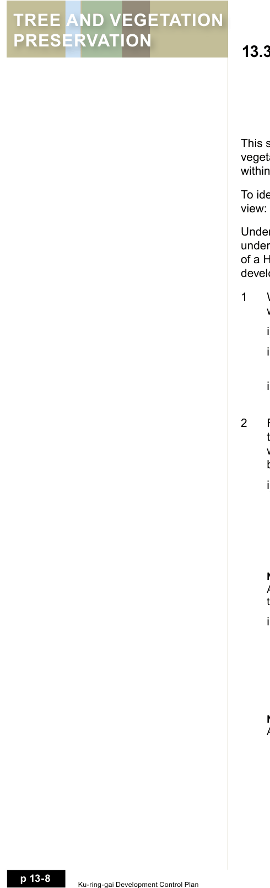

### 13.3	 HERITAGE ITEMS OR HERITAGE

### CONSERVATION AREAS

This section explains approval requirements to carry out tree or

vegetation works on land that is or forms part of a heritage item or is in

within a heritage conservation area. To identify if your tree, vegetation or land has heritage significance please

view: http://maps.kmc.nsw.gov.au/PRODWebmap/index.html Under Clause 5.10 of the KLEP, development consent is required to

undertake works in relation to a tree or vegetation that is or forms part

of a Heritage Item or is within a Heritage Conservation Area. However,

development consent may not be required in the following circumstances: 1 Works in relation to a tree or other vegetation may be carried out

with the written consent of Council where Council is satisfied that:

i) the proposed works is of a minor nature,

ii)	 is for the maintenance of the Heritage Item or place within the

Heritage Conservation Area; and

iii)	 would not adversely affect the heritage significance of the

Heritage Item or Heritage Conservation Area.

2 For the purpose of 1i) above, the following tree works in relation to a

tree or other vegetation that is or forms part of a Heritage Item or is

within a Heritage Conservation Area may be regarded by Council as

being of a minor nature:

i) Tree branches directly over roof lines

- removal of tree branches which directly overhang the roof

of a residence or commercial building, if pruned back to the

nearest branch junction or collar to remove from the roofline.

Detached garages, carports and ancillary buildings are not

included.

Note: Pruning is to be consistent with the Australian Standard for Pruning of

Amenity Trees (AS4373-2007) and is not to result in a detrimental impact to

the future health or stability of the tree or compromise the form of the tree.

ii)	 Minor pruning

- pruning of trees and other vegetation provided:

• branches pruned, are not more than 50mm in diameter,

and

• roots pruned are not more than 50mm in diameter.

Note: Pruning is consistent with the Australian Standard for Pruning of

Amenity Trees (AS4373-2007).

> [Picture on page 8: a picture, saved as a picture (images/part-13-tree-vegetation-preservation-page-8-39.gif, 150 dpi).]
