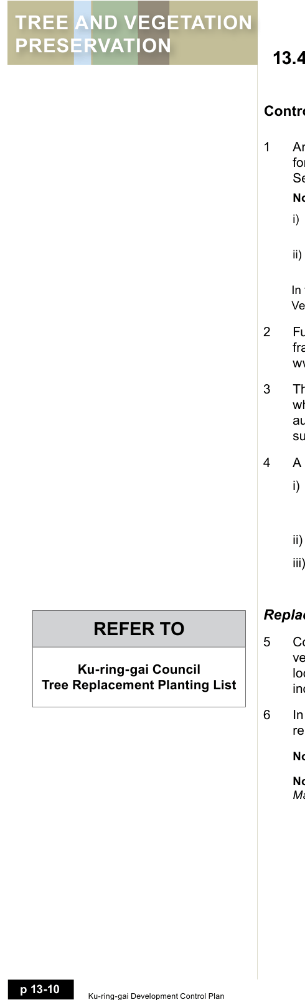

### 13.4	 APPLICATION FOR TREE AND OTHER

### VEGETATION WORKS

> [Picture on page 10: a picture, saved as a picture (images/part-13-tree-vegetation-preservation-page-10-3.gif, 150 dpi).]

#### Controls

1 An application is required to be completed and forwarded to Council

for all works on trees or other vegetation where an exemption under

Section 13.2 does not apply. Note: A permit cannot be granted for the clearing of:

i) native vegetation on land included on the Biodiversity Values Map

except where the tree is assessed to be a risk;

ii) vegetation that is or forms part of an Aboriginal object or that is within

an Aboriginal place of heritage significance. In these instances a Development Application or approval of Native Vegetation Panel is required. 2 Further information on types of applications, fees, assessment time

frames and criteria for approvals, can be found on Council’s web site

www.krg.nsw.gov.au 3 The applications are only to be made by the owner of the site on

which the vegetation or the trunk of the tree is located or their

authorised agent (Council will require proof of authority to be

submitted), 4 A Development Application is required where the proposed works:

i) are within the core riparian zone of Category 1 or 2 Riparian

Lands and the works will disturb soil within 2m of the channel or

within the channel itself;

ii)	 will affect large stands of trees or other vegetation; or

iii)	 are in relation to a tree or other vegetation that forms part of a heritage item or within a heritage conservation area.

#### Replacement trees and vegetation

### REFER TO

#### Ku-ring-gai Council

#### Tree Replacement Planting List

5 Council will require the planting of replacement  trees and/or

vegetation and may specify the number, species, provenance,

location and stock size of the replacement trees and vegetation to

increase and achieve net gain of canopy area on maturity. 6 In a mapped biodiversity area, trees and vegetation are to be

replaced with suitable species from the ecological community. Note: Refer to the Ku-ring-gai Council Tree Replacement Planting List. Note: Check the Ku-ring-gai Local Environmental Plan 2015 Biodiversity

Mapping on Council’s website Map Viewer.

### THIS PAGE IS INTENTIONALLY BLANK

### TREE & VEGETATION PRESERVATION
