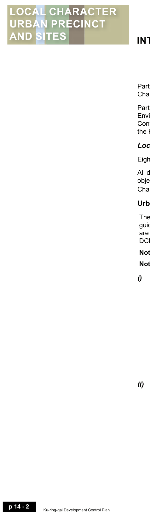
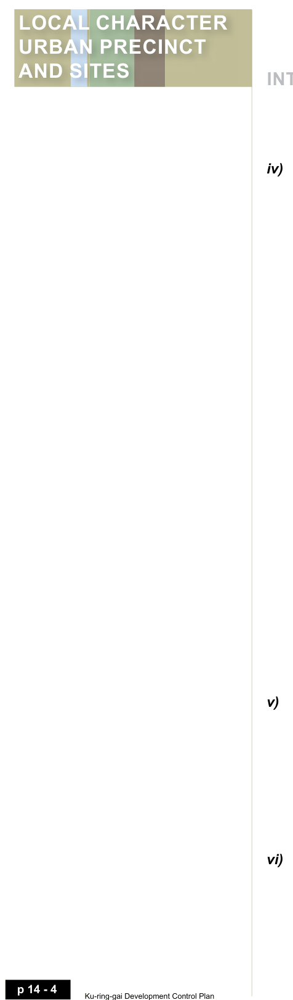
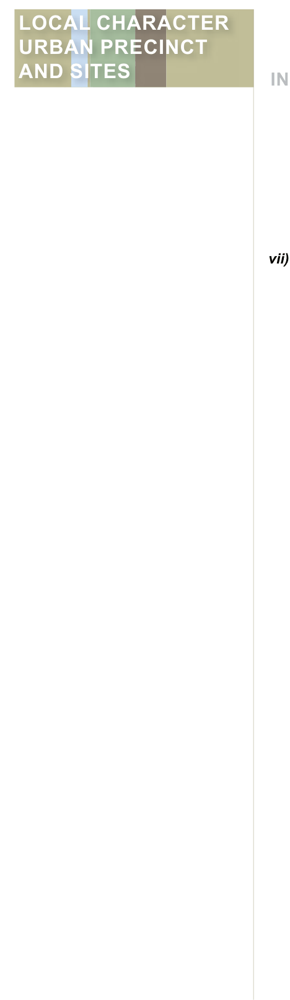

# Ku-ring-gai Development Control Plan - Part 14 Local Character Areas Urban Precincts & Sites

Source PDF: [kdcp-section-b-part-14-local-character-areas-urban-precincts-and-sites.pdf](https://planfortomorrow.sharepoint.com/sites/Planfortomorrow/Shared%20Documents/00%20NSW-Planning-Resources/dcp/ku-ring-gai-development-control-plan/part-14-local-character-areas-urban-precincts-sites/kdcp-section-b-part-14-local-character-areas-urban-precincts-and-sites.pdf)

### PART

### 5A

### LOCAL CHARACTER AREAS

### URBAN PRECINCTS & SITES

#### Introduction

## 14 Local Character Areas

### 14.1  Ridge and Centres Character Area

### 14.2  Green Fingers Character Area

### 14.3  Western Interface Character Area

### 14.4  West Pymble Character Area

### 14.5  Northern Plateau Character Area

### 14.6  Eastern Interface Character Area

### 14.7  Western Slopes Character Area

### 14.8  North Turramurra Table Character Area

14A 	   St Ives Local Centre Precinct 14B	   Turramurra Local Centre Precinct 14C Pymble Local Centre Precinct

14D Gordon Local Centre Precinct 14E Lindfield Local Centre Precinct 14F Roseville Local Centre Precinct

14G Pymble Business Park Precinct 14H    Screen Australia Precinct 14I Killara Golf Club Precinct

#### 14J Holford Crescent, Gordon Precinct

14K 45-47 Tennyson Avenue & 105 Eastern Road, Turramurra Precinct 14L Part 62 and 64-66 Pacific Highway, Roseville Precinct

14M	    47 Warrane Road, Roseville Chase Precinct 14N 8, 14 & 16 Buckingham Road, Killara Precinct

#### 14O 4, 12 and 14 Cowan Road, St Ives (Pymble Golf Club)

### CHARACTER AREAS, URBAN PRECINTS & SITES

#### 14P Turramurra Plaza: 1364-1396 Pacific Highway &

#### 1, 1A, 3, 3A Kissing Point Road, Turramurra 14R References - Masterplans

### INTRODUCTION

Part 14 provides guidance for development within the Ku-ring-gai Local

Character Areas and land identified as an Urban Precinct or Site. Part 14 seeks to meet the aims and objectives of the Ku-ring-gai Local

Environmental Plan 2015. It relates to the provisions in the Ku-ring-gai

Contributions Plan 2010, the Ku-ring-gai Public Domain Plan 2010, and

the Ku-ring-gai Local Character Background Study 2021.

#### Local Character Areas

Eight Local Character Areas have been identified within Ku-ring-gai. All development proposals are to meet the relevant Local Character Areas

objectives and controls to ensure alignment and consistency across Local Character Areas.

#### Urban Precincts and Sites

The below site-specific performance-based provisions are provided to

guide development within each urban precinct or site. These provisions

are in addition to the development controls in Section A, B and C of this

> [Picture on page 2: a picture, saved as a picture (images/part-14-local-character-areas-urban-precincts-sites-page-2-17.gif, 150 dpi).]
> Words printed on the picture (title and legend, copied from the PDF):
> p 14 - 2

DCP. Note: Refer to Ku-ring-gai Contributions Plan 2010. Note: Refer to Ku-ring-gai Public Domain Plan.

i) Urban Precincts A set of performance-based provisions is provided comprising:

- development objectives;

- a Planned Future Character statement describing the desired

form and function of the precinct;

- controls to support the objectives.

A development proposal within an identified Precinct or site is to

respond to the relevant objectives and controls, and demonstrate

how the provisions are addressed.

### INTRODUCTION

ii) Public Domain and Pedestrian Access This section identifies works that will either extend the publicly

accessible areas or improve the amenity of public areas within a

precinct. While it is expected that, in most cases, these lands will

remain in private ownership and control, a high degree of public

access will be required. This work will be funded privately as part of the costs of

redevelopment of a site. The type of work may include, among

others, awnings or colonnades; new pedestrian access ways;

building entrance forecourts; or, new lane ways. The Ku-ring-gai

Public Domain Plan 2010 (KPDP) provides guidelines and concept

plans to guide the implementation of this work to ensure it is fully

integrated within the broader public domain in terms of finishes and

materials as well as accessibility. Council may seek the dedication of these lands, at no cost,

### INTRODUCTION (continued)

depending on the circumstances. Such works will generally not be

offset against development contributions unless specifically valued

by the Contributions Plan.

iii)	 Community Infrastructure An important aspect of the DCP is the identification of new key

community infrastructure to be provided within precincts or sites.

The intention is to identify these elements upfront to assist with the

site planning process of a Development Application. Community

infrastructure is defined as those works listed in the Ku-ring-gai

Contributions Plan 2010 (KCP 2010) Works Programs. Within each precinct or site there is a range of new community

infrastructure works proposed. These include works such as

footpath embellishment, road works and traffic management works,

creation of new urban spaces, construction of new community

buildings and the like. This Part of the DCP provides information to assist applicants

determine how each of the proposed community works are to be

funded and how they may affect site planning. There are a number

of identified funding sources for the proposed infrastructure. These

are colour coded with symbols as follows:

a. Land Acquisition for public purposes – this Part makes

reference to areas of land for new roads or new parks. These

lands are to be acquired by Council with funds from the KCP

2010.

b. Provision of community facilities – this Part identifies

new community facilities including library buildings and

multi-purpose community buildings. The construction and fit

out of these facilities are partially funded by the KCP 2010.

The facilities themselves may be constructed by Council

where they are freestanding on Council land, or alternatively

constructed as part of a private development and funded

as in-kind development contributions, or provided through a

Voluntary Planning Agreement (VPA).

### INTRODUCTION

c. Embellishment works on public land – this Part identifies

public domain areas, footpaths and parks that will be upgraded

and embellished by Council. These lands include those

areas that are currently owned by Council; lands that are to

be acquired by Council in the future; or lands that are to be

dedicated to Council. The construction works are proposed to

be funded by the KCP 2010 and all materials and finishes are

undertaken in accordance with the guidelines within the Ku-

ring-gai Public Domain Plan 2010 (KPDP 2010).

> [Picture on page 3: a picture, saved as a picture (images/part-14-local-character-areas-urban-precincts-sites-page-3-45.gif, 150 dpi).]

### INTRODUCTION (continued)

iv)	 Building Setbacks Parts 4 to 11 of this DCP contain detailed provisions that apply to the

main building types that are likely to be developed. These provisions

include standard setbacks for building types such as mixed-use

buildings, residential flat buildings, and non-residential buildings. Within each precinct, variations to the standard building type

setbacks are proposed for a range of reasons including, but not

limited to the following:

- to provide opportunities for street tree plantings or footpath

widening in appropriate locations;

- to allow widening of lanes and streets in identified locations;

- to provide for an increase in the area of the public domain;

- to enable a consistency of built character. The Building Setbacks Plan identifies where there is a requirement

for land within a setback area to be dedicated to Council at no

cost in accordance with the KCP 2010. Where necessary this Part

makes allowance for the relaxation of development controls such as

in deep soil requirements across the development site. The intent

is to ensure there is no loss of development potential on the sites

where dedication is required. Typically, a setback may be required to

allow for footpath widening, roadway widening or a new pedestrian

access way through the site. It is noted that where the works to

the land to be dedicated are costed in the KCP 2010, the works

may be provided as works-in-kind (ie. as an offset to development

contributions).

The Building Setbacks Plan makes reference to areas of land

for new roads or new parks. In most cases specific setback

requirements are applicable to these lands.

v) Built Form

### INTRODUCTION

This section provides objectives and controls relating to site specific

built form requirements within a precinct or site. The development controls in this section must be read in conjunction

with the relevant development controls relating to building

design contained in Parts 4 to 11 of this DCP. Where there is an

inconsistency between this Part and another control in the DCP then

this Part will prevail to the extent of the inconsistency.

vi)	 Building Entries, Car Parking and Service Access This section provides site specific requirements for the design of

buildings in relation to building foyers and lobbies, vehicle access,

and circulation to and from a site. These controls are particularly applicable to areas of high pedestrian

activity where the objective is to minimise pedestrian and vehicle

conflicts in streets, and to activate the main commercial streets.

> [Picture on page 4: a picture, saved as a picture (images/part-14-local-character-areas-urban-precincts-sites-page-4-46.gif, 150 dpi).]
> Words printed on the picture (title and legend, copied from the PDF):
> p 14 - 4

### INTRODUCTION (continued)

The development controls in this Part must be read in conjunction

with the relevant development controls relating to vehicle access and

parking contained in Parts 7, 8 and 9 of this DCP. Where there is an

inconsistency between a control in this Part and another control in

the DCP then this Part will prevail to the extent of the inconsistency.

vii)	 Other Design Controls This section includes:

- controls where there are site-specific issues relating to

Heritage Items or Heritage Conservation Areas;

- controls where there are site-specific issues relating to an Area

of Biodiversity Significance;

- controls where there are site-specific issues relating to Bush

Fire Prone Land.

The development controls in this section must be read in conjunction

with the relevant general development controls contained in Parts

14-20 of this Section. Where there is an inconsistency between this

Part and another control in volumes A or C of this DCP then this Part

will prevail to the extent of the inconsistency.

### INTRODUCTION

> [Picture on page 5: a picture, saved as a picture (images/part-14-local-character-areas-urban-precincts-sites-page-5-21.gif, 150 dpi).]
