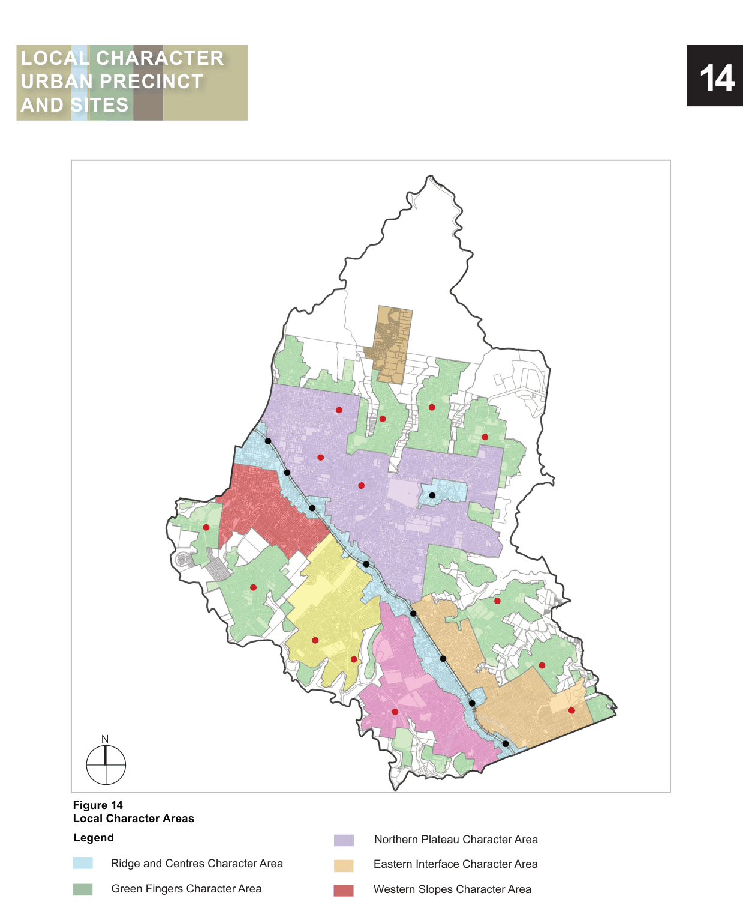
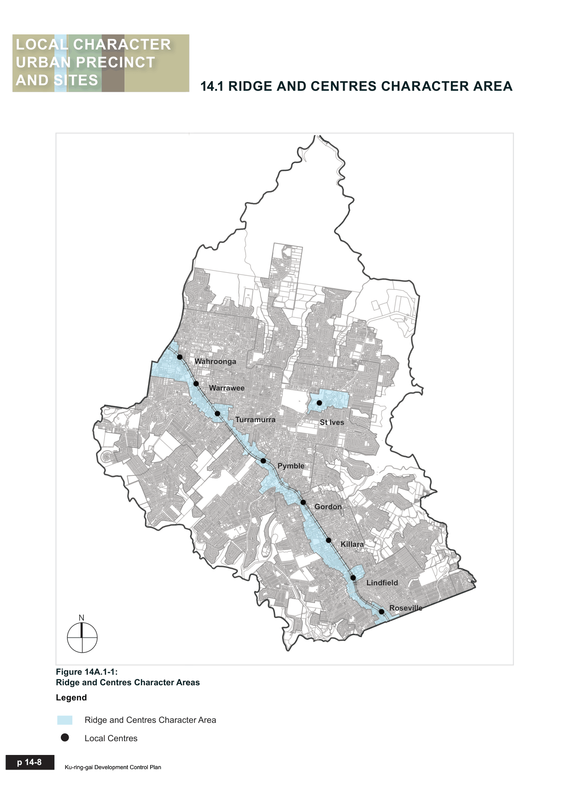

## 14 Local Character Areas

### 14.1  Ridge and Centres Character Area

### 14.2  Green Fingers Character Area

### 14.3  Western Interface Character Area

### 14.4  West Pymble Character Area

### 14.5  Northern Plateau Character Area

### 14.6  Eastern Interface Character Area

### 14.7  Western Slopes Character Area

### 14.8  North Turramurra Table Character Area

### REFER TO

#### KU-RING-GAI LOCAL CHARACTER STUDY

### LOCAL CHARACTER  AREAS

> [Picture on page 2: a picture, saved as a picture (images/part-14-local-character-areas-page-2-1.gif, 150 dpi).]
> Words printed on the picture (title and legend, copied from the PDF):
> N
> Local Character Areas
> Legend
> Northern Plateau Character Area
> Ridge and Centres Character Area
> Eastern Interface Character Area
> Green Fingers Character Area
> Western Slopes Character Area

Figure 14

North Turramurra Table Character Area

Western Interface Character Area

Railway Line

West Pymble Character Area Local Centres

Neighbourhood Centres

> [Picture on page 3: a map, saved as a picture (images/part-14-local-character-areas-page-3-1.gif, 150 dpi); the street names and other small labels are on the picture.]
> Words printed on the picture (title and legend, copied from the PDF):
> Ridge and Centres Character Areas
> Ridge and Centres Character Area

Figure 14A.1-1:
