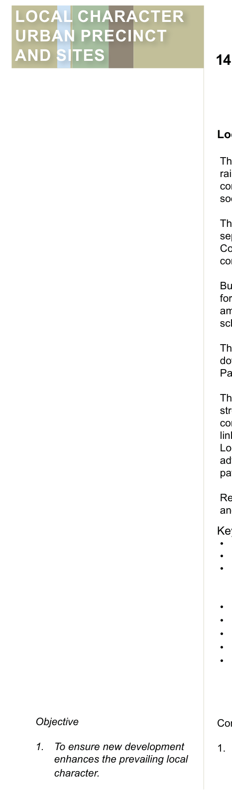
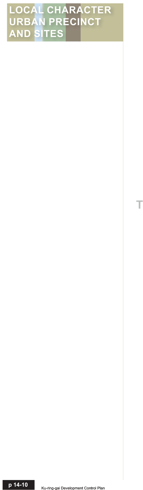

### 14.1 RIDGE AND CENTRES CHARACTER AREA

### 14A.1

### 14.1  RIDGE AND CENTRES CHARACTER

### AREA (continued)

#### Local Character Statement

The Ridge and Centres Character Area is located on the Pacific Highway/

railway corridor and around the St Ives Local Centre. It contains retail,

commercial and residential density development and brings important

social and economic value to Ku-ring-gai.

The Ku-ring-gai ridge is dominated by the Pacific Highway which

separates eight Local Centres into eastern and western sides.

Commercial hubs on both sides of the highway service the wider

community.

Buildings in this area have large footprints and greater height than built

form across the rest of Ku-ring-gai. The prevalent high density leverages

amenity provided by proximity to arterial roads, public transport, shops,

schools, and facilities.

The Pacific Highway/railway corridor is on a flat ridgeline with land sloping

down to riverine systems that connect into the surrounding National

> [Picture on page 4: a picture, saved as a picture (images/part-14-local-character-areas-page-4-19.gif, 150 dpi).]
> Words printed on the picture (title and legend, copied from the PDF):
> Objective
> enhances the prevailing local
> character.

Parks.

The general urban nature of the area means tree canopy is reliant on

street and public domain tree planting with occasional front setbacks, rear

communal open spaces and rooftops/ podium landscaping also providing

links to the Ku-ring-gai character of buildings within a garden setting.

Local Centres retain the historical fabric of early settlement from the

advent of the rail in the late 1800’s and Inter-war period and movement

patterns along the Pacific Highway/railway corridor.

Retail and commercial streetscapes within the local centres are active

and engaging despite the busy bisecting road corridor. Key Characteristics & Features

• Private Schools including:

- Abbotsleigh

- Knox Grammar School

- Masada College

- Ravenswood School for Girls

• Public Schools including:

- Lindfield Public

- Warrawee Public

### ST IVES LOCAL CENTRE PRECINCT

• Large footprint buildings

• Mainly street tree canopy

• Dominated by high density

development on the Pacific

Highway/railway corridor

• Commercial Local Centres

• Pymble Business Park

• Ku-ring-gai Town Hall

• Ku-ring-gai Council Chambers

• Diversity of scale with intact heritage conservation areas and items.

Control

### RIDGE AND CENTRES CHARACTER AREA

1\.	 All development within the Ridge and Centres Local Character Area is

to demonstrate consitency with the Local Character Statement.

1\.	 To ensure new development

### THIS PAGE IS INTENTIONALLY BLANK

> [Picture on page 5: a picture, saved as a picture (images/part-14-local-character-areas-page-5-2.gif, 150 dpi).]
