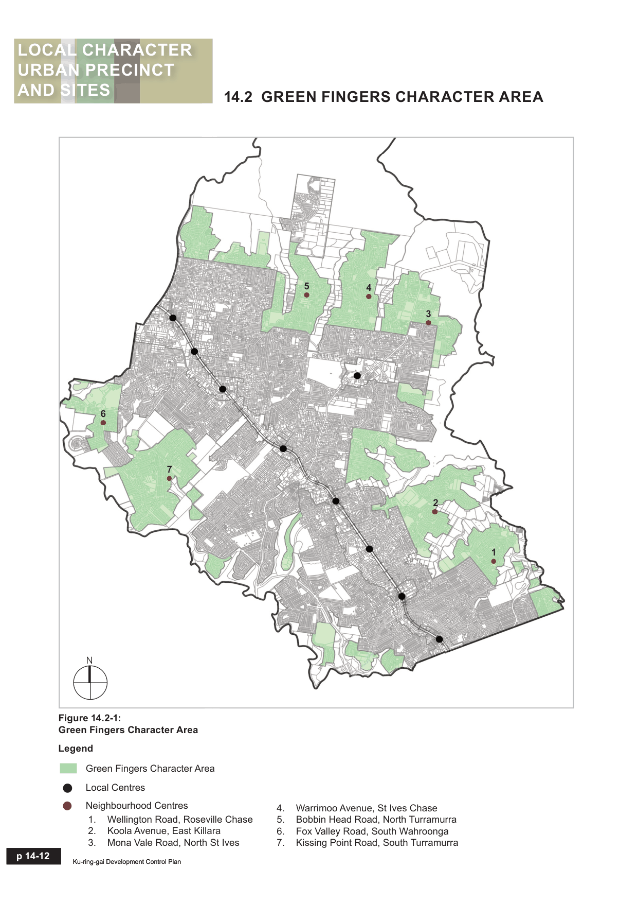

### 14.2		 Green Fingers Character Area

### REFER TO

#### KU-RING-GAI LOCAL CHARACTER STUDY

### GREEN FINGERS

> [Picture on page 7: a picture, saved as a picture (images/part-14-local-character-areas-page-7-1.gif, 150 dpi).]
> Words printed on the picture (title and legend, copied from the PDF):
> 5
> 4
> 3
> 6
> 7
> 2
> 1
> N
> Green Fingers Character Area
> Legend
> Green Fingers Character Area
> Local Centres
> Neighbourhood Centres
> 1\. Wellington Road, Roseville Chase
> 2\. Koola Avenue, East Killara
> 3\. Mona Vale Road, North St Ives
> 4\. Warrimoo Avenue, St Ives Chase
> 5\. Bobbin Head Road, North Turramurra
> 6\. Fox Valley Road, South Wahroonga
> 7\. Kissing Point Road, South Turramurra

Figure 14.2-1:
