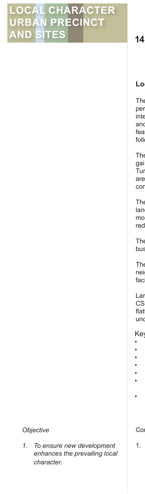
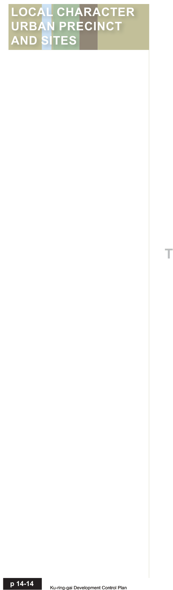

### 14.2  GREEN FINGERS CHARACTER AREA

### 14.2  GREEN FINGERS CHARACTER AREA

### (continued)

#### Local Character Statement

The Green Fingers Character Area includes the areas located on the

periphery of the Local Government Area ridgeline surrounded by edge

interface bushland which falls steeply into densely vegetated gullies,

and is important habitat for endangered flora and fauna. The edge areas

feature more diverse and unique housing styles and street patterns that

follow the topography and take advantage of views across valleys.

These fingers extend out towards Lane Cove, Garigal and Ku-ring-

gai Chase National Parks. The mature vegetation, including Sydney

Turpentine Ironbark Forest and Blue Gum High Forest, found in this

area holds significant social, environmental, and economic value to the

community.

The street pattern and built form is intertwined with the topography and

landscape setting of the area. Flatter areas along ridgelines have a

more consistent built form and street pattern and have been the focus of

redevelopment and the delivery of new homes.

These areas are dominated by trees and vegetation and create and

bushland setting for the homes.

The Green Fingers are predominately low density residential, supported by

neighbourhood centres generally co-located with local parks, community

facilities or playgrounds and serve as community focal points.

Larger institutions such as Sydney Adventist Hospital, Wahroonga;

CSIRO, Lindfield; and the Lindfield Learning Village School are located on

flatter land away from the Pacific Highway/ railway corridor where land is

under greater development pressure.

• Private School:

• Sydney Grammer

Preparatory School, St Ives

• Public School:

• Killara High School

Key Characteristics & Features

• Numerous mature trees

• Bushfire prone land

• Streets follow topography

• Diverse built form and styles

• Sydney Adventist Hospital

• Heritage Item:

- Rose Seidler House

• Leisure facilities:

### ST IVES LOCAL CENTRE PRECINCT

- Lindfield Rollers Bowling

Club

- Echo Point and Marina

> [Picture on page 8: a picture, saved as a picture (images/part-14-local-character-areas-page-8-46.gif, 150 dpi).]
> Words printed on the picture (title and legend, copied from the PDF):
> Objective
> enhances the prevailing local
> character.

Control

1\.	 All development within the Green Fingers Local Character Area is to

demonstrate consistency with the Local Character Statement.

### GREEN FINGERS CHARACTER AREA

1\.	 To ensure new development

### THIS PAGE IS INTENTIONALLY BLANK

> [Picture on page 9: a picture, saved as a picture (images/part-14-local-character-areas-page-9-2.gif, 150 dpi).]
