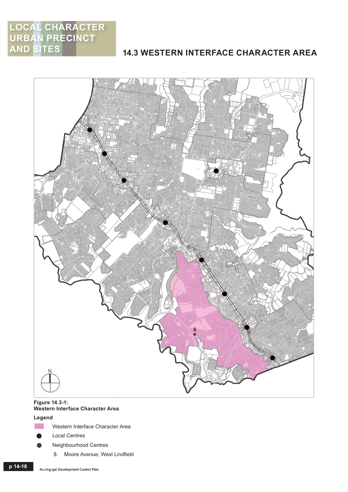

### 14.3		 Western Interface Character Area

### REFER TO

#### KU-RING-GAI LOCAL CHARACTER STUDY

### WESTERN  INTERFACE

> [Picture on page 11: a picture, saved as a picture (images/part-14-local-character-areas-page-11-1.gif, 150 dpi).]
> Words printed on the picture (title and legend, copied from the PDF):
> 8
> N
> Western Interface Character Area
> Legend
> Western Interface Character Area
> Local Centres
> Neighbourhood Centres
> 8\. Moore Avenue, West Lindfield

Figure 14.3-1:
