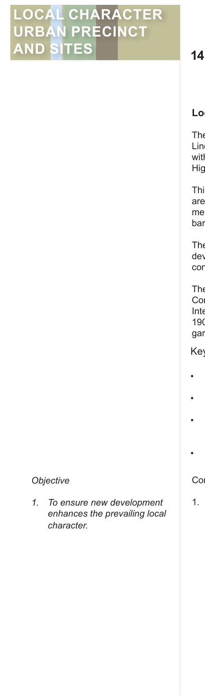
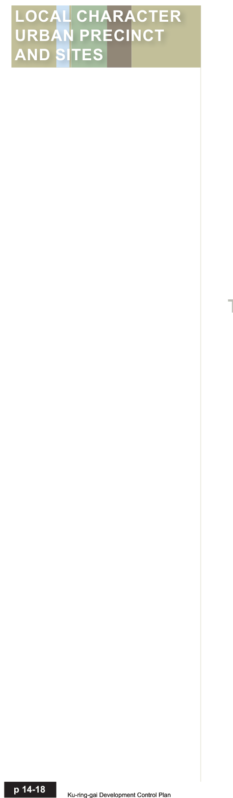

### 14.3 WESTERN INTERFACE CHARACTER AREA

### 14.3  WESTERN INTERFACE CHARACTER

### AREA (continued)

#### Local Character Statement

The Western Interface Character Area includes areas of Gordon, Killara,

Lindfield, and Roseville to the west of the Pacific Highway/railway corridor

with highly undulating topography that falls away steeply from the Pacific

Highway ridgeline to Lane Cover River.

This Area is characterised by large-detached dwellings on streets that

are predominately perpendicular to the Pacific Highway. Street patterns

meander around heavily vegetated gullies and golf courses which form

barriers to movement in the northern portion of this Character Area.

The Area interfaces with high density residential, retail, and commercial

development along the Pacific Highway to the North-East, and has direct

connection with Lane Cove National Park to the west.

The area contains multiple heritage listed dwellings and includes Heritage

Conservation Areas with generally intact examples of Federation and

Inter-war housing, and subdivision patterns from the mid-1800s to early

1900s. It includes grand homes set within large lots with manicured private

> [Picture on page 12: a picture, saved as a picture (images/part-14-local-character-areas-page-12-19.gif, 150 dpi).]
> Words printed on the picture (title and legend, copied from the PDF):
> Objective
> enhances the prevailing local
> character.

gardens. Key Characteristics & Features

• Killara Golf Club

• Gordon Golf Club

• West Lindfield Sport and

Recreation Area

• Ku-ring-gai Bicentennial Park

• Public School:

- Killara Primary School

• Low density residential area with

large houses in garden settings

• Interfaces with high density and

bushland areas

• Dense tree canopy and

significant bushland that

supports biodiversity and habitat

• Areas of heritage significance

Control

1\.	 All development within the Western Interface Local Character Area is

to demonstrate consistency with the Local Character Statement.

1\.	 To ensure new development

### ST IVES LOCAL CENTRE PRECINCT

### WESTERN INTERFACE CHARACTER AREA

### THIS PAGE IS INTENTIONALLY BLANK

> [Picture on page 13: a picture, saved as a picture (images/part-14-local-character-areas-page-13-2.gif, 150 dpi).]
