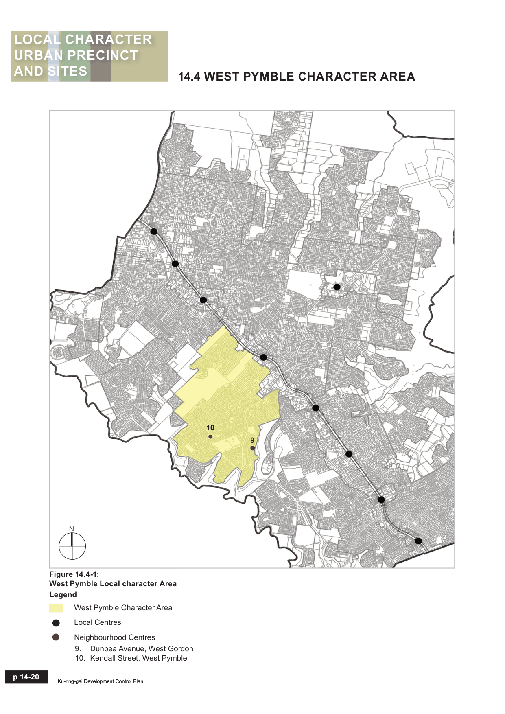

### 14.4		 West Pymble Local Character Area

### REFER TO

#### KU-RING-GAI LOCAL CHARACTER STUDY

### WEST PYMBLE

> [Picture on page 15: a picture, saved as a picture (images/part-14-local-character-areas-page-15-1.gif, 150 dpi).]
> Words printed on the picture (title and legend, copied from the PDF):
> 10
> 9
> N
> West Pymble Local character Area
> Legend
> West Pymble Character Area
> Local Centres
> Neighbourhood Centres
> 9\. Dunbea Avenue, West Gordon
> 10\.	 Kendall Street, West Pymble

Figure 14.4-1:
