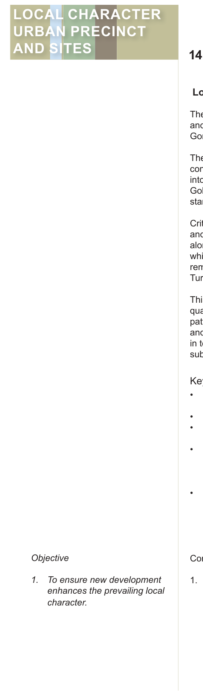
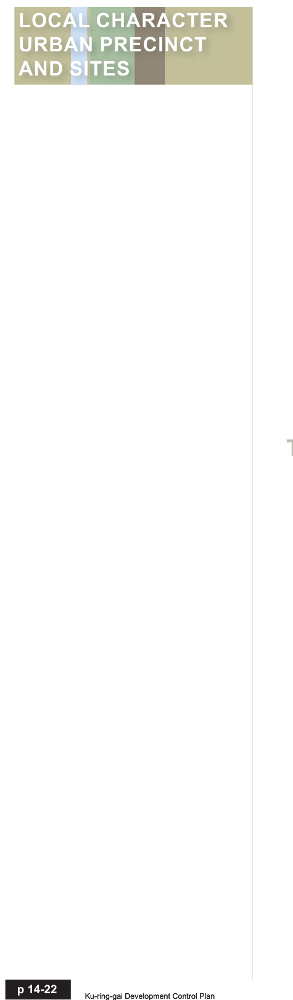

### 14.4 WEST PYMBLE CHARACTER AREA

### 14.4  WEST PYMBLE CHARACTER AREA

### (continued)

#### Local Character Statement

The West Pymble Character Area includes areas of Pymble, West Pymble

and Gordon West south of the railway corridor. Ryde Road separates

Gordon West from the rest of the Character Area.

The direct interface with Lane Cove National Park to the south-west

connects the Area to the bushland and creek topography which extends

into the leafy setting of this locality. The large land holdings of Avondale

Golf Club, Pymble Ladies College, Lofberg Oval contribute significant

stands of mature trees to the area.

Critically endangered communities of Sydney Ironbark Turpentine Forest

and Blue Gum High Forest are prevalent across the Area, located both

along streets and within private land. Sheldon Forest is a 5.5 ha reserve

which has high conservation status and contains some of the last

remnants of the critically endangered Blue Gum High Forest and Sydney

Turpentine Ironbark Forest in the Sydney Bason.

This area is predominantly residential with detached houses within high-

quality landscaped garden settings. The area has a mix of different street

patterns: following ridge lines in the north where topography is steepest,

and as a patchwork of small grids to the south where there is less variation

in topography. This part of the Character Area was developed and

subdivided in a piecemeal fashion from the early 1900s to the 1960s.

• Avondale Golf Club

• Private School:

- Pymble Ladies College

• Public School:

- West Pymble Public School

- Gordon West Public School

Key Characteristics & Features

• Varied street layout and

subdivision

• No development around gullies

• Consistent low density and low

height built form

• High value bushland context

with critically endangered

ecological communities and

fauna habitat

• Significant environmentally

sensitive/biodiversity area

Ku-ring-gai Fitness and Aquatic

Centre

> [Picture on page 16: a picture, saved as a picture (images/part-14-local-character-areas-page-16-44.gif, 150 dpi).]
> Words printed on the picture (title and legend, copied from the PDF):
> Objective
> enhances the prevailing local
> character.

Control

### ST IVES LOCAL CENTRE PRECINCT

1\.	 All development within the West Pymble Local Character Area is to

demonstrate consistency with the Local Character Statement.

1\.	 To ensure new development

### WEST PYMBLE CHARACTER AREA

### THIS PAGE IS INTENTIONALLY BLANK

> [Picture on page 17: a picture, saved as a picture (images/part-14-local-character-areas-page-17-2.gif, 150 dpi).]
