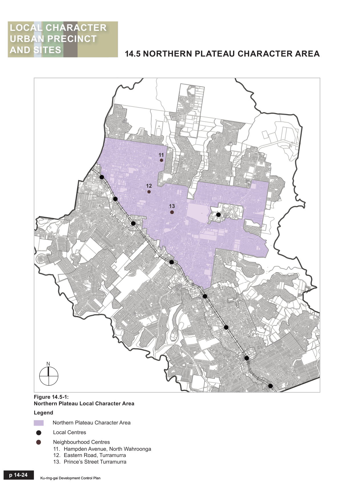

### 14.5		  Northern Plateau Character Area

### REFER TO

#### KU-RING-GAI LOCAL CHARACTER STUDY

### NORTHERN PLATEAU

> [Picture on page 19: a map, saved as a picture (images/part-14-local-character-areas-page-19-1.gif, 150 dpi); the street names and other small labels are on the picture.]
> Words printed on the picture (title and legend, copied from the PDF):
> Northern Plateau Local Character Area
> Northern Plateau Character Area
> 11\.	 Hampden Avenue, North Wahroonga
> 12\.	 Eastern Road, Turramurra
> 13\.	 Prince’s Street Turramurra

Figure 14.5-1:
