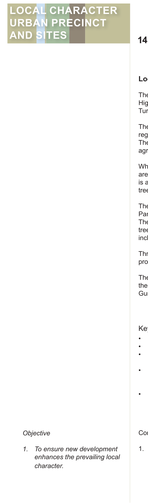
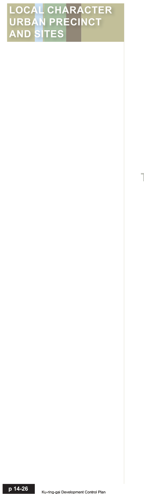

### 14.5 NORTHERN PLATEAU CHARACTER AREA

### 14.5  NORTHERN PLATEAU CHARACTER AREA

### (Continued)

#### Local Character Statement

The Northern Plateau Character Area is located to the north of the Pacific

Highway/railway corridor and includes areas of Wahroonga, Warrawee,

Turramurra, Pymble and St Ives.

The area is predominately residential with detached houses set within

regular subdivision lot patterns presenting a consistent streetscape.

The land use pattern was established through the subdivision of former

agricultural lands located on the generally flat topography of the Area.

While still highly vegetated in comparison to other areas of Sydney, the

area has a lesser tree canopy compared to other parts of Ku-ring-gai. This

is a result of historical tree clearing related to agricultural use. A mix of

trees and vegetation line long and straight streets framing distant views.

The area includes a number of sports fields including Turramurra Memorial

Park, Karuah Park, Kent Oval, Pymble Golf Club and Bannockburn Oval.

These open spaces include or are adjoined by large stands of mature

trees which reinforce the Ku-ring-gai character of landscaped settings

including tall canopy trees.

Three Neighbourhood Centres are located along primary roads and

provide smaller scale day-to-day services within close proximity of homes.

The area includes areas of high conservation status containing some of

the last remnants of critically endangered ecological communities of Blue

Gum High Forest and Sydney Turpentine Ironbark Forest.

• Wahroonga Public School

• Knox Grammar Preparatory

School

• Brigidine Girls College for Girls

St Ives

• St Ives Public and St Ives High

School

• Dalrymple-Hay Nature Reserve

• Turramurra Memorial Park

Key Characteristics & Features

• Flatter land

• Mostly low density residential

• Consistent Street layout and

subdivision

• High level of architecturally

significant 20th Century

dwellings

• Last remaining Blue Gum High

Forest and Sydney Turpentine

Ironbark Forest.

### ST IVES LOCAL CENTRE PRECINCT

> [Picture on page 20: a picture, saved as a picture (images/part-14-local-character-areas-page-20-46.gif, 150 dpi).]
> Words printed on the picture (title and legend, copied from the PDF):
> Objective
> enhances the prevailing local
> character.

Control

1\.	 All development within the Northern Plateau Local Character Area is

to demonstrate consistency with the Local Character Statement.

1\.	 To ensure new development

### NORTHERN PLATEAU CHARACTER AREA

### THIS PAGE IS INTENTIONALLY BLANK

> [Picture on page 21: a picture, saved as a picture (images/part-14-local-character-areas-page-21-2.gif, 150 dpi).]
