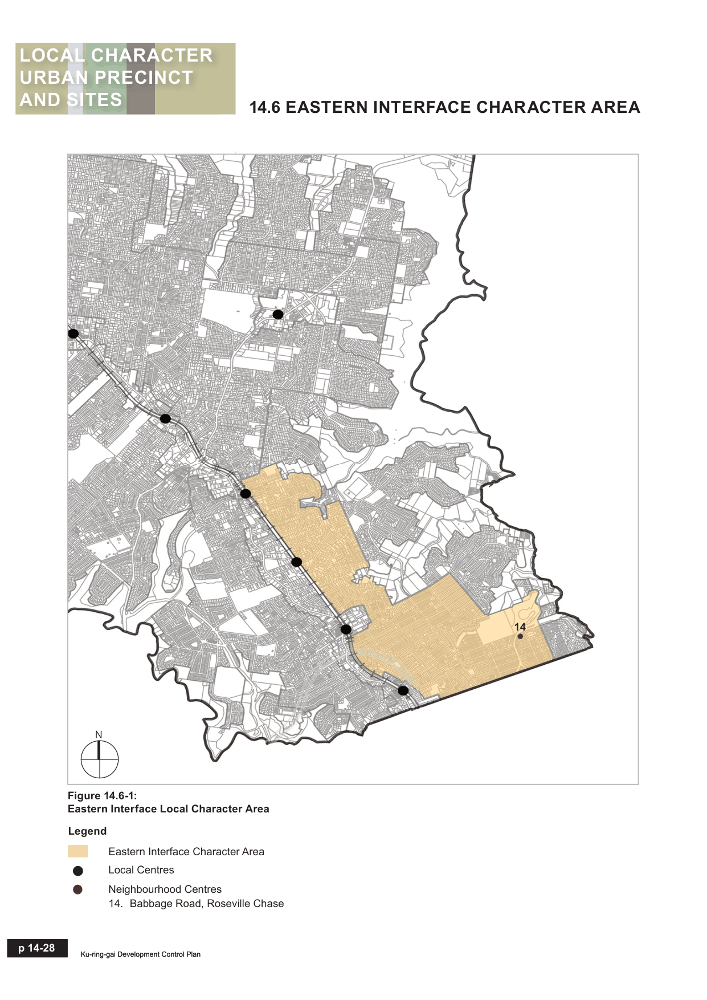

### 14.6		 Eastern Interface Local Character Area

### REFER TO

#### KU-RING-GAI LOCAL CHARACTER STUDY

### EASTERN INTERFACE

> [Picture on page 23: a picture, saved as a picture (images/part-14-local-character-areas-page-23-1.gif, 150 dpi).]
> Words printed on the picture (title and legend, copied from the PDF):
> 14
> N
> Eastern Interface Local Character Area
> Legend
> Eastern Interface Character Area
> Local Centres
> Neighbourhood Centres
> 14\.	 Babbage Road, Roseville Chase

Figure 14.6-1:
