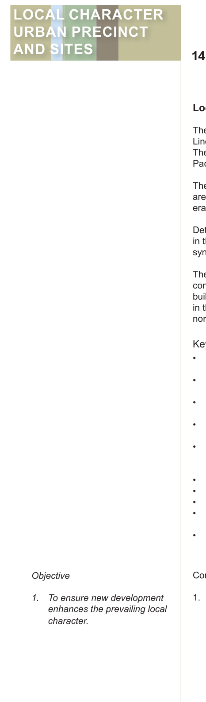
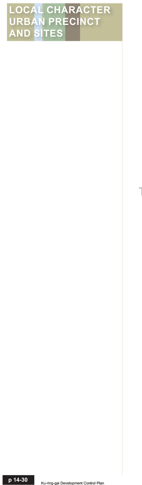

### 14.6 EASTERN INTERFACE CHARACTER AREA

### 14.6  EASTERN INTERFACE CHARACTER AREA

### (continued

#### Local Character Statement

The Eastern Interface Character Area includes areas of Roseville,

Lindfield, Killara, and Gordon east of the Pacific Highway/railway corridor.

The area has undulating topography that drops away steeply from the

Pacific Highway to Middle Harbour.

The area has heritage significance including multiple heritage conservation

areas (HCAs). Its significance generally relates to Federation and Inter-war

era housing and subdivision delivered from the mid-1800s to early 1900s.

Detached houses on large lots within a garden setting feature heavily

in the north. The area is complemented by mature well-planted streets,

synonymous with the idea of the idyllic and leafy North Shore.

The northern extent of this area is almost entirely covered in heritage

conservation areas whilst the southern portion features more diversity in

built form quality, style and age of stock. While heritage conservation areas

in the south of the area possess consistent street planting similar to the

north, interstitial areas feature reduced and variable street planting.

• Ravenswood School

• Swain Gardens

• Heritage Conservation Areas:

• Clanville

• Archbold Farms

• Earl of Canarvon

• Middle Harbour Road

• Crown Blocks

• Blenheim Road

• Oliver Grant

• Lynwood Avenue

• Springdale

• Thorne Grant

• Gordon Park Estate

Key Characteristics & Features

• Streets run perpendicular to the

Pacific Highway

• Large residential lots with

considerable private open space

• any houses with pools and

tennis courts

• Quality areas of flora and fauna

habitat

• Heritage Items Including:

Eryldene Historic House and

Garden

• Roseville Girls College

• Roseville Park and Oval

• Roseville Golf Club

• KOPWA and Lourdes

Retirement Homes

• Newington Preparatory School

Lindfield

> [Picture on page 24: a picture, saved as a picture (images/part-14-local-character-areas-page-24-52.gif, 150 dpi).]
> Words printed on the picture (title and legend, copied from the PDF):
> Objective
> enhances the prevailing local
> character.

Control

### ST IVES LOCAL CENTRE PRECINCT

1\.	 All development within the Eastern Interface Local Character Area is

to demonstrate consistency with the Local Character Statement.

1\.	 To ensure new development

### EASTERN INTERFACE CHARACTER AREA

### THIS PAGE IS INTENTIONALLY BLANK

> [Picture on page 25: a picture, saved as a picture (images/part-14-local-character-areas-page-25-2.gif, 150 dpi).]
