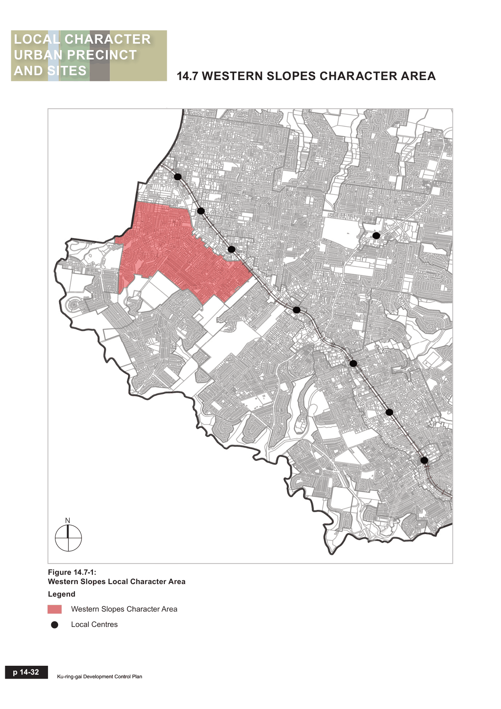

### 14.7		 Western Slopes Local Character Area

### REFER TO

#### KU-RING-GAI LOCAL CHARACTER STUDY

### WESTERN SLOPES

> [Picture on page 27: a picture, saved as a picture (images/part-14-local-character-areas-page-27-1.gif, 150 dpi).]
> Words printed on the picture (title and legend, copied from the PDF):
> N
> Western Slopes Local Character Area
> Legend
> Western Slopes Character Area
> Local Centres

Figure 14.7-1:
