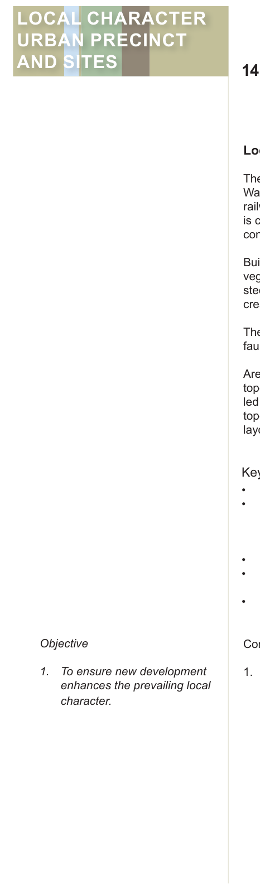
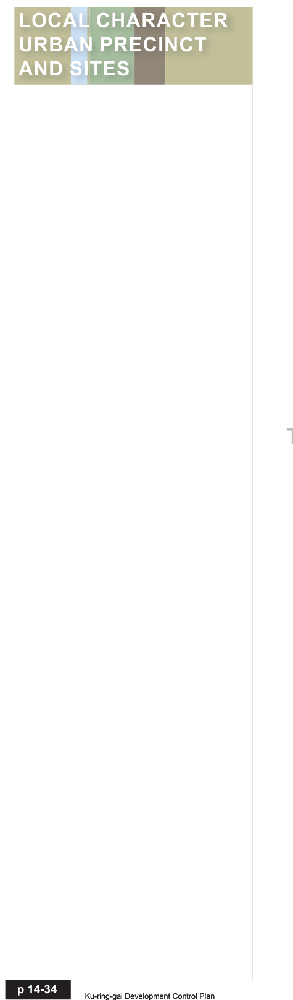

### 14.7 WESTERN SLOPES CHARACTER AREA

### 14.7  WESTERN SLOPES CHARACTER AREA

### (continued)

#### Local Character Statement

The Western Slopes Character Area includes areas of Wahroonga,

Warrawee and Turramurra to the south of the Pacific Highway/

railway corridor. This area has a close relationship to bushland and

is characterised by a significant tree canopy coverage. The area also

contains architecturally significant 20th century dwellings.

Built form appears as a secondary, recessive feature with the trees and

vegetation remaining dominant. Flatter area’s in the north fall away to very

steep topography, to the south-west topography and dense vegetation also

creates a cool microclimate.

The biodiversity protects the environmental value of the native flora and

fauna of this area.

Area’s in the north have a consistent street layout and less varied

topography; the complexity of land form and vegetation in the south has

led to more variation in the street layout and built form. The very steep

topography had led to more unique and diverse built form and a street

layout that conforms to the topography.

Key Characteristics & Features

• Very high tree canopy cover

• South/ South-West aspect

creates cool moist micro climate

that supports very tall trees

vegetation and fauna habitat

• High levels of biodiversity

• Steep slopes and varied

topography

• Diverse built form

• Area contains architecturally

significant 20th century

dwellings

• Browns Field

• The Glade Reserve

• Twin Creeks Reserve and Track

• Heritage Listed School

of Practical Philosophy,

Wahroonga

> [Picture on page 28: a picture, saved as a picture (images/part-14-local-character-areas-page-28-39.gif, 150 dpi).]
> Words printed on the picture (title and legend, copied from the PDF):
> Objective
> enhances the prevailing local
> character.

Control

1\.	 All development within the Western Slopes Local Character Area is

to demonstrate consistency with the Local Character Statement.

1\.	 To ensure new development

### ST IVES LOCAL CENTRE PRECINCT

### WESTERN SLOPES CHARACTER AREA

### THIS PAGE IS INTENTIONALLY BLANK

> [Picture on page 29: a picture, saved as a picture (images/part-14-local-character-areas-page-29-2.gif, 150 dpi).]
