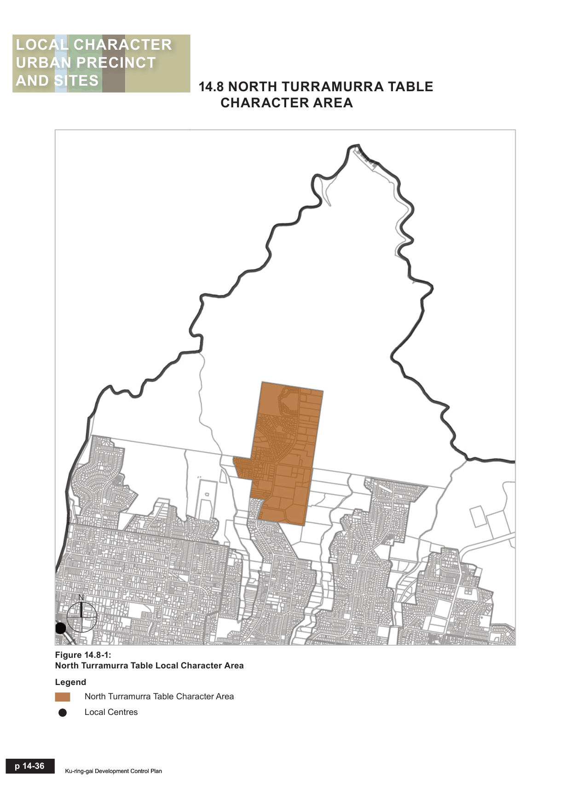

### 14.8		 North Turramurra Table Local Character Area

### REFER TO

#### KU-RING-GAI LOCAL CHARACTER STUDY

### NORTH TURRAMURRA TABLE

> [Picture on page 31: a picture, saved as a picture (images/part-14-local-character-areas-page-31-1.gif, 150 dpi).]
> Words printed on the picture (title and legend, copied from the PDF):
> N
> North Turramurra Table Local Character Area
> Legend
> North Turramurra Table Character Area
> Local Centres

Figure 14.8-1:
