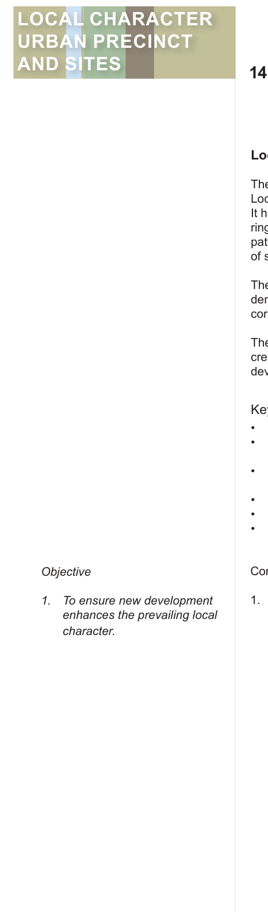
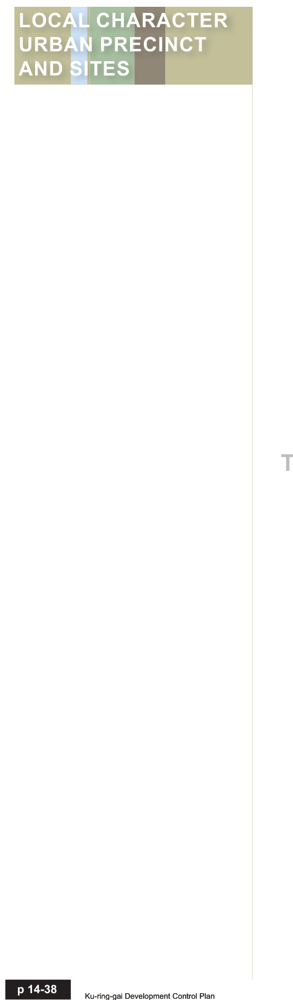

### 14.8 NORTH TURRAMURRA TABLE

### CHARACTER AREA

### 14.8 NORTH TURRAMURRA TABLE

### CHARACTER AREA (continued)

#### Local Character Statement

The North Turramurra Table Character Area is located in the north of the

Local Government Area on the edge of Ku-ring-gai Chase National Park.

It has a close relationship to the surrounding bushland leading into Ku-

ring-gai Chase National Park. It is unique in street layout and subdivision

pattern. The area is predominately residential in use with a high proportion

of seniors housing and aged care facilities.

The Area has a mix of large lot residential development, suburban homes,

densely packed seniors housing and parks. A high voltage power line

corridor runs from the north-west to the south-east of this Area.

The topography is quite flat and was historically used as agricultural land

creating a stark and straight demarcation between National Park and

development.

• North Turramurra Golf Course

and Recreation Area

• Lady Davidson Private Hospital

• Ku-ring-gai High School

• Curagul Field

• Knox Grammar Fields

• Bushfire prone land

Key Characteristics & Features

• Isolated with limited access

• Large amounts of open space

with limited tree canopy

• Consistent built form on large lot

developments

• Surrounded by bushland

• Flat land

• Varied street layout

> [Picture on page 32: a picture, saved as a picture (images/part-14-local-character-areas-page-32-32.gif, 150 dpi).]
> Words printed on the picture (title and legend, copied from the PDF):
> Objective
> enhances the prevailing local
> character.

Control

1\.	 All development within the North Turramurra Table Local Character

Area is to demonstrate consitency with the Local Character Statement.

1\.	 To ensure new development

### ST IVES LOCAL CENTRE PRECINCT

### NORTH TURRAMURRA TABLE CHARACTER AREA

### THIS PAGE IS INTENTIONALLY BLANK

> [Picture on page 33: a picture, saved as a picture (images/part-14-local-character-areas-page-33-2.gif, 150 dpi).]
