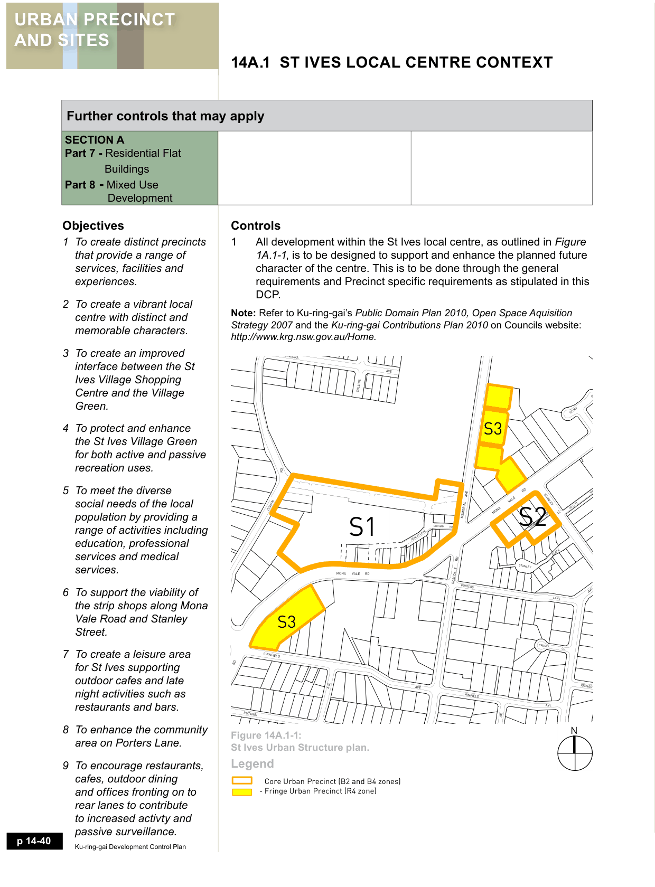
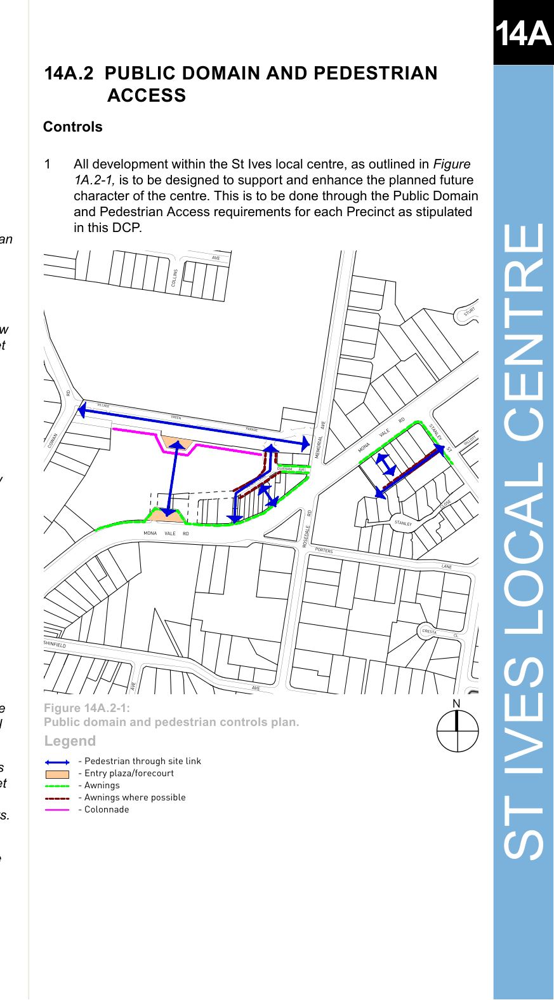

### 14A		 St Ives Local Centre

14A.1	 	St Ives Local Centre Context 14A.2	 	Public Domain and Pedestrian Access 14A.3	 	Proposed Community Infrastructure 14A.4	 	Setbacks 14A.5	 	Built Form 14A.6	 	Building Entries, Car Parking and Service Access 14A.7	 	Precinct S1: St Ives Shopping Village

### 14A.8	 	Precinct S2: Stanley Street Shops 14A.9	 	Precinct S3: Buildings in R4 Zones

### ST IVES LOCAL CENTRE

> [Picture on page 2: a map, saved as a picture (images/part-14a-st-ives-local-centre-page-2-1.gif, 150 dpi); the street names and other small labels are on the picture.]
> Words printed on the picture (title and legend, copied from the PDF):
> 33 35 37
> 25 27 29 31
> 7.32 / 3.66 W.
> ESMT FOR SERVICES
> 48 - 46
> 21 19 17
> 12 10 8
> 26 4 7
> 14 12 10 8

Figure 14A.1-1:

### 14A.1  ST IVES LOCAL CENTRE CONTEXT

### Further controls that may apply

### SECTION A

## Part 7 - Residential Flat Buildings

## Part 8 - Mixed Use

### Development

#### GARR

### Objectives

### Controls

## 20 AVE

#### CARBEEN

#### BENAROON

#### COLLINS

## 1	 To create distinct precincts

that provide a range of

services, facilities and

### experiences.

## 1 All development within the St Ives local centre, as outlined in Figure

### 1A.1-1, is to be designed to support and enhance the planned future

### character of the centre. This is to be done through the general

### requirements and Precinct specific requirements as stipulated in this

### DCP.

#### KENTHURST

#### RD

#### ST

#### KILLEATON

#### ST

## 2	 To create a vibrant local

centre with distinct and

### memorable characters.

#### KILLEATON

### Note: Refer to Ku-ring-gai’s Public Domain Plan 2010, Open Space Aquisition

### Strategy 2007 and the Ku-ring-gai Contributions Plan 2010 on Councils website:

### http://www.krg.nsw.gov.au/Home.

#### KANOONA

#### AVE

#### LINK

#### COLLINS

## 3	 To create an improved

### interface between the St

### Ives Village Shopping

### Centre and the Village

### Green.

### S3

#### RD

## 4	 To protect and enhance

### the St Ives Village Green

### for both active and passive

### recreation uses.

#### RD

#### AVE

#### VALE STANLEY

#### COWAN

#### MONA

#### ST

#### MEMORIAL

### S2

#### MONA VALE RD

### S1

## 5	 To meet the diverse

### social needs of the local

population by providing a

### range of activities including

### education, professional

### services and medical

### services.

#### ROSEDALE

#### RD

#### AVE

### S3

## 6	 To support the viability of

### the strip shops along Mona

### Vale Road and Stanley

### Street.

#### SHINFIELD RD

#### AVE

#### RICHARD

#### AVE

#### SHINFIELD

#### AVE

## 7	 To create a leisure area

### for St Ives supporting

### outdoor cafes and late

### night activities such as

### restaurants and bars.

#### PUTARRI

#### RD

#### AVE

#### VALE

#### MONA

### N

#### AVE

## 8	 To enhance the community

### area on Porters Lane.

### St Ives Urban Structure plan.

#### PENTECOST

### URBAN STRUCTURE

#### RD

### Legend

76

#### AVE

### Core Urban Precinct (B2 and B4 zones) - Fringe Urban Precinct (R4 zone)

38 36 34 32 28 24 22

#### PILDRA

### Precinct Number

### -

### L1

## 9	 To encourage restaurants,

### cafes, outdoor dining

and offices fronting on to

### rear lanes to contribute

to increased activty and

### passive surveillance.

### p 14 - 40

### - Precinct S1

### - Precinct S2

### - Precinct S3

#### LYNBARA

2

4

3

5

7

> [Picture on page 3: a map, saved as a picture (images/part-14a-st-ives-local-centre-page-3-6.gif, 150 dpi); the street names and other small labels are on the picture.]
> Words printed on the picture (title and legend, copied from the PDF):
> 7.32 / 3.66 W.
> ESMT FOR SERVICES
> 123 125 127
> 4 8 10
> 5 7 9 11
> 38 36 34 32 28
> 14 12 10 8

Figure 14A.2-1:

## 20 AVE

#### CARBEEN

### 14A.2  PUBLIC DOMAIN AND PEDESTRIAN

### ACCESS 8

1

33 35 37

25 27 29 31

23

#### BENAROON

41

39

### Objectives

### Controls

#### COLLINS

50

44 48

60 64 70 74

68A

60A

72

52 62 66-68

56

#### KENTHURST

#### RD

#### ST

#### KILLEATON

#### ST

54

#### KILLEATON

## 1	 To provide opportunities

for new supermarkets to

support and anchor the

### local centre.

## 1 All development within the St Ives local centre, as outlined in Figure

### 1A.2-1, is to be designed to support and enhance the planned future

### character of the centre. This is to be done through the Public Domain

### and Pedestrian Access requirements for each Precinct as stipulated

### in this DCP.

#### KANOONA

#### AVE

#### LINK

## 2	 To increase the pedestrian

### permeability of the local

### centre.

#### COLLINS

#### PL

#### STURT

## 3	 To encourage new

shopping arcades;

### pedestrian laneways; new

### footpaths; and new street

### connections.

#### RD

#### RD

### ALIGNMENT AND SETBACKS

#### AVE

#### VALE STANLEY

### - 9m setback

#### 9m

276
