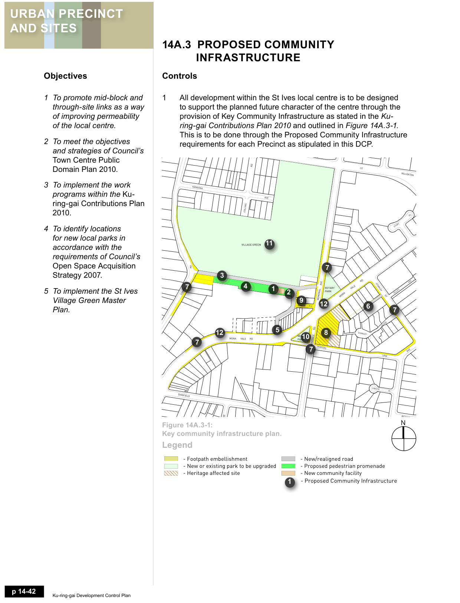
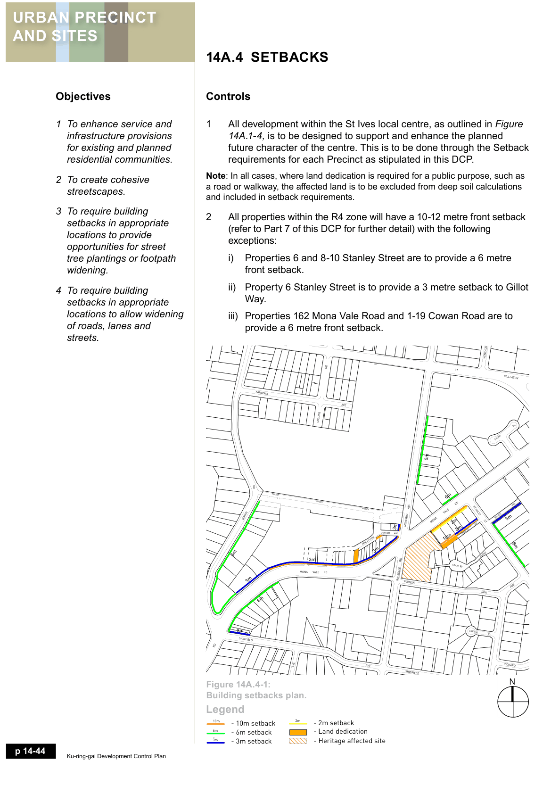
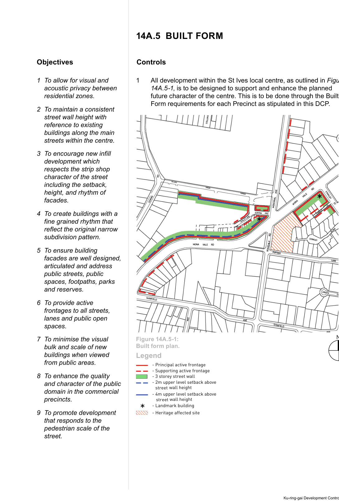

## 55 COWAN

#### ST

#### MONA

#### 15m

21 19 17

#### MEMORIAL

### - 15m setback

## 4	 To improve pedestrian

### amenity by providing

### continuous sun and rain

### protection to footpath

### areas. 293

15 11 7 5

9

16

3

14

### - 13m setback

#### 13m

VALE

295

289

GARRICK 1 272

274

#### 12m

12 10 8 6 4

### - 12m setback

RD 287A 2 285

PL

### - 11m setback

#### 11m 10m

3 4 270

6

#### CLOSE

#### 6m

5 6A

287

283

281

279

8

6

8

#### 5m

266

268

FLINDERS

277

12

#### STANLEY

258

1

2

#### 4m

## 5	 To provide a consistently

### high quality and visually

### pleasing streetscape

### environment.

#### MONA VALE RD

3 4

275

271

273

#### 3m

260

264

262

#### ROSEDALE

#### RD

269

#### 2m

258 MONA

#### AVE

4

267

#### LANE

#### PORTERS

107A

265

99

97

4

6

8

10

#### 40%

101 103 105 107

KILLEATON

DAINTON

- 10m setback - 6m setback - 5m setback - 4m setback - 3m setback - 2m setback - Land dedication - Alternate deep soil landscaping

### (% of site)

113 115

111

109

117

ST

119

### BUILT FORM

1

#### CL

#### CRESTA

#### RD SHINFIELD RD

2C

2B

CR

## 6	 To improve and

### enhance accessibility

### of the commercial

### precincts particularly

### for pedestrians, pram

walkers, people with

disabilities, cyclists and

### public transport users.

2 4 6 8 10

- Principal active frontage - Supporting active frontage - 3 storey street wall - 2m upper level setback above

#### AVE

#### RICHARD

#### AVE

### 1 3 5 street

#### SHINFIELD

### wall height - 4m upper level setback above

### N

#### AVE

### street wall height

#### PUTARRI

#### DR

### Public domain and pedestrian controls plan.

47

#### AVE

#### BYRON

### PUBLIC DOMAIN AND PEDESTRIAN

12

10

2

8

6

4

2A

#### RD

PL

## 7	 To improve commercial

### activity in the local centre

### by promoting street-level

### activity. 144

41 39B

43

45

### Legend

#### AVE

#### VALE

#### MONA

48 - 46

#### AVE

YARRABUNG

RD

16

14

18

16

12

20

14

10

8

6

4

147

NEWHAVEN

21

19

17

15

23

7

11

9

COLLEGE

#### PENTECOST

22 44

#### RD

#### CL

24 2

145

143

- Pedestrian through site link - Entry plaza/forecourt - Awnings - Awnings where possible - Colonnade

10 12 14 16 18

4 6 8 CATHERINE

136

## 8	 To facilitate opportunities

### for outdoor dining in quiet

locations away from the

### main roads and highways.

139

1

42C 42A

#### AVE

137

#### DORSET

3 5 7 11

### BUILDING ENTRIES AND CARPAT

42 40

#### PILDRA

RD

#### PRIESTLEY

### ST IVES LOCAL CENTRE

136

142

142

136

132

132

130

128

### - Vehicular access to site - Pedestrian access to site

ST

131

135

42B 59

RD

57 55

ST 2

6

AVE

127 3

8

### HERITATGGEA

## 9	 To improve the saftey

### and passive surveillance

of the public domain by

### encouraging street level

### activity.

10

#### LYNBARA

12 14

### - Heritage item

32

30

26

24

22

20

18

28

16A

15

11

9

7

5

12

10

8

6

82 3.66W PATHWAY

### - Landmark building

14

12

10

8

4

6

4

11

9

7

5

### *

37

33

31

29

35

### - Character item

GREVILLEA

3.66W PATHWAY

LANCASTER

MARIANA

### - Refer to site specific DCP

### - Proposed road

YARRABUNG

7 3.66W PATHWAY

### - Proposed Community Infrastructure

> [Picture on page 4: a map, saved as a picture (images/part-14a-st-ives-local-centre-page-4-1.gif, 150 dpi); the street names and other small labels are on the picture.]
> Words printed on the picture (title and legend, copied from the PDF):
> 28 26 24 22
> 29 27 25 23
> 21 19 17
> 26 24 22
> 1 12 10 8
> 33 35 37
> 25 27 29 31
> 7.32 / 3.66 W.
> ESMT FOR SERVICES
> 56 14 12
> 7.32 / 3.66 W.
> ESMT FOR SERVICES
> 54 27 25 23
> 21 19 17
> 26 24 22
> 12 10 8 6
> 4 RD 287A
> 101 103 105
> 21 19 17
> 293 9 5
> 123 125 127
> GARRICK 1 18 16
> 12 10 8
> 7.32 / 3.66 W.
> ESMT FOR SERVICES
> 4 RD 287A 258
> 4 6 8 10
> 101 103 105
> 123 125 127
> STANLEY 101 103 105
> 123 125 127
> 1 3 5
> 4 6 8 10
> 4 6 8
> 1 3 5
> 3 5 7 11
> 4 8 10
> 5 7 9 11
> 4 8 10
> 5 7 9 11
> 4 6 8
> 3 5 7 11
> 24 22 20 18
> 4 6 8
> 3 5 7 11
> IKARA 1 80
> 9 26 41 10
> 24 22 20 18
> 7 ST 16
> 48 - 46
> 6 3.66W PATHWAY
> 3.66W PATHWAY 18
> 14 12 10 8
> 44 6 4 2
> 7 3.66W PATHWAY

Figure 14A.3-1:

### 14A.3  PROPOSED COMMUNITY

### INFRASTRUCTURE

### Objectives

### Controls

### ALIGNMENT AND SETBACKS

#### GARRICK

### - 9m setback

#### 9m

#### 10 15m

### - 15m setback

#### AVE

#### CARBEEN

### - 13m setback

#### 13m 12m

## 6 BENAROON

### - 12m setback

## 1	 To promote mid-block and

### through-site links as a way

### of improving permeability

### of the local centre.

### - 11m setback

#### 11m

#### COLLINS

#### 10m

#### 6m

## 1 All development within the St Ives local centre is to be designed

to support the planned future character of the centre through the

### provision of Key Community Infrastructure as stated in the Ku-

### ring-gai Contributions Plan 2010 and outlined in Figure 14A.3-1.

### This is to be done through the Proposed Community Infrastructure

### requirements for each Precinct as stipulated in this DCP.

#### 5m

#### KENTHURST

#### 4m

## 3 RD

#### 51 53 3m

#### ST

#### KILLEATON

#### ST

## 2	 To meet the objectives

### and strategies of Council’s

### Town Centre Public

### Domain Plan 2010. 269

#### 2m

#### KILLEATON

### ALIGNMENT AND SETBACKS

#### KANOONA

#### 40%

#### AVE

- 10m setback - 6m setback - 5m setback - 4m setback - 3m setback - 2m setback - Land dedication - Alternate deep soil landscaping

### (% of site)

16

#### LINK

#### COLLINS

### BUILT FORM

### ALIGNMENT AND SETBACKS

## 3	 To implement the work

### programs within the Ku-

### ring-gai Contributions Plan

### 2010.

- 10m setback - 6m setback - 3m setback - Nil setback - Land dedication - Alternate deep soil requirement

#### VILLAGE GREEN

### 11

### BUILT FORM

- Principal active frontage - Supporting active frontage - 3 storey street wall - 2m upper level setback above

### DAINTON 1 3 5 street

- 10m setback - 6m setback - 3m setback - Nil setback - Land dedication - Alternate deep soil requirement

### wall height - 4m upper level setback above

#### RD

#### 6m

### 7

### street wall height

### BUILT FORM

### 3

## 4	 To identify locations

for new local parks in

accordance with the

### requirements of Council’s

### Open Space Acquisition

### Strategy 2007.

#### RD

#### 3m

#### AVE

#### 2m

### PUBLIC DOMAIN AND PEDESTRIAN

#### VALE

### 4

#### STANLEY

### 7

#### ROTARY PARK

#### 3m

### 1

#### COWAN

### 2

#### MONA

#### ST

#### 10m

#### MEMORIAL

2 4 6 8 10

### 5 7 9 11 9

#### 6m

- Primary active frontage - Secondary active frontage - 3 storey street wall - 2m upper level setback above street

### wall height - 4m upper level setback above street wall height

### 12

### 6

## 5	 To implement the St Ives

### Village Green Master

### Plan.

### 7

### PUBLIC DOMAIN AND PEDESTRIAN

- Pedestrian through site link - Entry plaza/forecourt - Awnings - Awnings where possible - Colonnade

10 12 14 16 18

- Primary active frontage - Secondary active frontage - 3 storey street wall - 2m upper level setback above street

### wall height - 4m upper level setback above street wall height

#### MONA VALE RD

#### MEMORIAL PARK

### 12

### 5

### 10

### 8

#### ROSEDALE

#### RD

### BUILDING ENTRIES AND CARPAT

### 7

### PUBLIC DOMAIN AND PEDESTRIAN

#### AVE

### 7

- Through site link - Entry plaza/forecourt - Continuous awnings - Continuous awnings where possible

### - Continuous colonnade

### - Vehicular access to site - Pedestrian access to site

#### S

### BUILDING ENTRIES AND CARPAT

10 12 14 16 18

### HERITATGGEA

- Through site link - Entry plaza/forecourt - Continuous awnings - Continuous awnings where possible

### - Continuous colonnade

#### SHINFIELD

### - Vehicular access to site - Pedestrian access to site

#### NEW PARK

#### RD

### - Heritage item

### BUILDING ENTRIES AND CARPAT

10 12 14 16 18

#### AVE

#### RICHARD

### AVE KEY COMMUNITY INFRASTRUCTRE

#### SHINFIELD

### N

### - Landmark building

### - Vehicular access to site - Pedestrian access to site

#### NEW PARK

#### AVE

### *

#### PUTARRI

### Key community infrastructure plan.

#### RD

### KEY COMMUNITY INFRASTRUCTRE - Character item

#### AVE

#### VALE

#### MONA

### Legend

#### AVE

#### PENTECOST

7

### - Refer to site specific DCP

### - Proposed road

#### RD

- Footpath embellishment - New or existing park to be upgraded - Historic/character building to be retained - New/realigned road - Proposed pedestrian promenade - New community facility - Landscaping

### - Proposed Community Infrastructure

### 1

#### AVE

3

#### LYNBARA

38 36 34 32 28 24 22

#### PILDRA

14

- Footpath embellishment - New or existing park to be upgraded - Heritage affected site - New/realigned road

### - Proposed pedestrian promenade - New community facility - Landscaping

1

#### LYNBARA

#### LYNBARA

### 14A.3  PROPOSED COMMUNITY

### INFRASTRUCTURE (continued)

### Controls

## 2 The following development is to be designed to support and

### compliment the provision of Key Community Infrastructure through

### the Ku-ring-gai Contributions Plan 2010, Voluntary Planning

### Agreement (VPA) or other mechanism (refer to individual precincts

### 14A.7 to 14A.9):

## 1 A new town square between the shopping centre and the Village

Green. The town square will be generously proportioned (a

minimum dimension of 30m x 30m or 900sqm) located so as to

### be level, with a northern aspect and views across, and direct

### access to, the Village Green.

## 2 A new freestanding Council owned multi-purpose facility

### incorporating a branch library, neighbourhood centre, youth

### facility and childcare centre and located at the north-eastern

### corner of the St Ives Shopping Village adjoining Denley Lane/

Village Green Parade intersection but on land additional to the

### 900sqm town square.

## 3 Reconstruction of Village Green Parade as a one way street with

### on street parking and avenue tree planting.

## 4 A broad pedestrian promenade (minimum width 8 metres) and

### tree lined along the northern edge of shopping centre. Public car

### parking relocated to basement parking under the promenade.

## 5 A modified Denley Lane to connect with Mona Vale Road (in a

### new location) as a two way lane with footpaths.

## 6 Reconstruction of Stanley Lane as a two way lane with

### footpaths.

### 7

### Embellishment of the footpath areas on Mona Vale Road, Cowan

Road, Memorial Avenue, Stanley Street, Rosedale Road and

Porters Lane including underground power lines, new lighting,

### high quality paving, furniture and street tree planting.

## 8 Improvement works to the old school area including the creation

of a new public square, parking modifications, and upgrading of

### the community buildings.

## 9 Closure of Durham Lane and creation of a new civic space.

### 10

### Upgrade works to Memorial Park and Rotary Park on Mona Vale

### Road.

### 11

### ST IVES LOCAL CENTRE

Upgrade works to St Ives Village Green in accordance with

### Village Green Master plan.

## 12 A range of traffic and transport improvements including new

traffic signals on Mona Vale Road; new bus facilities; and

### modifications to existing streets and lanes. These have all been

### modelled and will support improved traffic access and circulation

### around the centre.

> [Picture on page 6: a map, saved as a picture (images/part-14a-st-ives-local-centre-page-6-1.gif, 150 dpi); the street names and other small labels are on the picture.]
> Words printed on the picture (title and legend, copied from the PDF):
> 33 35 37
> 25 27 29 31
> 7.32 / 3.66 W.
> ESMT FOR SERVICES
> 27 25 23
> 21 19 17
> 26 24 22
> 12 10 8
> 4 RD 287A
> 7.32 / 3.66 W.
> ESMT FOR SERVICES
> 101 103 105 107
> 123 125 127
> 4 6 8 10
> 1 3 5
> 4 8 10
> 5 7 9 11
> 27 25 23
> 27 25 23
> 21 19 17
> 21 19 17
> 26 24 22
> 26 24 22
> 12 10 8
> 12 10 8
> 4 6 8
> 21 19 17
> 3 4 293
> 3 5 7 11
> 12 10 8
> MYRTLE 8 47
> 21 19 17
> PL 7.32 / 3.66 W.
> 7.32 / 3.66 W.
> ESMT FOR SERVICES
> ESMT FOR SERVICES
> 48 - 46
> 12 10 8
> 3.66W PATHWAY 18
> IKARA 1 80

Figure 14A.4-1:

### 14A.4  SETBACKS

### Objectives

### Controls

## 1 All development within the St Ives local centre, as outlined in Figure

### 14A.1-4, is to be designed to support and enhance the planned

### future character of the centre. This is to be done through the Setback

### requirements for each Precinct as stipulated in this DCP.

## 1	 To enhance service and

### infrastructure provisions

### for existing and planned

### residential communities.

## 2	 To create cohesive

### streetscapes.

### Note: In all cases, where land dedication is required for a public purpose, such as

### a road or walkway, the affected land is to be excluded from deep soil calculations

### and included in setback requirements.

## 2 All properties within the R4 zone will have a 10-12 metre front setback

### (refer to Part 7 of this DCP for further detail) with the following

### exceptions:

### i) Properties 6 and 8-10 Stanley Street are to provide a 6 metre

### front setback.

## 3	 To require building

### setbacks in appropriate

### locations to provide

### opportunities for street

### tree plantings or footpath

### widening.

29 27 25

#### GARRICK

### ii)	 Property 6 Stanley Street is to provide a 3 metre setback to Gillot

20

26 24 22

### Way.

## 20 AVE

#### CARBEEN

#### BENAROON

iii)	 Properties 162 Mona Vale Road and 1-19 Cowan Road are to

#### COLLINS

9 7

11

### provide a 6 metre front setback. 73B

20

15

MYR

18 16

## 4	 To require building

### setbacks in appropriate

### locations to allow widening

of roads, lanes and

### streets.

#### KENTHURST

#### RD

#### ST

#### KILLEATON

#### ST

PATHWAY

3.66W

#### KILLEATON

#### S

#### LINK

### ALIGNMENT AND SETBACKS

#### 6m

- 10m setback - 6m setback - 3m setback - Nil setback - Land dedication - Alternate deep soil requirement

### BUILT FORM

#### 6m

#### RD

#### AVE

#### VALE

#### 3m

#### ST

#### MONA LN

#### 2m

#### MEMORIAL

#### 3m

#### 3m

#### 10m

#### 6m

#### 3m

#### 6m

#### 3m

- Primary active frontage - Secondary active frontage - 3 storey street wall - 2m upper level setback above street

### wall height - 4m upper level setback above street wall height

#### MONA VALE RD

#### ROSEDALE

#### RD

#### 3m

### PUBLIC DOMAIN AND PEDESTRIAN

#### AVE

#### 6m

#### STANLEY

### ALIGNMENT AND SETBACKS

### ALIGNMENT AND SETBACKS

#### 3m

- Through site link - Entry plaza/forecourt - Continuous awnings - Continuous awnings where possible

### - Continuous colonnade

### - 9m setback

#### 9m

### - 9m setback

#### 9m

#### SHINFIELD

#### 15m

#### 15m

#### COLLEGE RD

### - 15m setback

### - 15m setback

## 293 ALIGNMENT AND SETBACKS

### BUILDING ENTRIES AND CARPAT

### - 13m setback

#### 13m

### - 13m setback

#### 13m 12m

#### 12m

### - 12m setback

### - 12m setback

### 287A - 9m setback

#### 9m

#### AVE

#### RICHARD

#### AVE

10 12 14 16 18

### ALIGNMENT AND SETBACKS

#### 15m

### - 11m setback

#### 11m

### - 11m setback

#### 11m

#### SHINFIELD

24 22 20 18

### - 15m setback 10m

#### 10m

#### AVE

### - Vehicular access to site - Pedestrian access to site

### - 13m setback

#### 13m

### - 9m setback

#### 9m

### N

#### NEW PARK

#### 6m

#### 6m

#### 12m

#### PUTARRI

#### 15m

### - 12m setback

#### 5m

### - 15m setback 5m

#### RD

### - 11m setback

#### 11m

### Building setbacks plan.

### - 13m setback

#### 13m

#### 4m

#### AVE

#### 4m

#### 10m

#### VALE

#### MONA

#### 12m

5 3

### KEY COMMUNITY INFRASTRUCTRE

#### AVE

### - 12m setback

6

IKARA

### Legend

### - 11m setback

#### 2 5m

#### PENTECOST

#### 2 44 4m

#### 107A 6m

#### 40%

#### 40%

#### 42C 2m

- 10m setback - 6m setback - 5m setback - 4m setback - 3m setback - 2m setback - Land dedication - Alternate deep soil landscaping

### (% of site)

- 10m setback - 6m setback - 5m setback - 4m setback - 3m setback - 2m setback - Land dedication - Alternate deep soil landscaping

### (% of site)

38 36 34 32 28 24 22

20 18 14 12 10 8 4 2

#### PILDRA

### BUILT FORM

#### 40%

### BUILT FORM

- 10m setback - 6m setback - 5m setback - 4m setback - 3m setback - 2m setback - Land dedication - Alternate deep soil landscaping

### (% of site)

AMIN

#### 40%

- Footpath embellishment - New or existing park to be upgraded - Heritage affected site - New/realigned road

### - Proposed pedestrian promenade - New community facility - Landscaping

#### A

### - Principal active frontage - Supporting active frontage

### - Principal active frontage - Supporting active frontage

### BUILT FORM

- 10m setback - 6m setback - 5m setback - 4m setback - 3m setback - 2m setback - Land dedication - Alternate deep soil landscaping

### (% of site)

> [Picture on page 7: a map, saved as a picture (images/part-14a-st-ives-local-centre-page-7-1.gif, 150 dpi); the street names and other small labels are on the picture.]
> Words printed on the picture (title and legend, copied from the PDF):
> 21 19 17
> GARRICK 1 272
> 21 19 17
> GARRICK 1 272
> 12 10 8 6
> 3 4 MONA
> 101 103 105 107
> 117 3 4
> 123 125 127
> 101 103 105 107
> ST 2 123 125 127
> 4 6 8 10
> 1 3 5
> 21 19 17
> GARRICK 1 272
> 12 10 8 6
> 4 6 8 10
> 1 3 5
> 10 4 8 10
> 5 7 9 11
> RD 101 103 105 107
> 5 7 9 11
> 3 5 7 11
> 123 125 127
> 4 6 8
> 3 5 7 11
> 8 3.66W PATHWAY
> 9 4 8 10
> GREVILLEA 5 7 9 11
> 82 3.66W PATHWAY 18
> 6 4 2
> 4 6 8
> 38 47 48
> 50 15 19
> 3 5 7 11
> 7 3.66W PATHWAY

Figure 14A.5-1:

### 14A.5  BUILT FORM

### Objectives

### Controls

## 1	 To allow for visual and

### acoustic privacy between

### residential zones.

## 1 All development within the St Ives local centre, as outlined in Figure

### 14A.5-1, is to be designed to support and enhance the planned

### future character of the centre. This is to be done through the Built

### Form requirements for each Precinct as stipulated in this DCP.

### ALIGNMENT AND SETBACKS

## 2	 To maintain a consistent

street wall height with

### reference to existing

### buildings along the main

### streets within the centre.

### - 9m setback

#### 9m

#### 15m

### - 15m setback

### - 13m setback

#### 13m 12m

12 10 8 6 4

### - 12m setback

### - 11m setback

#### 11m 10m

#### 55 6m 5m

#### 4m

### ALIGNMENT AND SETBACKS

#### 3m

## 3	 To encourage new infill

### development which

### respects the strip shop

### character of the street

including the setback,

height, and rhythm of

### facades.

#### 2m

#### 40%

- 10m setback - 6m setback - 5m setback - 4m setback - 3m setback - 2m setback - Land dedication - Alternate deep soil landscaping

### (% of site) BUILT FORM

- 10m setback - 6m setback - 3m setback - Nil setback - Land dedication - Alternate deep soil requirement

## 4	 To create buildings with a

fine grained rhythm that

### reflect the original narrow

### subdivision pattern. 150

### BUILT FORM ALIGNMENT AND SETBACKS

- Principal active frontage - Supporting active frontage - 3 storey street wall - 2m upper level setback above

### 152 - 9m setback

#### 9m

### street

#### 15m

### - 15m setback

### wall height - 4m upper level setback above

### - 13m setback

#### 13m 12m

### street wall height

### - 12m setback

### - 11m setback

#### 11m

## 5	 To ensure building

facades are well designed,

### articulated and address

### public streets, public

### spaces, footpaths, parks

### and reserves. 2

#### 10m

### PUBLIC DOMAIN AND PEDESTRIAN

- Primary active frontage - Secondary active frontage - 3 storey street wall - 2m upper level setback above street

### wall height - 4m upper level setback above street wall height

#### 6m

#### LAWSON 5m

### PUBLIC DOMAIN AND PEDESTRIAN

#### 4m

#### 3m 2m

## 6	 To provide active

frontages to all streets,

### lanes and public open

### spaces.

- Pedestrian through site link - Entry plaza/forecourt - Awnings - Awnings where possible - Colonnade

10 12 14 16 18

4 6 8 4 8 10

#### 40%

### N

### BUILDING ENTRIES AND CARPAT

- 10m setback - 6m setback - 5m setback - 4m setback - 3m setback - 2m setback - Land dedication - Alternate deep soil landscaping

### (% of site)

- Through site link - Entry plaza/forecourt - Continuous awnings - Continuous awnings where possible

### - Continuous colonnade

### Built form plan.

### BUILT FORM

## 152 BUILDING ENTRIES AND CARPAT
