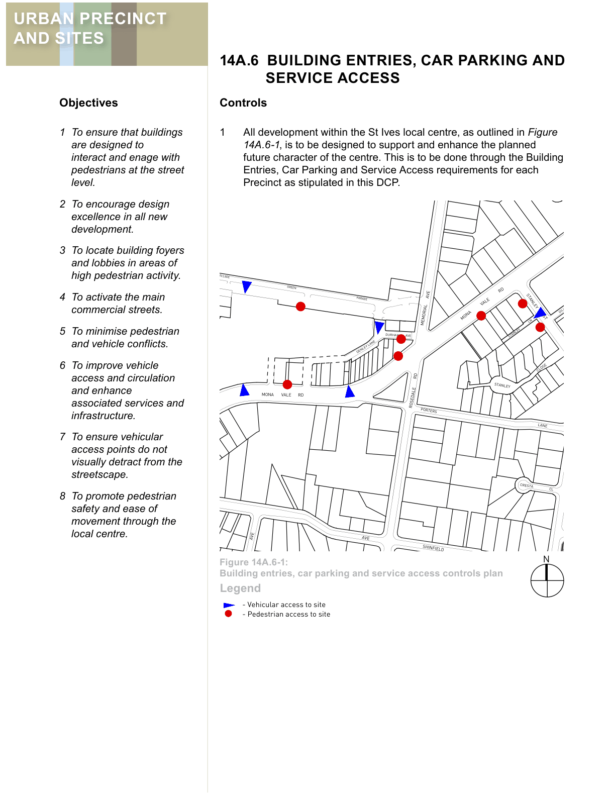
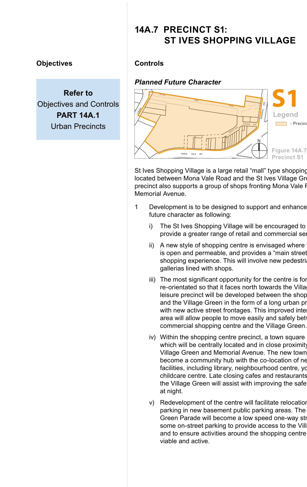

## 20 AVE

#### CARBEEN

> [Picture on page 8: a map, saved as a picture (images/part-14a-st-ives-local-centre-page-8-3.gif, 150 dpi); the street names and other small labels are on the picture.]
> Words printed on the picture (title and legend, copied from the PDF):
> 1 19 17
> GARRICK 1 272
> 12 10 8 6
> 101 103 105 107
> 123 125 127
> 4 8 10
> 5 7 9 11
> 4 6 8
> 3 5 7 11
> 38 36 34 32
> 14 12 10 8
> 82 3.66W PATHWAY
> 6 4 2
> 7 3.66W PATHWAY

Figure 14A.6-1:

#### BENAROON

#### COLLINS

#### KENTHURST

#### RD

### 14A.6  BUILDING ENTRIES, CAR PARKING AND

### SERVICE ACCESS

#### ST

#### KILLEATON

### Objectives

### Controls

#### KANOONA

#### AVE

#### LIN

#### COLLINS

## 1	 To ensure that buildings

are designed to

interact and enage with

### pedestrians at the street

### level.

## 1 All development within the St Ives local centre, as outlined in Figure

### 14A.6-1, is to be designed to support and enhance the planned

### future character of the centre. This is to be done through the Building

### Entries, Car Parking and Service Access requirements for each

### Precinct as stipulated in this DCP.

#### PL

#### STURT

## 2	 To encourage design

### excellence in all new

### development.

### ALIGNMENT AND SETBACKS

#### RD

### VILLAGE - 9m setback

#### 9m

## 3	 To locate building foyers

and lobbies in areas of

### high pedestrian activity.

#### 15m

#### GREEN

### - 15m setback

#### RD

### - 13m setback

#### 13m

#### AVE

#### PARADE

#### 12m

#### VALE

### - 12m setback

#### STANLEY

#### GILLOTT

#### WAY

### - 11m setback

#### 11m

## 4	 To activate the main

### commercial streets. COWAN

#### 10m

#### ST

#### MONA

#### LN

#### MEMORIAL

#### 6m

#### AVE

#### DURHAM

#### STANLEY

#### 5m

#### 4m

## 5	 To minimise pedestrian

### and vehicle conflicts.

#### DENLEY LANE

#### 3m 2m

#### CLOSE

#### STANLEY

#### 40% MONA VALE RD

- 10m setback - 6m setback - 5m setback - 4m setback - 3m setback - 2m setback - Land dedication - Alternate deep soil landscaping

### (% of site)

#### ROSEDALE

#### RD

### BUILT FORM

#### AVE

## 6	 To improve vehicle

### access and circulation

### and enhance

associated services and

### infrastructure.

#### LANE

#### PORTERS

2 4 6 8 10

- Principal active frontage - Supporting active frontage - 3 storey street wall - 2m upper level setback above

### 1 3 5 street

## 7	 To ensure vehicular

### access points do not

visually detract from the

### streetscape.

### wall height - 4m upper level setback above

#### CL

#### CRESTA

### street wall height

#### SHINFIELD RD

### PUBLIC DOMAIN AND PEDESTRIAN

#### AVE

## 8	 To promote pedestrian

safety and ease of

movement through the

### local centre.

#### RICHARD

#### AVE

#### SHINFIELD

1

### AVE N

- Pedestrian through site link - Entry plaza/forecourt - Awnings - Awnings where possible - Colonnade

3

10 12 14 16 18

#### PUTARRI

#### DR

### Building entries, car parking and service access controls plan

#### AVE

#### BYRON

### BUILDING ENTRIES AND CARPAT RD

7

10

43

### Legend

#### VALE

#### MONA

#### AVE

### - Vehicular access to site - Pedestrian access to site

#### PENTECOST

8 6 10

## 8 RD

### HERITATGGEA

#### CL

9

7

### - Heritage item

#### AVE

#### DORSET 16

#### PILDRA

#### PRIESTLEY

### - Landmark building

### *

### - Character item

#### LYNBARA

### - Refer to site specific DCP

### - Proposed road - Proposed Community Infrastructure

7.32 / 3.66 W.

ESMT FOR SER

66-68

> [Picture on page 9: a map, saved as a picture (images/part-14a-st-ives-local-centre-page-9-4.gif, 150 dpi); the street names and other small labels are on the picture.]
> Words printed on the picture (title and legend, copied from the PDF):
> 29 27 25 23
> 28 21 19 17
> 26 24 22
> 12 10 8 6
> 4 RD 287A
> 3 4 VILLAGE 270
> 7.32 / 3.66 W.
> ESMT FOR SERVICES
> 101 103 105 107
> 123 125 127
> 1 3 5
> VALE STANLEY GILLOTT
> 4 8 10
> 5 7 9 11
> 4 6 8
> 3 5 7 11
> 48 - 46
> 24 22 20 18
> 14 12 10 8
> 82 3.66W PATHWAY
> IKARA 1 80
> 44 6 4 2
> 1 7 3.66W PATHWAY

Figure 14A.7-1:

#### KENTHURST

#### KANOONA

#### COLLINS

### 14A.7  PRECINCT S1:

### ST IVES SHOPPING VILLAGE

#### PL

#### STURT

### Objectives

### Controls

### URBAN STRUCTURE

### Planned Future Character

#### RD

### Core Urban Precinct (B2 and B4 zones) - Fringe Urban Precinct (R4 zone)

#### RD

#### AVE

Refer to

### Objectives and Controls

### Precinct Number

### -
