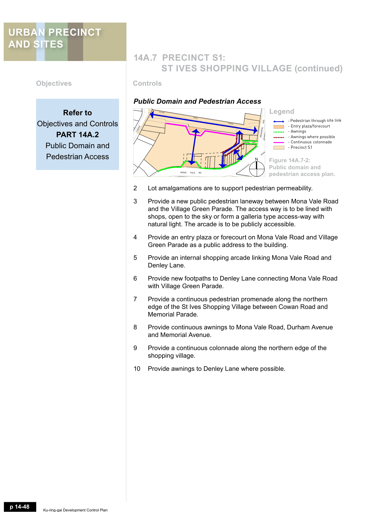
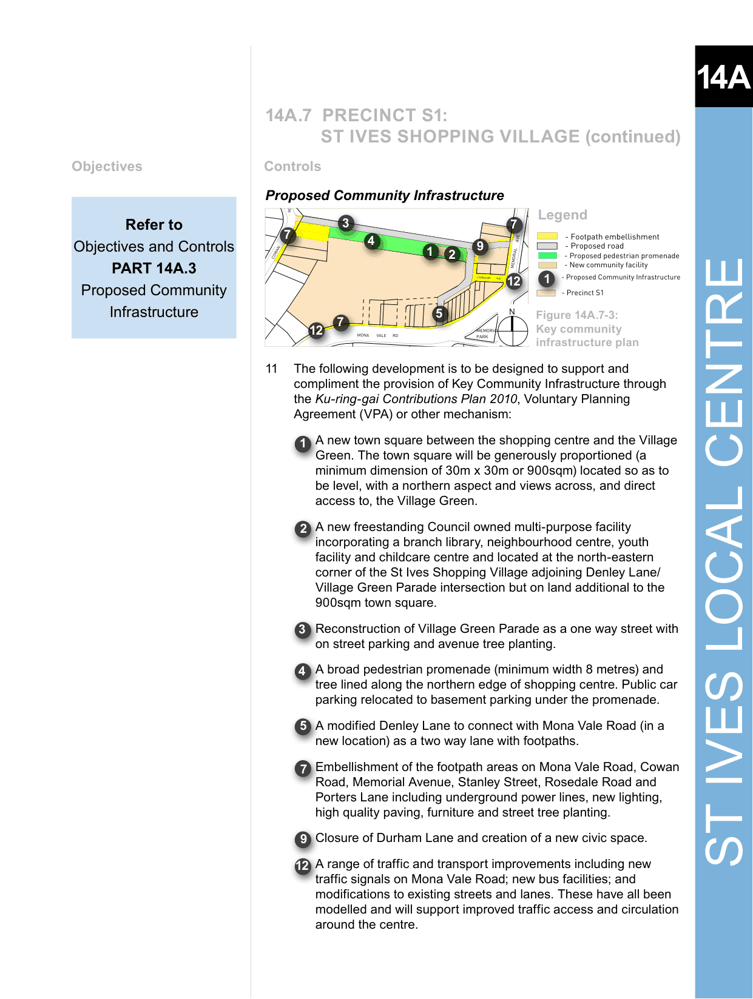

## 1 Development is to be designed to support and enhance the planned

### future character as following:

#### AVE

#### RICHARD

#### AVE 16

26 24

18

#### SHINFIELD

1

i) The St Ives Shopping Village will be encouraged to expand to

### provide a greater range of retail and commercial services.

#### AVE

4

3

#### PUTARRI

#### DR

6

10 12 14 16 18

5

AVE

BYRON

### ii)	 A new style of shopping centre is envisaged where the centre

8

#### RD 15 19

7

10

#### AVE

#### VALE

#### MONA

#### AVE

### is open and permeable, and provides a “main street” style

shopping experience. This will involve new pedestrian lanes and

### gallerias lined with shops.

23

25

27

8

#### PENTECOST

6 10

20A

22

24

#### RD

CL

29

9

iii)	 The most significant opportunity for the centre is for it to be

26 4 7

31

#### AVE

28 5

#### DORSET 16

38 36 34 32 28 24 22

72

#### PILDRA

3

PRIESTLEY 1

35

33

30

37

32

34

36

66

68

70

64

### re-orientated so that it faces north towards the Village Green. A

### leisure precinct will be developed between the shopping centre

### and the Village Green in the form of a long urban promenade

### with new active street frontages. This improved interface

area will allow people to move easily and safely between the

### commercial shopping centre and the Village Green.

#### LYNBARA

### iv)	 Within the shopping centre precinct, a town square is proposed

which will be centrally located and in close proximity to the

### Village Green and Memorial Avenue. The new town square will

### become a community hub with the co-location of new community

facilities, including library, neighbourhood centre, youth and

### childcare centre. Late closing cafes and restaurants overlooking

### the Village Green will assist with improving the safety of the area

### at night.

### v)	 Redevelopment of the centre will facilitate relocation of car

### ST IVES LOCAL CENTRE

### parking in new basement public parking areas. The Village

Green Parade will become a low speed one-way street with

### some on-street parking to provide access to the Village Green

### and to ensure activities around the shopping centre remain

### viable and active.

#### KENTHU

> [Picture on page 10: a map, saved as a picture (images/part-14a-st-ives-local-centre-page-10-2.gif, 150 dpi); the street names and other small labels are on the picture.]
> Words printed on the picture (title and legend, copied from the PDF):
> 1 ( UNFORMED )
> 29 27 25 23
> 21 19 17
> 26 24 22
> 12 10 8
> 4 RD 287A
> 7.32 / 3.66 W.
> ESMT FOR SERVICES
> 101 103 105
> 123 125 127
> 4 6 8 10
> 1 3 5
> 3 MONA ST
> 4 8 10
> 5 7 9 11
> 1-3 5 7
> 4 6 8
> 3 5 7 11
> 48 - 46
> 26 4 7
> 136 139 42C
> 24 22 20 18
> 14 12 10 8
> 82 3.66W PATHWAY
> 44 6 4 2
> 1 7 3.66W PATHWAY

Figure 14A.7-2:

#### KANOONA

### - Alternate deep soil requirement

#### COLLINS

#### PL

#### STURT

### 14A.7  PRECINCT S1:

### ST IVES SHOPPING VILLAGE (continued)

### Controls

### Objectives

- Primary active frontage - Secondary active frontage - 3 storey street wall - 2m upper level setback above street

### wall height - 4m upper level setback above street wall height

### Public Domain and Pedestrian Access

#### RD GARRICK

### URBAN STRUCTURE

### PUBLIC DOMAIN AND PEDESTRIAN

### Legend

#### RD

#### AVE

### Core Urban Precinct (B2 and B4 zones) - Fringe Urban Precinct (R4 zone)

#### VALE

Refer to

### Objectives and Controls

#### STANLEY

#### COWAN

### Precinct Number

### -

### L1

#### ST

#### MONA

#### MEMORIAL

### - Pedestrian through site link - Entry plaza/forecourt -

### Awnings -

### Awnings where possible - Continuous colonnade

### PART 14A.2

Public Domain and

### BUILDING ENTRIES AND CARPAT

### - Precinct S1

### - Precinct S2

### - Precinct S3

#### CLOSE

### Pedestrian Access

### N

#### STANLEY

### - Vehicular access to site - Pedestrian access to site

#### MONA VALE RD

Public domain and

### pedestrian access plan.

#### ROSEDALE

#### RD

4

#### AVE

#### LANE

#### PORTERS

### AVE 2 Lot amalgamations are to support pedestrian permeability.

### S3

### - Precinct L1

### - Precinct L2

### - Precinct L3

### - Precinct L4

### - Precinct L5 - Precinct L6

### - Precinct L7

### - Precinct L8

### - Precinct L9

#### CL

#### CRESTA

#### SHINFIELD

## 3 Provide a new public pedestrian laneway between Mona Vale Road

and the Village Green Parade. The access way is to be lined with

shops, open to the sky or form a galleria type access-way with

### natural light. The arcade is to be publicly accessible.

#### RD

### S2

#### AVE

#### RICHARD

#### AVE

## 4 Provide an entry plaza or forecourt on Mona Vale Road and Village

### Green Parade as a public address to the building.

2

#### SHINFIELD

#### AVE

#### PUTARRI ST

#### DR

10 12 14 16 18

#### BYRON

## 5 Provide an internal shopping arcade linking Mona Vale Road and

### Denley Lane.

#### RD

#### AVE

#### VALE

#### MONA

#### AVE

5

## 6 Provide new footpaths to Denley Lane connecting Mona Vale Road

### with Village Green Parade.

#### PENTECOST

#### RD

#### CL

#### AVE

#### DORSET 16

38 36 34 32 28

## 16 PILDRA

## 7 Provide a continuous pedestrian promenade along the northern

edge of the St Ives Shopping Village between Cowan Road and

### Memorial Parade.

#### PRIESTLEY

## 8 Provide continuous awnings to Mona Vale Road, Durham Avenue

### and Memorial Avenue.

#### LYNBARA

## 9 Provide a continuous colonnade along the northern edge of the

### shopping village.

## 10 Provide awnings to Denley Lane where possible.

C

DENL

### street

### wall height - 4m upper level setback above

#### 66-68 6m

#### KENTHURS

#### m

### street wall height

### PUBLIC DOMAIN AND PEDESTRIAN

### - 3 storey street wall

> [Picture on page 11: a map, saved as a picture (images/part-14a-st-ives-local-centre-page-11-12.gif, 150 dpi); the street names and other small labels are on the picture.]
> Words printed on the picture (title and legend, copied from the PDF):
> 7.32 / 3.
> MONA VALE RD
> CATHERINE 4 8 10
> 5 7 9 11
> 4 8 10
> 5 7 9 11
> MONA VALE RD MEMORIAL
> 4 6 8
> 3 5 7 11
> 4 6 8
> 24 22 20 18
> 3 5 7 11
> 29 3 ST 14
> 27 25 23
> 82 3.66W PATHWAY
> 2 8 20
> 15 11 7 5
> 26 24 22
> 10 8 4 2
> 12 10 8
> 24 22 20 18
> 8 26 3
> 24 22 20 18
> 7.32 / 3.66 W.
> ESMT FOR SERVICES
> 2 15 20
> 101 103 105
> LINK 2 4
> 123 125 127
> 44 6 4 2
> 1 7 3.66W PATHWAY
> 4 6 8 10
> 1 3 5
> VALE STANLEY GILLOTT
> 4 8 10
> 5 7 9 11
> MONA VALE RD
> 4 6 8
> 3 5 7 11
> 48 - 46
> 24 22 20 18
> 1 16 12
> 14 12 10 8
> 82 3.66W PATHWAY
> IKARA 1 80
> 44 6 4 2
> 1 7 3.66W PATHWAY

Figure 14A.7-3:

### - 2m upper level setback above street wall height - 4m upper level setback above street wall height

- Pedestrian through site link - Entry plaza/forecourt - Awnings - Awnings where possible - Colonnade

10 12 14 16 18

4 6 8 4 8 10

- Secondary active frontage - 3 storey street wall - 2m upper level setback above street wall height

### - 4m upper level setback above street wall height

### PUBLIC DOMAIN AND PEDESTRIAN

### BUILDING ENTRIES AND CARPAT

#### KANOONA

### PUBLIC DOMAIN AND PEDESTRIAN

#### 3m PARADE

- Pedestrian through site link - Entry plaza/forecourt - Awnings - Awnings where possible - Colonnade

10 12 14 16 18

#### LINK

### BUILDING ENTRIES AND CARPAT

#### COLLINS

- Through site link - Entry plaza/forecourt - Continuous awnings - Continuous awnings where possible

### - Continuous colonnade

### HERITATGGEA

### BUILDING ENTRIES AND CARPAT

#### 3m

- Through site link - Entry plaza/forecourt - Continuous awnings - Continuous awnings where possible

### - Continuous colonnade

### - Vehicular access to site - Pedestrian access to site

CRESTA 24 22 20 18

#### PL

#### STURT

### - Heritage item

### 14A.7  PRECINCT S1:

### ST IVES SHOPPING VILLAGE (continued)

10 12 14 16 18

### BUILDING ENTRIES AND CARPAT

### - Vehicular access to site - Pedestrian access to site

### HERITATGGEA

#### VILLAGE GREEN

10 12 14 16 18

### Objectives

### Controls 16

### - Landmark building

### - Heritage item

### - Vehicular access to site - Pedestrian access to site

### *

### KEY COMMUNITY INFRASTRUCTRE

### Proposed Community Infrastructure

### - Landmark building

### - Character item

#### RD 21 19 17

### *

### KEY COMMUNITY INFRASTRUCTRE

### Legend

### URBAN STRUCTURE

### 3

### 7

### 14 - Character item

#### RD

#### AVE

### 7 3 4

## 4 VALE

28 24 22 20 18 14 12 10 8 4 2

### - Refer to site specific DCP

### - Proposed road

#### STANLEY

### 9

### 4

Refer to

### Objectives and Controls

### Core Urban Precinct (B2 and B4 zones) - Fringe Urban Precinct (R4 zone)

## 10 COWAN

### 1

### - Proposed Community Infrastructure

### 2

#### MONA

#### ST

#### MEMORIAL

### Precinct Number

### -

### L1

### - Refer to site specific DCP

### - Proposed road

- Footpath embellishment - New or existing park to be upgraded - Historic/character building to be retained - New/realigned road - Proposed pedestrian promenade - New community facility - Landscaping

### - Proposed Community Infrastructure

### 1

### 9 12

### PART 14A.3

### Proposed Community

20 18 14 12 10 8 4 2

### - Precinct S1

### - Precinct S2

### - Precinct S3

- Footpath embellishment - New or existing park to be upgraded - Historic/character building to be retained - New/realigned road - Proposed pedestrian promenade - New community facility - Landscaping

#### CLOSE

### N

### Infrastructure

### 5

#### STANLEY

#### MONA VALE RD

#### MEMORIAL PARK

### 7

### 12
