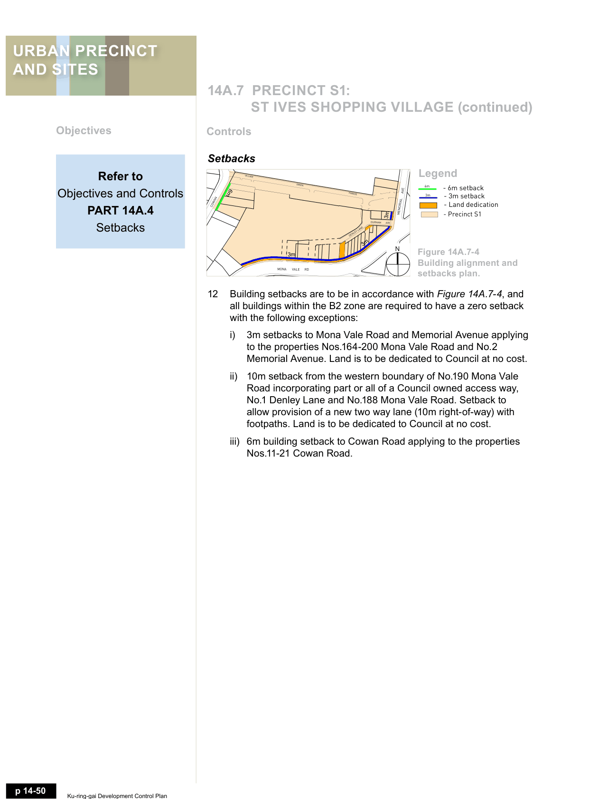

## 48 ROSEDALE

#### RD

12 10 8 4 2

### Key community

### infrastructure plan

#### AVE

#### LANE

#### PORTERS

### S3

## 11 The following development is to be designed to support and

### compliment the provision of Key Community Infrastructure through

### the Ku-ring-gai Contributions Plan 2010, Voluntary Planning

### Agreement (VPA) or other mechanism:

#### SHINFIELD RD

### 1. 1

### S2

#### NEWHAVEN AVE

#### RICHARD

#### AVE

### S1

#### SHINFIELD

#### AVE

10 12 14 16 18

### A new town square between the shopping centre and the Village

Green. The town square will be generously proportioned (a

minimum dimension of 30m x 30m or 900sqm) located so as to

### be level, with a northern aspect and views across, and direct

### access to, the Village Green.

#### PUTARRI

#### DR

#### RD

#### AVE

#### VALE

#### MONA

### 1. 2

#### AVE

#### PENTECOST

#### RD

#### AVE

#### DORSET 16

38 36 34 32 28 24 22

#### PILDRA

### A new freestanding Council owned multi-purpose facility

### incorporating a branch library, neighbourhood centre, youth

### facility and childcare centre and located at the north-eastern

### corner of the St Ives Shopping Village adjoining Denley Lane/

Village Green Parade intersection but on land additional to the

### 900sqm town square.

### 1. 3

Reconstruction of Village Green Parade as a one way street with

### on street parking and avenue tree planting.

35

20 18 14 12 10 8 4 2

PILDRA

### 1. 4 PL

#### LYNBARA

A broad pedestrian promenade (minimum width 8 metres) and

### tree lined along the northern edge of shopping centre. Public car

### parking relocated to basement parking under the promenade.

1\. 5 A modified Denley Lane to connect with Mona Vale Road (in a

### new location) as a two way lane with footpaths.

### 1. 7

### Embellishment of the footpath areas on Mona Vale Road, Cowan

Road, Memorial Avenue, Stanley Street, Rosedale Road and

Porters Lane including underground power lines, new lighting,

high quality paving, furniture and street tree planting. Closure of Durham Lane and creation of a new civic space.

### 1. 9

### ST IVES LOCAL CENTRE

### 1. 12 A range of traffic and transport improvements including new

traffic signals on Mona Vale Road; new bus facilities; and

### modifications to existing streets and lanes. These have all been

### modelled and will support improved traffic access and circulation

### around the centre.

ES

> [Picture on page 12: a map, saved as a picture (images/part-14a-st-ives-local-centre-page-12-2.gif, 150 dpi); the street names and other small labels are on the picture.]
> Words printed on the picture (title and legend, copied from the PDF):
> 29 27 25 23
> 21 19 17
> 27 25 23
> 26 24 22
> 21 19 17
> 12 10 8
> 26 24 22
> 27 25 23
> 21 19 17
> 12 10 8
> 27 25 23
> 26 24 22
> 21 19 17
> 12 10 8
> 26 24 22
> RD VALE 287A
> 12 10 8
> 7.32 / 3.66 W.
> ESMT FOR SERVICES 20
> 7.32 / 3.66 W.
> ESMT FOR SERVICES
> 14 12 6A
> 7.32 / 3.66 W.
> ESMT FOR SERVICES 20
> 7.32 / 3.66 W.
> ESMT FOR SERVICES
> 267 101 103 105
> 101 103 105
> 123 125 127
> 101 103 105 107
> 117 123 125 127
> 101 103 105
> 123 125 127
> 4 6 8 10
> CR 1 3 5
> 4 6 8 10
> 2 1 3 5
> 4 6 8 10
> 1 3 5
> 4 8 10
> 5 7 9 11
> 4 8 10
> 4 8 10
> 5 7 9 11
> 5 7 9 11
> 4 8 10
> 5 7 9 11
> 4 6 8
> 4 6 8
> 3 5 7 11
> 4 6 8
> 3 5 7 11
> 3 5 7 11
> 4 6 8
> 48 - 46
> 3 5 7 11
> ST 2 2
> 24 22 20 18
> 26 26 10
> 24 22 20 18
> 24 22 20 18
> 14 12 10 8
> 24 22 20 18
> 1 3 16
> 82 3.66W PATHWAY
> IKARA 3.66W PATHWAY
> 6 10 2
> 9 1 80
> 3.66W PATHWAY 30
> 72 2 4
> 1 7 3.66W PATHWAY

Figure 14A.7-4

#### KENTHUR

#### KANOONA

#### COLLINS

### ALIGNMENT AND SETBACKS ALIGNMENT AND SETBACKS

#### PL

#### STURT

### - 9m setback

#### 9m

### 14A.7  PRECINCT S1:

### ST IVES SHOPPING VILLAGE (continued)

#### 15m

### - 9m setback

#### 9m

### 51 53 - 15m setback

### ALIGNMENT AND SETBACKS

#### 15m

### - 13m setback

#### 13m

### - 15m setback

#### 12m

### 6m

### - 12m setback

### Objectives

### - 13m setback

#### 13m

### Controls

### - 9m setback

#### 9m 12m

### - 11m setback

#### 11m 15m

### - 12m setback

### - 15m setback

#### 10m

### - 11m setback

#### 11m

### URBAN STRUCTURE

### - 13m setback

#### 13m 10m

#### 6m

#### 12m

### - 12m setback

### Setbacks RD

#### 5m

#### 6m

#### RD

### - 11m setback

#### 11m 5m

#### 4m

#### FLINDERS 10m

### Legend

### Core Urban Precinct (B2 and B4 zones) - Fringe Urban Precinct (R4 zone)

#### 4m

#### 3m

#### 6m

#### RD

#### AVE

#### 2m

#### 5m

#### 3m

### 6m

#### VALE

### Precinct Number

### -

### L1

Refer to

### Objectives and Controls

#### STANLEY

#### 2m

#### 4m

#### COWAN

#### ST

#### MONA

#### MEMORIAL

#### 3m

#### 40%

### PART 14A.4

### 3m

#### 2m

#### 40%

- 10m setback - 6m setback - 5m setback - 4m setback - 3m setback - 2m setback - Land dedication - Alternate deep soil landscaping

### (% of site)

### - Precinct S1

### - Precinct S2

### - Precinct S3

### Setbacks

- 10m setback - 6m setback - 5m setback - 4m setback - 3m setback - 2m setback - Land dedication - Alternate deep soil landscaping

### (% of site)

### BUILT FORM

#### 40%

### 3m

#### CLOSE

### DAINTON N 123 125 127

### BUILT FORM

- 10m setback - 6m setback - 5m setback - 4m setback - 3m setback - 2m setback - Land dedication - Alternate deep soil landscaping

### (% of site)

### 3m

#### STANLEY

#### MONA VALE RD

### BUILT FORM

#### 6m

Building alignment and

### setbacks plan.

#### ROSEDALE

#### RD

#### 6m

#### AVE

- Principal active frontage - Supporting active frontage - 3 storey street wall - 2m upper level setback above

### S3

2 4 6 8 10

#### LANE

#### PORTERS

### street

- Principal active frontage - Supporting active frontage - 3 storey street wall - 2m upper level setback above

#### 6m

### 1 3 5 street

### wall height - 4m upper level setback above

#### 6m

### street wall height

### wall height - 4m upper level setback above

- Principal active frontage - Supporting active frontage - 3 storey street wall - 2m upper level setback above

#### AVE 6m
