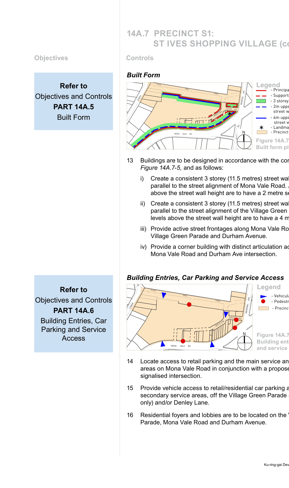

## 12 Building setbacks are to be in accordance with Figure 14A.7-4, and

### all buildings within the B2 zone are required to have a zero setback

### with the following exceptions:

### street wall height

### street

#### RD 3m

#### 2m

### PUBLIC DOMAIN AND PEDESTRIAN

### wall height - 4m upper level setback above

#### 3m 6m STANLEY 3m

#### 3m ST

#### 2m

### PUBLIC DOMAIN AND PEDESTRIAN

### street

### wall height

#### CRESTA

#### 3m

#### 10m

#### 3m

#### SHINFIELD

#### 6m

### 10m S2 3m

#### 3m

#### RD

#### 2m

### PUBLIC DOMAIN AND PEDESTRIAN

#### 6m

### i) 3m setbacks to Mona Vale Road and Memorial Avenue applying

### to the properties Nos.164-200 Mona Vale Road and No.2

### Memorial Avenue. Land is to be dedicated to Council at no cost.

#### 3m

#### 3m

#### 3m

#### 10m

### ii)	 10m setback from the western boundary of No.190 Mona Vale

#### 6m

#### AVE

#### RICHARD

#### AVE

- Pedestrian through site link - Entry plaza/forecourt - Awnings - Awnings where possible - Colonnade

#### 3m

10 12 14 16 18

#### SHINFIELD

- Pedestrian through site link - Entry plaza/forecourt - Awnings - Awnings where possible - Colonnade

10 12 14 16 18

#### AVE

10 12 14 16 18

### BUILDING ENTRIES AND CARPAT

#### PUTARRI

#### DR

### BUILDING ENTRIES AND CARPAT

- Pedestrian through site link - Entry plaza/forecourt - Awnings - Awnings where possible - Colonnade

10 12 14 16 18

#### RD

#### AVE

#### VALE

#### MONA

Road incorporating part or all of a Council owned access way,

No.1 Denley Lane and No.188 Mona Vale Road. Setback to

allow provision of a new two way lane (10m right-of-way) with

### footpaths. Land is to be dedicated to Council at no cost.

### - Vehicular access to site - Pedestrian access to site

### BUILDING ENTRIES AND CARPAT

#### ST AVE

IK

### - Vehicular access to site - Pedestrian access to site

4

### iii)	 6m building setback to Cowan Road applying to the properties

#### PENTECOST

### HERITATGGEA

### Nos.11-21 Cowan Road.

### - Vehicular access to site - Pedestrian access to site

#### RD

### HERITATGGEA

### - Heritage item

#### AVE

### - Heritage item

### HERITATGGEA

#### DORSET

38 36 34 32 28

#### PILDRA

### - Landmark building

### - Heritage item

### - Landmark building

### *

### 9 *

### - Character item

### - Landmark building

### - Character item

### *

#### LYNBARA

### - Character item

### - Refer to site specific DCP

### - Proposed road

### 4 - Proposed Community Infrastructure

### - Refer to site specific DCP

### - Proposed road - Proposed Community Infrastructure

#### LYNBARA

### - Refer to site specific DCP

### - Proposed road

#### LYNBARA

### - Proposed Community Infrastructure

#### LYNBARA

S

#### COL

MYRTLE

2C

7.32 / 3.66 W.

ESMT FOR SERVICES

CR

### ALIGNMENT AND SETBACKS

66-68

#### KENTHURST

CARCOOLA

> [Picture on page 13: a map, saved as a picture (images/part-14a-st-ives-local-centre-page-13-12.gif, 150 dpi); the street names and other small labels are on the picture.]
> Words printed on the picture (title and legend, copied from the PDF):
> 4 8 10
> 7.32 / 3.66 W.
> ESMT FOR SERVICES
> 5 7 9 11
> 4 6 8
> 101 103 105 107
> 3 5 7 11
> 123 125 127
> 27 25 23
> 28 21 19 17
> 26 24 22
> 12 10 8 6
> 4 6 8 10
> 24 22 20 18
> 27 25 23
> 1 3 5
> 21 19 17
> 26 24 22
> 7.32 / 3.66 W.
> ESMT FOR SERVICES
> 12 10 8
> 4 3 4 258
> 4 8 10
> 7.32 / 3.66 W.
> ESMT FOR SERVICES
> 101 103 105
> 5 7 9 11
> 123 125 127
> 107A 24 44
> 33 35 37
> 25 27 29 31
> 4 6 8
> 101 103 105
> 3 5 7 11
> 123 125 127
> 4 6 8 10
> 1 3 5
> 4 6 8 10
> 24 22 20 18
> 4 8 10
> 1 3 5
> 5 7 9 11
> 4 6 8
> 4 8 10
> 14 12 10 8
> 3 5 7 11
> 27 25 23
> 28 21 19 17
> 26 24 22
> 12 10 8
> 4 6 8
> 3 5 7 11
> 24 22 20 18
> 6 1 STANLEY 14 12
> 7.32 / 3.66 W.
> 101 103 105
> 24 22 20 18
> DENLEY LANE 7
> AVE 26 4
> 123 125 127
> 1 45 7
> 27 8 35
> 4 6 8 10
> 1 3 5
> 4 8 10
> 5 7 9 11
> 4 6 8
> 3 5 7 11
> 48 - 46
> 136 139 AVE

Figure 14A.7-5:

Figure 14A.7-5, and as follows: 4

Figure 14A.7-6:

### 100 1 3 5 street

PATHWAY

3.66W

#### PL KANOONA

#### LINK

#### 10m

#### 5m

#### COLLINS

#### 6m

#### 4m

#### 3m

#### 3m

### 14A.7  PRECINCT S1:

### ST IVES SHOPPING VILLAGE (continued)

PL

STURT

#### 2m

- Pedestrian through site link - Entry plaza/forecourt - Awnings - Awnings where possible - Colonnade

10 12 14 16 18

### Controls

### Objectives

#### 40%

### BUILDING ENTRIES AND CARPAT

- 6m setback - 5m setback - 4m setback - 3m setback - 2m setback - Land dedication - Alternate deep soil landscaping

### (% of site)

### Built Form

#### RD

### BUILT FORM

### - Vehicular access to site - Pedestrian access to site

### Legend

#### RD

#### AVE

### URBAN STRUCTURE

#### VALE

3

#### STANLEY

#### 6m

### ALIGNMENT AND SETBACKS

GILLOTT

WAY

Refer to

### Objectives and Controls COWAN PL

### HERITATGGEA

#### ST

## 3 MONA

## 2 MEMORIAL

### - 9m setback

#### 9m

- Principal active frontage - Supporting active frontage - 3 storey street wall - 2m upper level setback above

### PART 14A.5

#### 15m

### Core Urban Precinct (B2 and B4 zones) - Fringe Urban Precinct (R4 zone)

### - Heritage item

### street

### - 15m setback

### Precinct Number

### -

### L1 - 13m setback

#### 13m

### wall height - 4m upper level setback above

### 2 *

#### 12m

#### 6m

### Built Form 7

### - 12m setback

CLOSE

### street

### wall height

### - 11m setback

#### 11m

### - Landmark building

#### 10m

#### 3m

### N

#### MONA VALE RD

### *

#### 2m

### PUBLIC DOMAIN AND PEDESTRIAN

#### 6m

27

#### 3m

29

#### ROSEDALE

#### RD

#### 3m

25

#### 5m

#### GA

### - Precinct S1

### - Precinct S2

### - Precinct S3

28

#### AVE

#### 10m

26 24

### - Character item

21

LANE

#### 4m

#### 6m 74

### Built form plan.

#### 3m

#### 3m 2m

#### AVE

#### CARBEEN

#### STANLEY

12

16

18

14

#### BENAROON

### - Refer to site specific DCP

### - Proposed road

- Pedestrian through site link - Entry plaza/forecourt - Awnings - Awnings where possible - Colonnade

10 12 14 16 18
