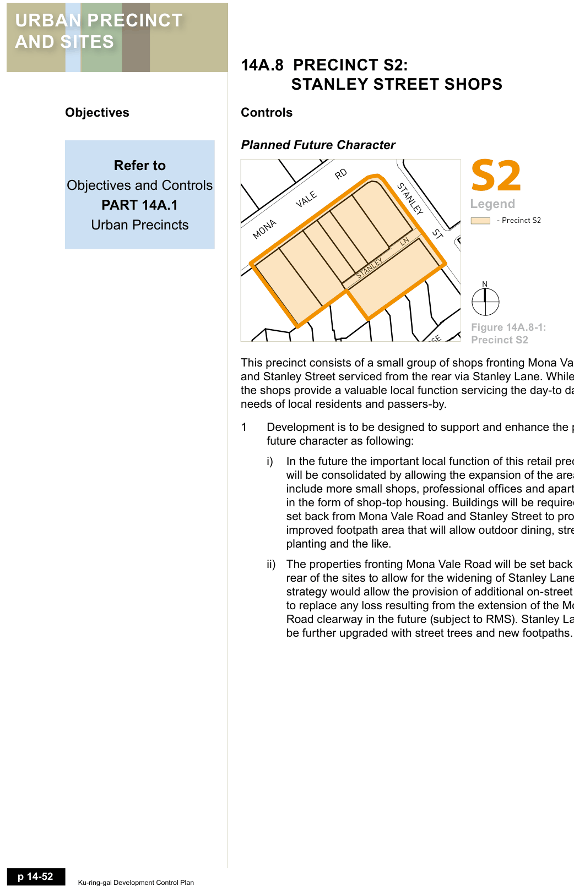
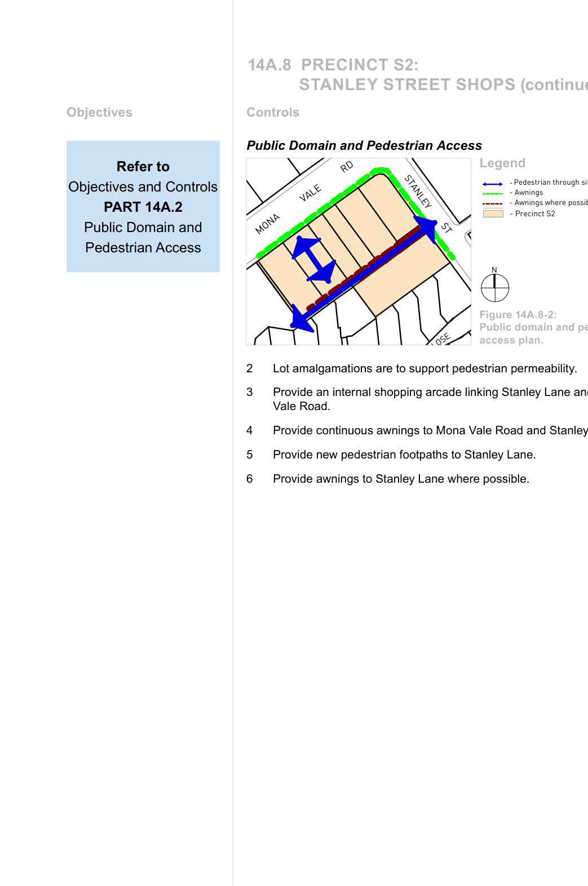

## 16 Residential foyers and lobbies are to be located on the Village Green

### Parade, Mona Vale Road and Durham Avenue.

3

#### PUTARRI

#### DR

6

5

AVE

BYRON

8

#### RD

#### VALE

#### PENTECOST

#### DORSET 16

38 36 34 32 28 24 22

#### PILDRA

PRIESTLEY

B

IK

> [Picture on page 14: a map, saved as a picture (images/part-14a-st-ives-local-centre-page-14-1.gif, 150 dpi); the street names and other small labels are on the picture.]
> Words printed on the picture (title and legend, copied from the PDF):
> 27 25 23
> 28 21 19 17
> 26 24 22
> 12 10 8 6
> 4 RD 287A
> 7.32 / 3.66 W.
> ESMT FOR SERVICES
> 101 103 105 107
> 123 125 127
> 1 3 5
> 4 8 10
> 5 7 9 11
> 4 6 8
> 3 5 7 11
> 24 22 20 18
> 82 3.66W PATHWAY
> IKARA 1 80
> 44 6 4 2
> 1 7 3.66W PATHWAY

Figure 14A.8-1:

### 14A.8  PRECINCT S2:

### STANLEY STREET SHOPS

### Objectives

### Controls

### URBAN STRUCTURE

### Planned Future Character

### Core Urban Precinct (B2 and B4 zones) - Fringe Urban Precinct (R4 zone)

### RD

### Precinct Number

### -

### L1

### AVE

Refer to

### Objectives and Controls

### PARADE

### S2

### VALE

### Legend

### STANLEY

### GILLOTT

### WAY

### PART 14A.1

### Urban Precincts

### - Precinct S1

### - Precinct S2

### - Precinct S3

### MONA

### ST

### LN

### MEMORIAL

### AVE

### DURHAM

### STANLEY

### N

### S3

2 4 6 8 10

### DENLEY LANE

### Precinct S2

### CLOSE

### S2

### STANLEY

### This precinct consists of a small group of shops fronting Mona Vale Road

and Stanley Street serviced from the rear via Stanley Lane. While small,

### the shops provide a valuable local function servicing the day-to day-

### needs of local residents and passers-by.

10 12 14 16 18

### ROSEDALE

### RD

## 1 Development is to be designed to support and enhance the planned

### future character as following:

### AVE

### LANE

### PORTERS

### i) In the future the important local function of this retail precinct

will be consolidated by allowing the expansion of the area to

### include more small shops, professional offices and apartments

in the form of shop-top housing. Buildings will be required to be

set back from Mona Vale Road and Stanley Street to provide an

### improved footpath area that will allow outdoor dining, street tree

### planting and the like.

E

ii)	 The properties fronting Mona Vale Road will be set back at the

### CL

### CRESTA

### rear of the sites to allow for the widening of Stanley Lane. This

### strategy would allow the provision of additional on-street parking

### to replace any loss resulting from the extension of the Mona Vale

### Road clearway in the future (subject to RMS). Stanley Lane will

### be further upgraded with street trees and new footpaths.

### RICHARD

### AVE

#### 26

#### 2

#### 18

### SHINFIELD

#### 1

### AVE

#### 4

#### 3

### DR

#### 6 5

### AVE

### BYRON

#### 8

### RD

#### 155

R

LADE

LINDFIELD

16-18

LINDFIELD

KENILWORTH

16-18

KENILWORTH

2 ST

### - Alternate deep soil requirement

HIGHGATE

> [Picture on page 15: a map, saved as a picture (images/part-14a-st-ives-local-centre-page-15-12.gif, 150 dpi); the street names and other small labels are on the picture.]
> Words printed on the picture (title and legend, copied from the PDF):
> ( UNFORMED )
> 1 ( UNFORMED )
> 27 25 23
> 21 19 17
> 26 24 22
> 12 10 8
> 7.32 / 3.66 W.
> ESMT FOR SERVICES
> 101 103 105
> 123 125 127
> 4 6 8 10
> 1 3 5
> 24 18 STANLEY
> 2 MONA ST
> 4 8 10
> 5 7 9 11
> 1-3 5 7
> 9 LLEWELLYN LANE
> 1-3 5 7
> 4 6 8
> 3 5 7 11
> STRICKLAND LANE 2
> 24 22 20 18
> 82 3.66W PATHWAY
> IKARA 1 80
> 44 6 4 2
> 1 7 3.66W PATHWAY

Figure 14A.8-2:

### - Alternate deep soil requirement

### 14A.8  PRECINCT S2:

### STANLEY STREET SHOPS (continued)

NELSON

### Controls

### Objectives

### URBAN STRUCTURE

- Primary active frontage - Secondary active frontage - 3 storey street wall - 2m upper level setback above street

### wall height - 4m upper level setback above street wall height

- Primary active frontage - Secondary active frontage - 3 storey street wall - 2m upper level setback above street

### wall height - 4m upper level setback above street wall height

### Public Domain and Pedestrian Access

### PUBLIC DOMAIN AND PEDESTRIAN

### Core Urban Precinct (B2 and B4 zones) - Fringe Urban Precinct (R4 zone)

### PUBLIC DOMAIN AND PEDESTRIAN

### Legend

### RD

### Precinct Number

### -

### L1

### AVE

### PARADE

Refer to

### Objectives and Controls

### VALE

### STANLEY

### - Pedestrian through site link - Entry plaza/forecourt -

### Awnings -

### Awnings where possible - Continuous colonnade

### GILLOTT

### WAY

### - Pedestrian through site link - Entry plaza/forecourt -

### Awnings -

### Awnings where possible - Continuous colonnade

### - Precinct S1

### - Precinct S2

### - Precinct S3

### BUILDING ENTRIES AND CARPAT

### ST

### PART 14A.2

### Public Domain and MONA

### LN

### BUILDING ENTRIES AND CARPAT

### MEMORIAL

### Pedestrian Access RUSSELL

18

### - Vehicular access to site - Pedestrian access to site

18

### N

### AVE

### DURHAM

### - Vehicular access to site - Pedestrian access to site

### STANLEY

### S3

### DENLEY LANE

### Public domain and pedestrian

### access plan.

### CLOSE

### - Precinct L1

### - Precinct L2

### - Precinct L3

### - Precinct L4

### - Precinct L5 - Precinct L6

### - Precinct L7

### - Precinct L8

### - Precinct L9

### - Precinct L1

### - Precinct L2

### - Precinct L3

### - Precinct L4

### - Precinct L5 - Precinct L6

### - Precinct L7

### - Precinct L8

### - Precinct L9

### S2

## 2 Lot amalgamations are to support pedestrian permeability.

### STANLEY

23

23

## 3 Provide an internal shopping arcade linking Stanley Lane and Mona

### Vale Road.

10

10 12 14 16 18

10

### ROSEDALE

### RD
