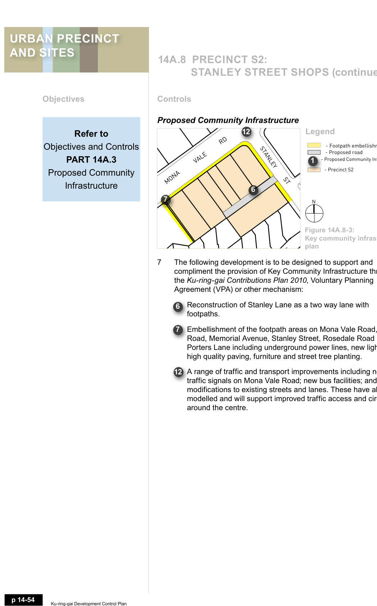

## 4 Provide continuous awnings to Mona Vale Road and Stanley Street.

### AVE

## 5 Provide new pedestrian footpaths to Stanley Lane.

### LANE

### PORTERS

## 6 Provide awnings to Stanley Lane where possible.

VE

### CL

### CRESTA

### RICHARD

### AVE

#### 26

#### 18

### SHINFIELD

## 1 ST IVES LOCAL CENTRE

### AVE

#### 4

#### 3

### DR

#### 6

#### 5

### AVE

### BYRON

#### 8

### RD

### VE

#### 155

DURHAM

> [Picture on page 16: a map, saved as a picture (images/part-14a-st-ives-local-centre-page-16-2.gif, 150 dpi); the street names and other small labels are on the picture.]
> Words printed on the picture (title and legend, copied from the PDF):
> 4 8 10
> 5 7 9 11
> 24 22 20 18
> 26 12 10
> 24 22 20 18
> 4 6 8
> 27 25 23
> 21 19 17
> 3 5 7 11
> IKARA 18 16
> 26 24 22
> 2 AVE 20
> 2 12 10 8
> 4 2 21
> 1 PRIESTLEY MYRTLE
> 7.32 / 3.66 W.
> ESMT FOR SERVICES
> 3 6 4 2
> 24 22 20 18
> 101 103 105
> IKARA 1 80
> 123 125 127
> 1 2 5
> 4 6 8 10
> 44 6 4 2
> 1 3 5
> 1 7 3.66W PATHWAY
> VALE STANLEY GILLOTT
> 4 8 10
> 5 7 9 11
> 4 6 8
> 3 5 7 11
> 24 22 20 18
> 82 3.66W PATHWAY
> IKARA 1 80
> 6 4 2
> 1 7 3.66W PATHWAY

Figure 14A.8-3:

STAN

10 12 14 16 18

10 12 14 16 18

4 6 8 15 19

#### ROTARY PARK

E

### HERITATGGEA

### STANLEY STREET SHOPS (continued)

### - Continuous awnings - Continuous awnings where possible - Continuous colonnade

### HERITATGGEA

### - Heritage item

#### MEMORIAL PARK

### BUILDING ENTRIES AND CARPAT

### - Heritage item

10 12 14 16 18

### Controls

### Objectives

### - Landmark building

### - Landmark building

### - Vehicular access to site - Pedestrian access to site

### AVE *

#### NEW PARK

### * URBAN STRUCTURE

### Proposed Community Infrastructure

### - Character item

### - Character item

### KEY COMMUNITY INFRASTRUCTRE

### 12

### Legend

### Core Urban Precinct (B2 and B4 zones) - Fringe Urban Precinct (R4 zone)

### RD

### Precinct Number

### -

### L1

Refer to

### Objectives and Controls

### AVE

### - Refer to site specific DCP

### - Proposed road

### - Refer to site specific DCP

### - Proposed road

### PARADE

1 7 7 3.66W PATHWAY

### - Proposed Community Infrastructure

### - Proposed Community Infrastructure

### VALE

### 1

### STANLEY

### GILLOTT

### WAY

### - Precinct S1

### - Precinct S2

### - Precinct S3

### PART 14A.3

### Proposed Community

### MONA

### ST

### LN

### Infrastructure

### MEMORIAL

### 6

- Footpath embellishment - New or existing park to be upgraded - Historic/character building to be retained - New/realigned road - Proposed pedestrian promenade - New community facility - Landscaping

### 7

### N

### AVE

### DURHAM

### STANLEY

### S3

### DENLEY LANE

### Key community infrastructure

### plan

#### RD LYNBARA

### CLOSE

### S2

### STANLEY 16

## 7 The following development is to be designed to support and

### compliment the provision of Key Community Infrastructure through

### the Ku-ring-gai Contributions Plan 2010, Voluntary Planning

### Agreement (VPA) or other mechanism:

10 12 14 16 18

### 6

### ROSEDALE

### RD

Reconstruction of Stanley Lane as a two way lane with

### footpaths.

### AVE

### 7

### LANE

### PORTERS

### Embellishment of the footpath areas on Mona Vale Road, Cowan

Road, Memorial Avenue, Stanley Street, Rosedale Road and

Porters Lane including underground power lines, new lighting,

### high quality paving, furniture and street tree planting.

### 12

E

### A range of traffic and transport improvements including new

traffic signals on Mona Vale Road; new bus facilities; and

### modifications to existing streets and lanes. These have all been

### modelled and will support improved traffic access and circulation

### around the centre.
