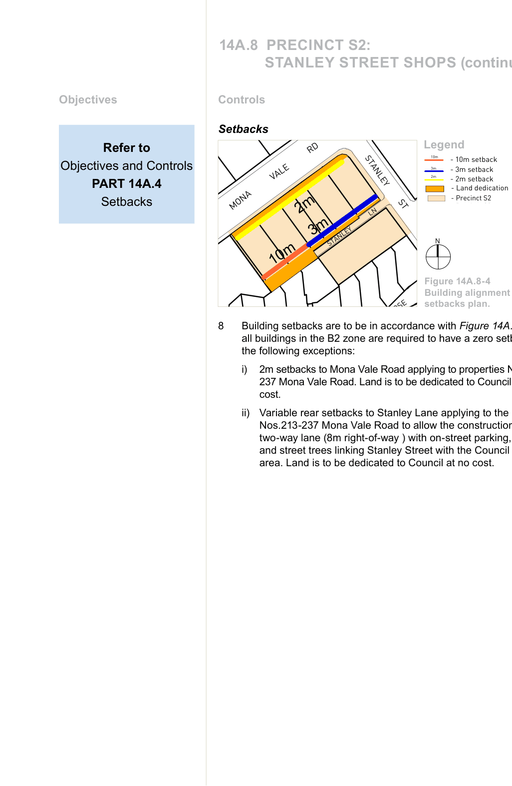

## 44 CL

### CRESTA

### RICHARD

### AVE

#### 26

#### 18

### SHINFIELD

#### 1

### AVE

#### 4

#### 3

### DR

#### 6 5

### AVE

### BYRON

> [Picture on page 17: a map, saved as a picture (images/part-14a-st-ives-local-centre-page-17-1.gif, 150 dpi); the street names and other small labels are on the picture.]
> Words printed on the picture (title and legend, copied from the PDF):
> 29 27 25 23
> 27 25 23
> 21 19 17
> 21 19 17
> 26 24 22
> 26 24 22
> 27 25 23
> 12 10 8
> 26 24 22
> 27 25 23
> 12 10 8
> 21 19 17
> 26 24 22
> 12 10 8
> 7.32 / 3.66 W.
> 7.32 / 3.66 W.
> ESMT FOR SERVICES
> ESMT FOR SERVICES
> ESMT FOR SERVICES
> 3.66W 14 12 260
> 7.32 / 3.66 W.
> ESMT FOR SERVICES
> 101 103 105
> 101 103 105
> 101 103 105 107
> 123 125 127
> 123 125 127
> 152 123 125 127
> 101 103 105 107
> RD 123 125 127
> 4 6 8 10
> 4 6 8 10
> CR RD CARCOOLA
> 4 6 8 10
> 1 3 5
> 1 3 5
> 1 3 5
> 4 6 8 10
> 1 3 5
> 4 8 10
> 4 8 10
> 4 8 10
> 5 7 9 11
> 5 7 9 11
> 5 7 9 11
> 4 8 10
> 5 7 9 11
> 4 6 8
> 4 6 8
> 3 5 7 11
> 3 5 7 11
> 3 5 7 11
> 4 6 8
> 3 5 7 11
> 24 22 20 18
> 24 22 20 18
> 24 22 20 18
> 14 6 12
> 24 22 20 18
> 82 82 3.66W PATHWAY
> 3.66W PATHWAY 18
> 6 10 6
> 76 82 3.66W PATHWAY
> 3 72 15
> 6 4 2
> 1 7 3.66W PATHWAY

Figure 14A.8-4

### STANLEY STREET SHOPS (continued)

### ALIGNMENT AND SETBACKS

### ALIGNMENT AND SETBACKS - 9m setback

#### 9m
