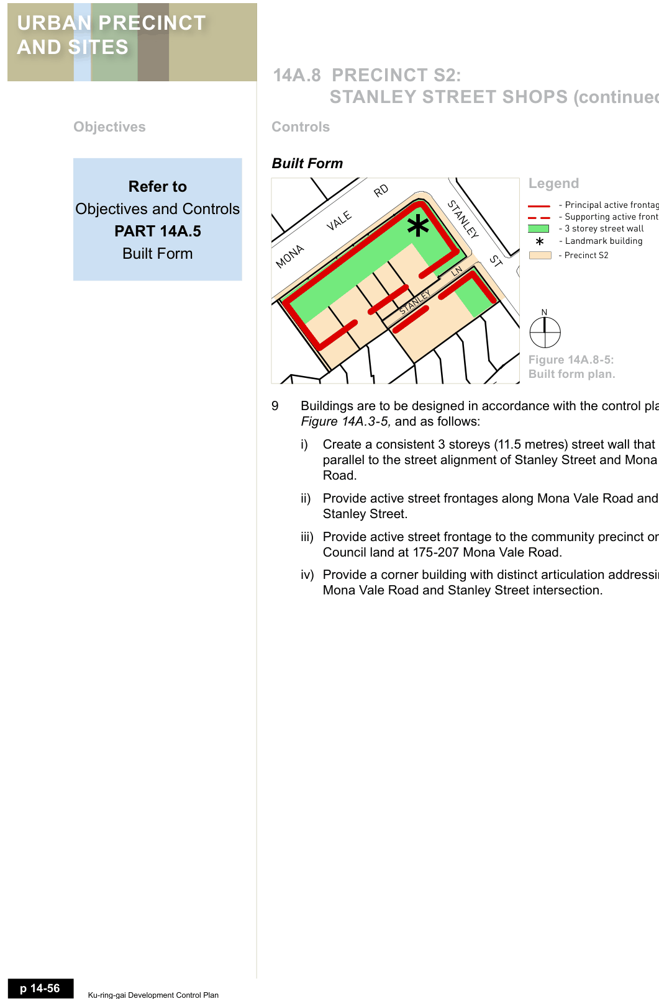

### 51 53 - 9m setback

#### 9m

#### 15m

#### 15m

### - 15m setback

### - 15m setback

### ALIGNMENT AND SETBACKS

### Controls

### Objectives

14

14

### - 13m setback

#### 13m

### - 13m setback

#### 13m 12m

#### 12m

21 19 17 12 10 8 6

### - 12m setback

### - 12m setback

### - 9m setback

#### 9m

#### 15m

### - 11m setback

#### 11m

### - 11m setback

#### 11m

### - 15m setback

### URBAN STRUCTURE

#### 10m

#### 10m

### - 13m setback

#### 13m

### Setbacks

#### 3 6m

#### 6m

#### 12m

### - 12m setback

#### 5m

#### 5m

### Legend

### - 11m setback

#### 11m

### RD

### Core Urban Precinct (B2 and B4 zones) - Fringe Urban Precinct (R4 zone)

#### 10m

#### 4m

#### 4m

### AVE 7.32 / 3.66 W.

#### 6m

#### 3m

#### 3m

### PARADE

### Precinct Number

### -

### L1

Refer to

### Objectives and Controls

#### 5m

#### 2m

#### FLINDERS 2m

### VALE

#### 4m

### STANLEY

### PART 14A.4

### GILLOTT

### WAY

#### 3m

#### 40%

#### 40%

#### 2m

### Setbacks

### - Precinct S1

### - Precinct S2

### - Precinct S3

- 10m setback - 6m setback - 5m setback - 4m setback - 3m setback - 2m setback - Land dedication - Alternate deep soil landscaping

### (% of site)

- 10m setback - 6m setback - 5m setback - 4m setback - 3m setback - 2m setback - Land dedication - Alternate deep soil landscaping

### (% of site)

### ST

### MONA

### LN

### 2m

### MEMORIAL

#### 40%

### BUILT FORM

### BUILT FORM

- 10m setback - 6m setback - 5m setback - 4m setback - 3m setback - 2m setback - Land dedication - Alternate deep soil landscaping

### (% of site)

### 3m 117

### N

### AVE

### DURHAM

### STANLEY RD

### BUILT FORM

#### 6m

#### 6m

### 10m

### S3

- Principal active frontage - Supporting active frontage - 3 storey street wall - 2m upper level setback above

- Principal active frontage - Supporting active frontage - 3 storey street wall - 2m upper level setback above

### DENLEY LANE

### CARCOOLA street

### street

#### 6m

### wall height - 4m upper level setback above

### wall height - 4m upper level setback above

#### 6m

#### 6m

### street

- Principal active frontage - Supporting active frontage - 3 storey street wall - 2m upper level setback above

### wall height

### street wall height

Building alignment and

### setbacks plan.

### street

### CLOSE

#### VALE 3m

#### 3m

#### 2m LN

#### 2m

### wall height - 4m upper level setback above

### PUBLIC DOMAIN AND PEDESTRIAN

### PUBLIC DOMAIN AND PEDESTRIAN

#### 6m

#### 3m

#### 3m

#### 3m

#### 3m

### street

### wall height

#### 10m

#### 10m

### VALE S2

#### 6m

#### 6m

#### 3m

#### m

#### m

#### 2m

### PUBLIC DOMAIN AND PEDESTRIAN

### STANLEY

#### 3m

## 8 Building setbacks are to be in accordance with Figure 14A.8-4, and

all buildings in the B2 zone are required to have a zero setback with

### the following exceptions:

#### 3m

#### 10m STANLEY

#### 6m

#### m

- Pedestrian through site link - Entry plaza/forecourt - Awnings - Awnings where possible - Colonnade

- Pedestrian through site link - Entry plaza/forecourt - Awnings - Awnings where possible - Colonnade

10 12 14 16 18

4 6 8 10 12 14 16 18

10 12 14 16 18

### ROSEDALE

### RD

9 15 19

### BUILDING ENTRIES AND CARPAT

### BUILDING ENTRIES AND CARPAT

### i) 2m setbacks to Mona Vale Road applying to properties Nos.213-

## 237 Mona Vale Road. Land is to be dedicated to Council at no

### cost.

- Pedestrian through site link - Entry plaza/forecourt - Awnings - Awnings where possible - Colonnade

10 12 14 16 18

### AVE

### ii)	 Variable rear setbacks to Stanley Lane applying to the properties

### BUILDING ENTRIES AND CARPAT

### - Vehicular access to site - Pedestrian access to site

### - Vehicular access to site - Pedestrian access to site

### LANE

### PORTERS

### - Vehicular access to site - Pedestrian access to site

### HERITATGGEA

### HERITATGGEA

### Nos.213-237 Mona Vale Road to allow the construction of a new

### two-way lane (8m right-of-way ) with on-street parking, footpaths

### and street trees linking Stanley Street with the Council car park

### area. Land is to be dedicated to Council at no cost.

### - Heritage item

### - Heritage item

### HERITATGGEA

RD

### - Heritage item

### - Landmark building

### - Landmark building

151

### *

### *

### - Landmark building

151

### - Character item

### - Character item

### *

### - Character item

### CL

### CRESTA

### - Refer to site specific DCP

### - Proposed road

### - Refer to site specific DCP

### - Proposed road - Proposed Community Infrastructure

### - Proposed Community Infrastructure

#### LYNBARA

#### LYNBARA

### - Refer to site specific DCP

### - Proposed road - Proposed Community Infrastructure

#### LYNBARA

### RICHARD

### AVE

#### 26

### ST IVES LOCAL CENTRE

#### 18

### SHINFIELD

#### 1

### AVE

#### 4

#### 3

### DR

#### 6

#### 5

### AVE

### BYRON

### E

### CARCOOLA - 2m upper level setback above

### 1 3 5 street wall height ALIGNMENT AND SETBACKS

WAY

> [Picture on page 18: a map, saved as a picture (images/part-14a-st-ives-local-centre-page-18-5.gif, 150 dpi); the street names and other small labels are on the picture.]
> Words printed on the picture (title and legend, copied from the PDF):
> 7.32 / 3.66 W.
> ESMT FOR SERVICES
> 4 6 8
> 3 5 7 11
> 29 27 25 23
> 21 19 17
> 101 103 105
> 26 24 22
> VALE 113 115
> 12 10 8 2
> 123 125 127
> 24 22 20 18
> 7.32 / 3.66 W.
> ESMT FOR SERVICES
> 4 6 8 10
> 4 AVE 267
> 1 3 5
> 101 103 105
> VALE STANLEY 28 LINK
> 123 125 127
> 4 8 10
> 6 4 2
> 5 7 9 11
> 1 7 3.66W PATHWAY
> 4 6 8 10
> 2 1 3 5
> 4 6 8
> 3 5 7 11
> 4 8 10
> 5 7 9 11
> 24 22 20 18
> 4 6 8
> 3 5 7 11
> 82 3.66W PATHWAY
> 24 22 20 18
> 82 3.66W PATHWAY
> IKARA 1 80
> 44 6 4 2
> 1 7 3.66W PATHWAY

Figure 14A.8-5:

Figure 14A.3-5, and as follows:

#### 6m 5m

### - Awnings where possible - Colonnade

10 12 14 16 18

#### 4m

### 14A.8  PRECINCT S2:

### STANLEY STREET SHOPS (continued)

#### 3m

### BUILDING ENTRIES AND CARPAT

#### 2m

### Controls

### Objectives

#### 40%

### - Vehicular access to site - Pedestrian access to site

- 6m setback - 5m setback - 4m setback - 3m setback - 2m setback - Land dedication - Alternate deep soil landscaping

### (% of site)

### URBAN STRUCTURE

### Built Form

### BUILT FORM

## 152 HERITATGGEA

## 5 Legend

### RD

### Core Urban Precinct (B2 and B4 zones) - Fringe Urban Precinct (R4 zone)

### - Heritage item

### AVE

### Precinct Number

### -

### L1

Refer to

### Objectives and Controls

### PARADE

#### 6m

### VALE

### STANLEY
