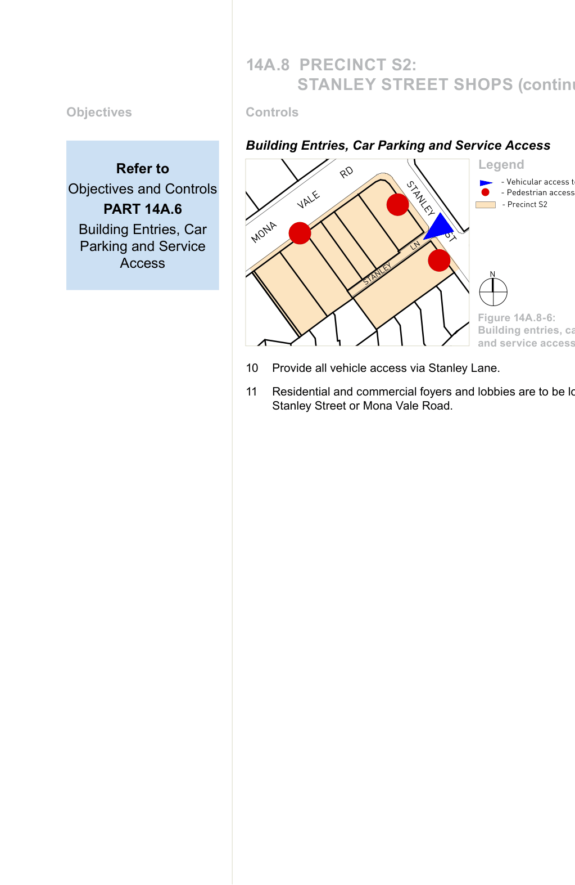

## 9 LANE

### PORTERS

### - Character item

### Council land at 175-207 Mona Vale Road.

iv)	 Provide a corner building with distinct articulation addressing the

### Mona Vale Road and Stanley Street intersection.

### - Refer to site specific DCP

### - Proposed road - Proposed Community Infrastructure

#### LYNBARA

### CL

### CRESTA

### RICHARD

### AVE

#### 26

#### 18

### SHINFIELD

#### 1

### AVE

#### 4

#### 3

### DR

### AVE

INK

STURT

> [Picture on page 19: a map, saved as a picture (images/part-14a-st-ives-local-centre-page-19-3.gif, 150 dpi); the street names and other small labels are on the picture.]
> Words printed on the picture (title and legend, copied from the PDF):
> 4 8 10
> 5 7 9 11
> 27 25 23
> 28 21 19 17
> 26 24 22
> 12 10 8
> 4 RD 287A
> 4 6 8
> 3 5 7 11
> 7.32 / 3.66 W.
> ESMT FOR SERVICES
> 101 103 105
> 24 22 20 18
> 123 125 127
> 82 3.66W PATHWAY
> IKARA 1 80
> 4 6 8 10
> 1 3 5
> 7 3.66W PATHWAY
> 4 8 10
> 5 7 9 11
> 4 6 8
> 3 5 7 11
> 24 22 20 18
> 82 3.66W PATHWAY
> IKARA 1 80
> 44 6 4 2
> 1 7 3.66W PATHWAY

Figure 14A.8-6:

2 4 6 8 10

### 1 3 5 street wall height

### - 4m upper level setback above 14A

#### 3m

#### 2m

### PUBLIC DOMAIN AND PEDESTRIAN

#### 3m

#### 3m

### 14A.8  PRECINCT S2:

### STANLEY STREET SHOPS (continued)

#### 10m

#### 6m

### Controls

### Objectives

### URBAN STRUCTURE

- Pedestrian through site link - Entry plaza/forecourt - Awnings - Awnings where possible - Colonnade

10 12 14 16 18

### Building Entries, Car Parking and Service Access

### Core Urban Precinct (B2 and B4 zones) - Fringe Urban Precinct (R4 zone)

### BUILDING ENTRIES AND CARPAT

### Legend

### RD

### AVE

### - Vehicular access to site - Pedestrian access to site

### Precinct Number

### -

### L1

Refer to

### Objectives and Controls

### PARADE

### 265 ST VALE 2

### - Precinct S1

### - Precinct S2

### - Precinct S3

### STANLEY

### DAINTON GILLOTT

### WAY

### HERITATGGEA

### PART 14A.6

### Building Entries, Car

### ST
