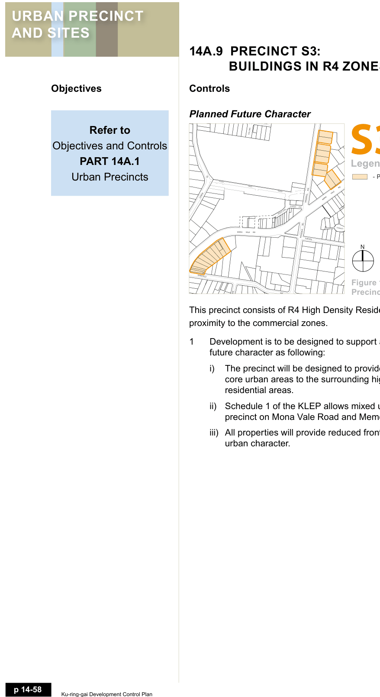
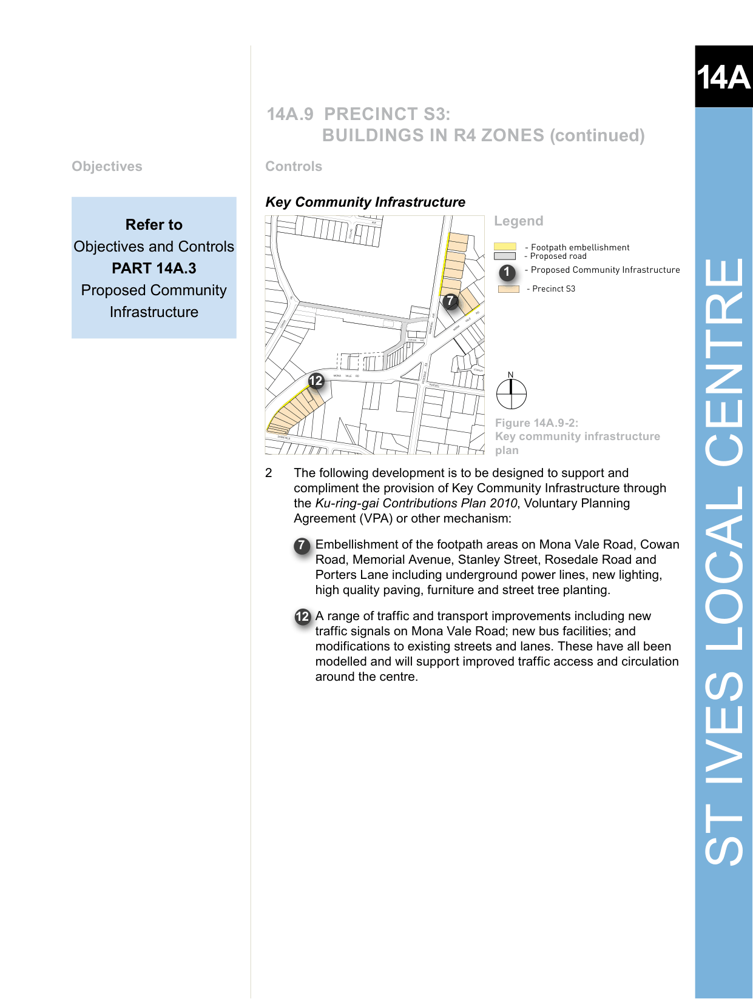

## 14 MONA

### - Heritage item

### LN

### Parking and Service

### MEMORIAL

### Access 5

### N

### - Landmark building

### AVE

### DURHAM

### S3

### STANLEY

### *

### - Character item

### DENLEY LANE

### Building entries, car parking

### and service access plan.

### - Refer to site specific DCP

### - Proposed road - Proposed Community Infrastructure

### S2

### CLOSE

## 10 Provide all vehicle access via Stanley Lane.

#### LYNBARA

### STANLEY 24

## 11 Residential and commercial foyers and lobbies are to be located off

### Stanley Street or Mona Vale Road.

10 12 14 16 18

### ROSEDALE

### RD

### AVE

### LANE

### PORTERS

### CL

### CRESTA

### ST IVES LOCAL CENTRE

### RICHARD

### AVE

#### 26

#### 18

### SHINFIELD

#### 1

### AVE

#### 4

#### 3

### DR

### AVE

28 21 19 17

293

15 11 7 5

9

18 16

20

26 24 22

3

14

VALE

295

289

GARRICK

GARRICK

1 272

274

12 10 8 6 4

RD 287A 2 285

PL

3 4 270

> [Picture on page 20: a map, saved as a picture (images/part-14a-st-ives-local-centre-page-20-25.gif, 150 dpi); the street names and other small labels are on the picture.]
> Words printed on the picture (title and legend, copied from the PDF):
> 33 35 37
> 25 27 29 31
> 27 25 23
> 21 19 17
> 26 24 22
> 12 10 8
> 4 RD 287A
> 7.32 / 3.66 W.
> ESMT FOR SERVICES
> VILLAGE 101 103 105
> 123 125 127
> MONA VALE RD
> 2 4 6 8 10 AVE
> 1 3 5
> 4 8 10
> 5 7 9 11
> 48 - 46
> 4 6 8
> 3 5 7 11
> 24 22 20 18
> 82 3.66W PATHWAY 18
> IKARA 1 80
> 44 6 4 2
> 1 7 3.66W PATHWAY

### 14A.9  PRECINCT S3:

### BUILDINGS IN R4 ZONES

6

9

5

7

11

6A

287

283

281

279

20

15

8

MYRTLE 18 16

266

268

277

14 12

7.32 / 3.66 W.

ESMT FOR SERVICES 258

### Objectives

### Controls

275

271

273

260

264

262

269 258

MONA

PATHWAY

3.66W 267

107A

### URBAN STRUCTURE 265

99

97

101 103 105 107

### Planned Future Character

KILLEATON

ST

113 115

111

109

1

LINK

ST

### Core Urban Precinct (B2 and B4 zones) - Fringe Urban Precinct (R4 zone) Precinct Number

### -

### L1

Refer to

### Objectives and Controls

### S3

### Legend

### - Precinct S1

### - Precinct S2

### - Precinct S3

### PART 14A.1

### Urban Precincts

PL

RD

18

16

12

20

14

10

8

6

4

NEWHAVEN

21

23

COLLEGE

22

### S3

24

### N

RD

STANLEY

ST 59

RD

57 55

ST 2

6

AVE

3

8

### S2

26 10

### Figure 14A.9-1:

### Precinct S3

24 22 20 18 1 16 12 14

3

6

5

AVE

BYRON

32

30

26

24

22

20

18

28

16A

8

15

11

9

7

5

7 10

5

14

12

10

8

6

3

6

34

84

82 3.66W PATHWAY

18

16

14

12

10

8

4

6

IKARA 1 80

16

4

86

4

AVE

34A

17

15

11

9

7

5

This precinct consists of R4 High Density Residential zones within close proximity to the commercial zones.

PL 2

20

49

47 45

43

41

39

37

33

31

29

35

36

10 12 14 16 18

19

43

6 10 CL 41

38

76

16A

18

4

GREVIL

7

74

28 5 39 17

1

3

38 36 34 32 28 24 22 20 18 14 12 10 8 4 2

72

15

3

PRIESTLEY

6

3.66W PATHWAY

## 1 Development is to be designed to support and enhance the planned

### future character as following:

20

22 1

30

26

24

22

28

PL

42

LANCASTER 29

25

45

11

9

2 4

CL

YARRABUNG

AMINYA

3

24

26

3

1 7

3.66W PATHWAY

34

32

4

2

5 35

37

47

21

33

31

27

23

28

66

68

70

64

30

i) The precinct will be designed to provide a transition from the

### core urban areas to the surrounding high and medium density

### residential areas.

### ii)	 Schedule 1 of the KLEP allows mixed use buildings within this

### precinct on Mona Vale Road and Memorial Avenue.

iii)	 All properties will provide reduced front setbacks to enhance the

### urban character. 11

> [Picture on page 21: a map, saved as a picture (images/part-14a-st-ives-local-centre-page-21-1.gif, 150 dpi); the street names and other small labels are on the picture.]
> Words printed on the picture (title and legend, copied from the PDF):
> 22 2 2C
> CATHERINE 15 19
> 27 25 23
> 28 21 19 17
> 4 8 10
> 15 11 7 5
> 26 24 22
> 5 7 9 11
> 12 10 8
> 24 22 20 18
> 33 35 37
> 25 27 29 31
> 7.32 / 3.66 W.
> ESMT FOR SERVICES
> 27 25 23
> 21 19 17
> 4 6 8
> 26 24 22
> 3 5 7 11
> 12 10 8
> 101 103 105
> ESMT FOR SERVICES
> 24 22 20 18
> 101 103 105
> 123 125 127
> MONA VALE RD
> 4 6 8 10
> 1 3 5
> 44 6 4 2
> 7 3.66W PATHWAY
> 4 8 10
> 5 7 9 11
> 24 22 20 18
> 1 16 12
> 48 - 46
> 82 3.66W PATHWAY
> IKARA 1 80
> 4 6 8
> 3 5 7 11
> 7 3.66W PATHWAY
> 24 22 20 18
> 82 3.66W PATHWAY
> IKARA 1 80
> 44 6 4 2
> 1 7 3.66W PATHWAY

Figure 14A.9-2:

NE

10 12 14 16 18

10 12 14 16 18

#### ROTARY PARK

### HERITATGGEA

### HERITATGGEA

24 22 20 18 10

### - Continuous awnings - Continuous awnings where possible - Continuous colonnade

### - Heritage item

### 14A.9  PRECINCT S3:

### BUILDINGS IN R4 ZONES (continued)

### - Heritage item

ALE

RD

### BUILDING ENTRIES AND CARPAT

155

### Controls

### Objectives

10 12 14 16 18

### - Landmark building

### - Landmark building 260

### - Vehicular access to site - Pedestrian access to site

### *

### URBAN STRUCTURE

### *

#### NEW

#### PARK 8

### Key Community Infrastructure

### - Character item

### - Character item

### Core Urban Precinct (B2 and B4 zones) - Fringe Urban Precinct (R4 zone)

### KEY COMMUNITY INFRASTRUCTRE
