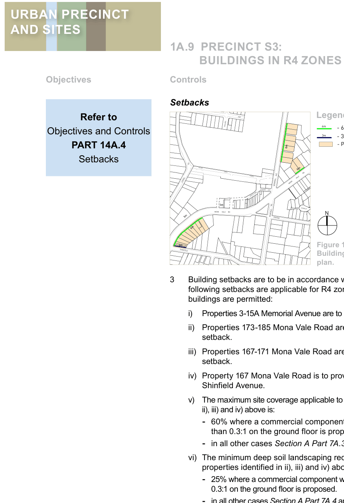

## 2 The following development is to be designed to support and

### compliment the provision of Key Community Infrastructure through

### the Ku-ring-gai Contributions Plan 2010, Voluntary Planning

### Agreement (VPA) or other mechanism: CL

GRE

38 36 34 32 28 24 22 20 18 14 12 10 8 4 2

### 7

47

### Embellishment of the footpath areas on Mona Vale Road, Cowan

Road, Memorial Avenue, Stanley Street, Rosedale Road and

Porters Lane including underground power lines, new lighting,

### high quality paving, furniture and street tree planting.

### 12

RD

149

### A range of traffic and transport improvements including new

traffic signals on Mona Vale Road; new bus facilities; and

### modifications to existing streets and lanes. These have all been

### modelled and will support improved traffic access and circulation

### around the centre.

### ST IVES LOCAL CENTRE

276

29 27 25 23 28 21 19 17

293

15 11 7 5

9

18 16

20

26 24 22

3

14

VALE

295

289

GARRICK

GARRICK

1 272

274

12 10 8 6

4 RD

287A

### ALIGNMENT AND SETBACKS

2 285

PL

> [Picture on page 22: a map, saved as a picture (images/part-14a-st-ives-local-centre-page-22-26.gif, 150 dpi); the street names and other small labels are on the picture.]
> Words printed on the picture (title and legend, copied from the PDF):
> 27 25 23
> 33 35 37
> 25 27 29 31
> 28 21 19 17
> 16 51 53
> 64 18 16
> 26 24 22
> 27 25 23
> 26 24 22
> 27 25 23
> 12 10 8
> 21 19 17
> 26 24 22
> 12 10 8
> 7.32 / 3.66 W.
> ESMT FOR SERVICES
> 7.32 / 3.66 W.
> ESMT FOR SERVICES
> 7.32 / 3.66 W.
> ESMT FOR SERVICES
> 101 103 105
> 101 103 105
> 123 125 127
> 101 103 105
> 123 125 127
> ST 1 123 125 127
> 1 3 5
> MONA VALE RD
> 4 6 8 10
> CR 1 3 5
> 4 6 8 10
> 1 3 5
> 4 8 10
> 5 7 9 11
> 4 8 10
> 5 7 9 11
> 4 8 10
> 4 6 8
> 5 7 9 11
> 48 - 46
> 3 5 7 11
> 4 6 8
> 3 5 7 11
> 4 6 8
> 3 5 7 11
> 24 22 20 18
> 16 6 12
> 24 22 20 18
> 24 22 20 18
> 10 6 10
> 24 3 5
> 26 4 1
> 27 8 3
> 74 2 4
> 1 7 3.66W PATHWAY

### 1A.9  PRECINCT S3:

### BUILDINGS IN R4 ZONES (continued)

3 4 270

### - 9m setback

#### 9m

6

### ALIGNMENT AND SETBACKS

9 5

7

11

6A

287

283

281

279

20

15

8

#### 15m

MYRTLE 18 16

266

268

21 19 17 12 10 8

277

### - 15m setback

14 12

### URBAN STRUCTURE

7.32 / 3.66 W.

ESMT FOR SERVICES

### Controls

### Objectives

258

1

2

### - 9m setback

#### 9m

### - 13m setback

#### 13m

3 4

#### 12m

275

271

273

#### 15m

260

264

262

### - 12m setback

### - 15m setback

269 258

MONA

PATHWAY

3.66W 267

### - 11m setback

#### 11m

### - 13m setback

#### 13m

107A

### Core Urban Precinct (B2 and B4 zones) - Fringe Urban Precinct (R4 zone)

265

#### 12m

#### 10m

### Setbacks
