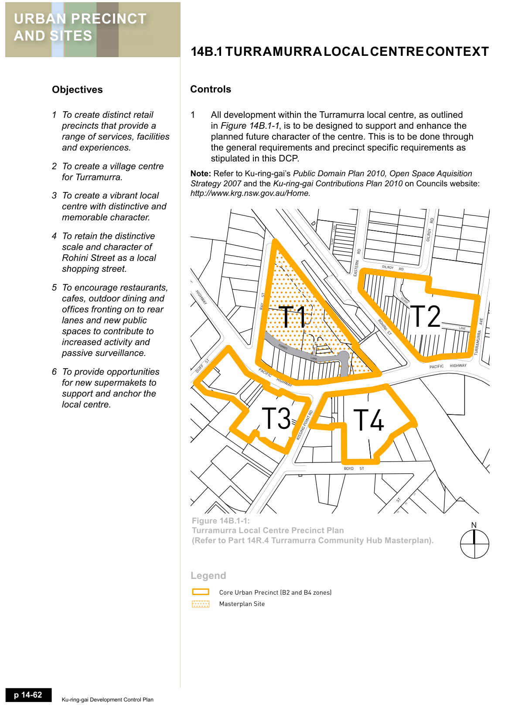

#### 14B		 Turramurra Local Centre

14B.1	 	Turramurra Local Centre Context 14B.2	 	Public Domain and Pedestrian Access 14B.3	 	Proposed Community Infrastructure 14B.4	 	Setbacks 14B.5	 	Built Form 14B.6	 	Building Entries, Car Parking and Service Access 14B.7	 	Environmental Protection and Bush Fire Protection 14B.8	 	Precinct T1: Pacific Highway and Ray Street Retail Area 14B.9	 	Precinct T2: Rohini Street and Eastern Road Retail Centre 14B.10	 Precinct T3: Kissing Point Road Retail Area 14B.11	 Precinct T4: Hillview Area

### READ WITH

#### SECTION A

PART 2 - Site Analysis

PART 3 - Land Consolidation and Subdivision

PART 7 - Residential Flat Buildings

PART 8 - Mixed Use Development

PART 9 - Non-Residential and Office Buildings

PART 12 - Signage and Advertising

#### SECTION B

PART 15 – Land Contamination

PART 16 – Bushfire Risk

PART 17 – Riparian Lands

PART 18 – Biodiversity

PART 19 – Heritage Items and Heritage Conservation

Areas

PART 20 – Development Near Road or Rail Noise

#### SECTION C

PART 22 - General Access and Parking

PART 23 - General Building Design and Sustainability

PART 24 - Water Management

### TURRAMURRA LOCAL CENTRE

AVE 45

57 55 53 49 45 43

BRENTWOOD

> [Picture on page 2: a map, saved as a picture (images/part-14b-turramurra-local-centre-page-2-4.gif, 150 dpi); the street names and other small labels are on the picture.]
> Words printed on the picture (title and legend, copied from the PDF):
> precincts that provide a
> range of services, facilities
> stipulated in this DCP.
> 20 22 24 28 30
> 22 24 28 30
> Note: Refer to Ku-ring-gai’s Public Domain Plan 2010, Open Space Aquisition
> Strategy 2007 and the Ku-ring-gai Contributions Plan 2010 on Councils website:
> 32 34 36
> ALIGNMENT AND SETBACKS
> ALIGNMENT AND SETBACKS
> 52 54 56
> 38 42 44 46
> 38 42 44 46 50 50
> RD 17 17 26 26
> centre with distinctive and
> scale and character of
> - 15m setback
> - 12m setback
> - 10m setback
> - 6m setback
> - 5m setback
> - 4m setback
> - 3m setback
> - 2m setback
> - Land dedication
> - Alternate deep soil requirement
> - 15m setback
> - 12m setback
> - 10m setback
> - 6m setback
> - 5m setback
> - 4m setback
> - 3m setback
> - 2m setback
> - Land dedication
> - Alternate deep soil requirement
> 1 ( UNFORMED )
> ( UNFORMED )
> BUILT FORM RAY
> 52 53 53
> 49 49 TRYON
> 5	 To encourage restaurants,
> cafes, outdoor dining and
> lanes and new public
> spaces to contribute to
> increased activity and
> - Primary active frontage
> - Secondary active frontage
> - 3 storey street wall
> - 2m upper level setback above street
> - 4m upper level setback above street
> - Primary active frontage
> - Secondary active frontage
> - 3 storey street wall
> - 2m upper level setback above street
> - 4m upper level setback above street
> PUBLIC DOMAIN AND PEDESTRIAN
> PUBLIC DOMAIN AND PEDESTRIAN
> 6	 To provide opportunities
> for new supermakets to
> support and anchor the
> 63 63 4
> KISSING POINT RD
> - Through site link
> - Entry plaza/forecourt
> - Continuous awnings
> - Continuous awnings where possible
> - Continuous colonnade
> - Through site link
> - Entry plaza/forecourt
> - Continuous awnings
> - Continuous awnings where possible
> - Continuous colonnade
> BUILDING ENTRIES AND CARPAT
> BUILDING ENTRIES AND CARPAT
> 36 36 9 9
> - Vehicular access to site
> - Pedestrian access to site
> - Vehicular access to site
> - Pedestrian access to site
> Turramurra Local Centre Precinct Plan
> (Refer to Part 14R.4 Turramurra Community Hub Masterplan).
> B2 Local Centre Development
> B2 Local Centre Development
> 38 26 26
> 21 19 17
> Site access points
> Site access points
> 12 10 8
> 23 23 3
> Core Urban Precinct (B2 and B4 zones)
> - Fringe Urban Precinct (R4 zone)
> - Masterplan Site
> - Masterplan Site
> - Precinct S1
> - Precinct S2
> - Precinct S3
> 101 103 105 107

Figure 14B.1-1:

### VOLUME B

### VOLUME B

BO
