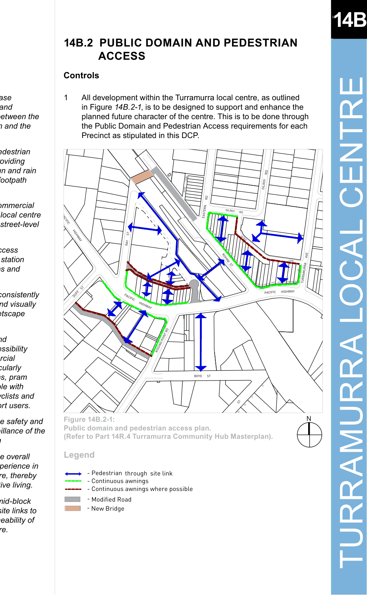

### 14B.1 TURRAMURRA LOCAL CENTRE CONTEXT

#### Controls

#### Objectives

1	 To create distinct retail

WONGA

1 All development within the Turramurra local centre, as outlined

in Figure 14B.1-1, is to be designed to support and enhance the

planned future character of the centre. This is to be done through

the general requirements and precinct specific requirements as

A

2	 To create a village centre

14

3	 To create a vibrant local

A

N

4	 To retain the distinctive

Rohini Street as a local

### T2

### T1

### T1

offices fronting on to rear

KU-RIN

### T3

### T4

PACIFIC

1312

5

1310

#### Legend

11

9

TER 4

2C CR 2 4 6 8 10 CARCOOLA

AVE 45

57 55 53 49 45 43

BRENTWOOD

> [Picture on page 3: a map, saved as a picture (images/part-14b-turramurra-local-centre-page-3-4.gif, 150 dpi); the street names and other small labels are on the picture.]
> Words printed on the picture (title and legend, copied from the PDF):
> KIRAWA     CLOSE DR
> ALIGNMENT AND SETBACKS
> KISSING POINT RD
> - 10m setback
> - 6m setback
> - 5m setback
> - 3m setback
> - 2m setback
> - Nil setback
> - Land dedication
> - Alternate deep soil requirement
> - Primary active frontage
> - Secondary active frontage
> - 3 storey street wall
> - 2m upper level setback above street
> - 4m upper level setback above street
> Public domain and pedestrian access plan.
> (Refer to Part 14R.4 Turramurra Community Hub Masterplan).
> PUBLIC DOMAIN AND PEDESTRIAN
> 38 19 5
> Pedestrian site link
> - Continuous awnings
> Continuous awnings where possible
> - Vehicular access to site
> - Pedestrian access to site

Figure 14B.2-1:

11 11A
