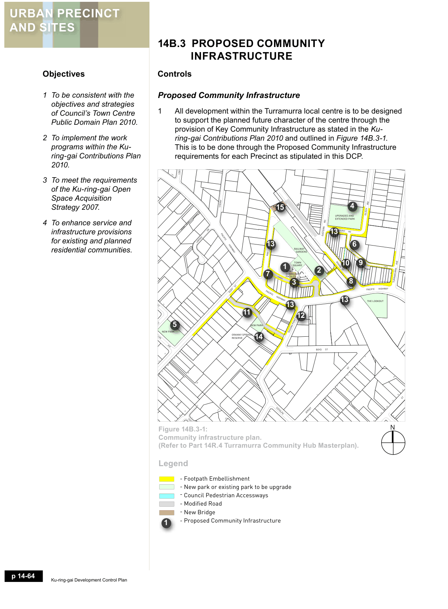
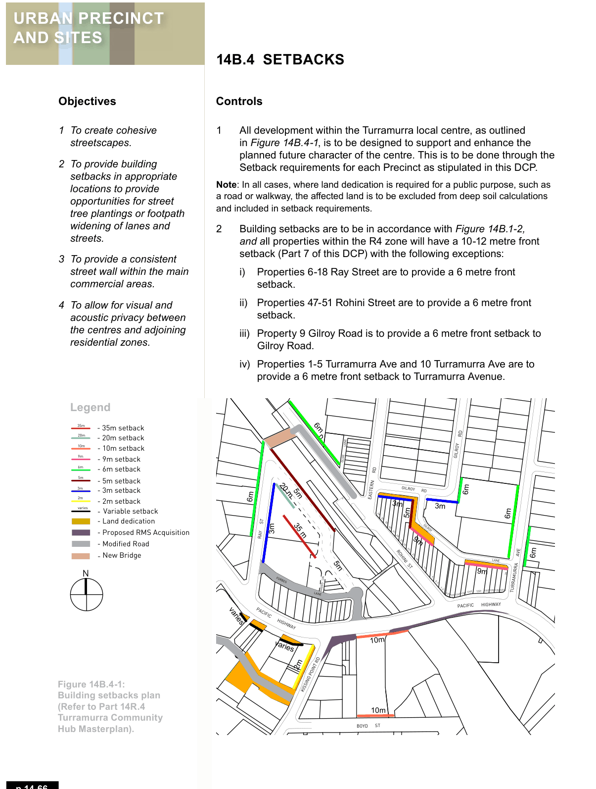

### 14B.2  PUBLIC DOMAIN AND PEDESTRIAN

### ACCESS

2B

2

2A

1

3

7

5

#### Objectives

#### Controls

1A 2C 1A

WINTON 1405

1407

1482

2

1397

1395

1391

HIGHWAY

1389

1 All development within the Turramurra local centre, as outlined

in Figure 14B.2-1, is to be designed to support and enhance the

planned future character of the centre. This is to be done through

the Public Domain and Pedestrian Access requirements for each

Precinct as stipulated in this DCP.

1	 To promote ease

of circulation and

connectivity between the

railway station and the

local centre.

RD

7

9

2	 To improve pedestrian

amenity by providing

continuous sun and rain

protection to footpath

areas.

15 3	 To improve commercial

activity in the local centre

by promoting street-level

activity.

NMAN

12 14

10

5

9 15

7

17

8

11

19

91

80

4	 To improve access

to the railway station

for pedestrians and

commuters.

74A

41A 74

81

85

87

83

76

72

78

21

23

19

5

7-9

11

1

3

36

AVE

KU-RING-GAI

45

ST

17

15

25 70

39

31

27-29

33 22

43 41 37 35 35A

BOOMERANG

24

5	 To provide a consistently

high quality and visually

pleasing streetscape

environment.

ST

RANG

28

26

79 ST 4

10A

6A

1 75A

75

AVE

10

ALLAN

AVE

69

77

71

73

65

6

18

63

22

14

2

ST

WONGA

19

12

8

20

16

28

24

32A

30A

26

39

37

35

29

6	 To improve and

enhance accessibility

to the commercial

precinct particularly

for pedestrians, pram

walkers, people with

disabilities, cyclists and

public transport users.

ST

32B

32

41

23

21

25

34A

43

15

9

5

7

17

27

43-47

7	 To improve the safety and

passive surveillance of the

public domain

34

42

40

38

36A

49 44

#### Legend

ST

46

31

37

41

51

51A53 53A

55

61

49

29

48 25

51

KU-RING-GAI

KU-RING-GAI

50

8	 To improve the overall

pedestrian experience in

the local centre, thereby

promoting active living.

30

34

32

45

28

52

53

9 7 5 3 1

AVE

DUFF

TURUGA

8 6 4

10

55

29 24

26

ST

57

35

37

41

43

39

59

25A

9	 To promote mid-block

and through-site links to

improve permeability of

the local centre.

AVE

CORNWALL

34A 33

### TURRAMURRA LOCAL CENTRE

### TURRAMURRA LOCAL CENTRE

13

WOMERAH

15

17

19

19A

21

29

23

25

27

> [Picture on page 4: a map, saved as a picture (images/part-14b-turramurra-local-centre-page-4-1.gif, 150 dpi); the street names and other small labels are on the picture.]
> Words printed on the picture (title and legend, copied from the PDF):
> 8 25 23
> 57 55 53 49 45 43
> 33 31 29
> 11 9 5 1
> 49-51 47 45
> objectives and strategies
> of Council’s Town Centre
> Public Domain Plan 2010.
> programs within the Ku-
> ring-gai Contributions Plan
> of the Ku-ring-gai Open
> KIRAWA     CLOSE DR
> 6 EASTERN 13
> for existing and planned
> 26A 16 18
> 35 37 38
> ALIGNMENT AND SETBACKS
> 1 NEW PARK
> KISSING POINT RD
> 43 41 37 35 35A
> - 10m setback
> - 6m setback
> - 3m setback
> - Nil setback
> - Land dedication
> - Alternate deep soil requirement
> 66 67 36
> Community infrastructure plan.
> (Refer to Part 14R.4 Turramurra Community Hub Masterplan).
> - Primary active frontage
> - Secondary active frontage
> - 3 storey street wall
> - 2m upper level setback above street
> - 4m upper level setback above street
> 17 11 9
> PUBLIC DOMAIN AND PEDESTRIAN
> - Footpath Embellishment
> - New park or existing park to be upgraded
> - Council Pedestrian Accessways
> - Modified Road
> Proposed Community Infrastructure
> 9 7 5 3 1
> 8 6 4
> 3 7 9
> - Vehicular access to site
> - Pedestrian access to site

Figure 14B.3-1:

### 14B.3  PROPOSED COMMUNITY

### INFRASTRUCTURE

#### Objectives

#### Controls Proposed Community Infrastructure

1	 To be consistent with the

1 All development within the Turramurra local centre is to be designed

to support the planned future character of the centre through the

provision of Key Community Infrastructure as stated in the Ku-

ring-gai Contributions Plan 2010 and outlined in Figure 14B.3-1.

This is to be done through the Proposed Community Infrastructure

requirements for each Precinct as stipulated in this DCP.

2	 To implement the work

3	 To meet the requirements

4	 To enhance service and

A

AI

### 14B.3  PROPOSED COMMUNITY

### INFRASTRUCTURE (continued)

#### Controls

2 The following development is to be designed to support and

compliment the provision of Key Community Infrastructure through

the Ku-ring-gai Contributions Plan 2010 or by Voluntary Planning

Agreement (VPA) or other delivery mechanism (refer to individual

precincts 14B.8 to 14B.11): 1 A new Town Square (minimum dimensions of 25 metres by 40

metres); 2 Public open space with a total area of 2,800 sqm 3 A new community building adjoining the new town square to

be owned by Council. With a total GFA of approx. 3,000 m2

comprising a new branch library and multi-purpose community

centre. An extension of Cameron Park to create a new town park.

#### 4

A new local park on the intersection of Duff Street and Allen

#### 5

Street. 6 A new multi-purpose community facility to be owned by Council

on Gilroy Lane An upgraded and improved Forbes Lane

#### 7

8 Improvements to the Rohini Street footpath area including

terracing to allow level areas for outdoor dining. 9 An improved Gilroy Lane widened to be a 13 metre wide right-

of-way with two-way traffic; on-street parking (one side); and

footpaths (both sides). 10 Embellishment of Council’s pedestrian access ways from Gilroy

Lane to Rohini Street. 11 A new public street connecting Kissing Point Road and Duff

Street with two way traffic, on–street parking (one side); and

footpaths (both sides). The land is to be dedicated to Council  as

part of redevelopment. The road will be a minimum of 15 metres

wide and will function as an Asset Protection Zone (APZ). In

addition the new street will be designed to aid fire fighting and

incorporate access specifications identified in Planning for

Bushfire Protection 2019; and designed to minimise impact on

adjoining Blue Gum High Forest. 12 Improvements to Kissing Point Road including a new dedicated

left-turn lane from Kissing Point Road to the highway. 13 Embellishment of all the footpath areas along all streets within

the Centre. 14 Construction and embellishment of a new urban park

### TURRAMURRA LOCAL CENTRE

### TURRAMURRA LOCAL CENTRE

A new bridge over the railway connecting Ray Street and Rohini

Street with separate lanes for pedestrians, cyclists and vehicles.

> [Picture on page 6: a map, saved as a picture (images/part-14b-turramurra-local-centre-page-6-1.gif, 150 dpi); the street names and other small labels are on the picture.]
> Words printed on the picture (title and legend, copied from the PDF):
> 1	 To create cohesive
> 57 55 53 49 45 43
> 33 31 29
> Note: In all cases, where land dedication is required for a public purpose, such as
> a road or walkway, the affected land is to be excluded from deep soil calculations
> and included in setback requirements.
> 2	 To provide building
> setbacks in appropriate
> locations to provide
> opportunities for street
> tree plantings or footpath
> widening of lanes and
> acoustic privacy between
> the centres and adjoining
> CHERRY iv)	 Properties 1-5 Turramurra Ave and 10 Turramurra Ave are to
> 18 35 EVELYN
> 29 33 35 37 38
> - 20m setback
> - 35m setback
> - 10m setback
> - 9m setback
> - 6m setback
> 20 18 14
> - 5m setback
> - 3m setback
> - 2m setback
> - Variable setback
> - Land dedication
> - Proposed RMS Acquisition
> 63 65 - Modified Road
> - New Bridge
> KISSING POINT RD
> 10 2 4
> 3 7 9
> Building setbacks plan
> (Refer to Part 14R.4

Figure 14B.4-1:
