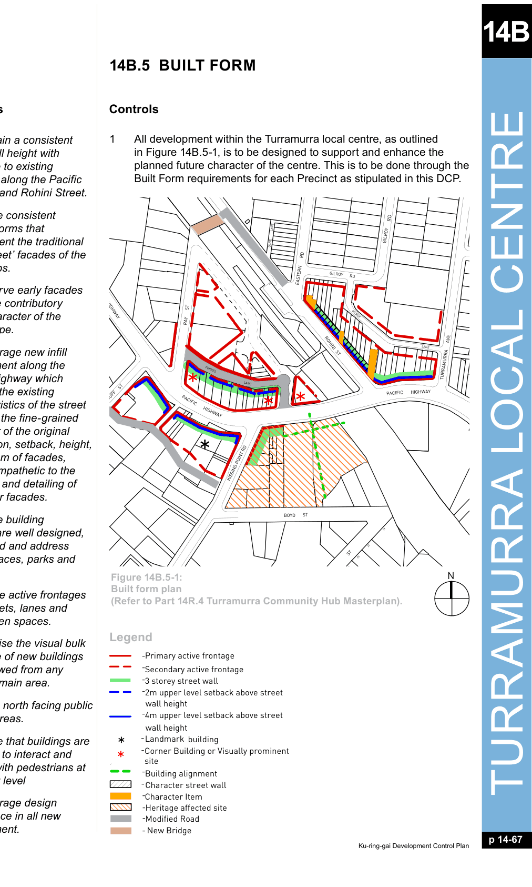

### 14B.4  SETBACKS

#### Objectives

#### Controls

1 All development within the Turramurra local centre, as outlined

in Figure 14B.4-1, is to be designed to support and enhance the

planned future character of the centre. This is to be done through the

Setback requirements for each Precinct as stipulated in this DCP.

49-51 47 45 BOOMERANG

2 Building setbacks are to be in accordance with Figure 14B.1-2,

and all properties within the R4 zone will have a 10-12 metre front

setback (Part 7 of this DCP) with the following exceptions:

3	 To provide a consistent

street wall within the main

i) Properties 6-18 Ray Street are to provide a 6 metre front

ii)	 Properties 47-51 Rohini Street are to provide a 6 metre front

iii)	 Property 9 Gilroy Road is to provide a 6 metre front setback to

4	 To allow for visual and

provide a 6 metre front setback to Turramurra Avenue.

#### Legend

NULLA

6

43 p 14-66

11 11A

BRENTWOOD

> [Picture on page 7: a map, saved as a picture (images/part-14b-turramurra-local-centre-page-7-3.gif, 150 dpi); the street names and other small labels are on the picture.]
> Words printed on the picture (title and legend, copied from the PDF):
> buildings along the Pacific
> Highway and Rohini Street.
> complement the traditional
> KISSING POINT RD
> characteristics of the street
> including the fine-grained
> character of the original
> subdivision, setback, height,
> materials and detailing of
> the earlier facades. 38
> ALIGNMENT AND SETBACKS
> facades are well designed,
> articulated and address
> public spaces, parks and
> Built form plan
> (Refer to Part 14R.4 Turramurra Community Hub Masterplan).
> - 10m setback
> - 6m setback
> - 5m setback
> - 3m setback
> - 2m setback
> - Nil setback
> - Land dedication
> - Alternate deep soil requirement
> - Primary active frontage
> - Secondary active frontage
> - 3 storey street wall
> - 2m upper level setback above street
> - 4m upper level setback above street
> - Landmark building
> Corner Building or Visually prominent
> - Building alignment
> designed to interact and
> engage with pedestrians at
> - Character street wall
> 9 7 5 3 1
> - Heritage affected site
> - Modified Road
> - New Bridge

Figure 14B.5-1:

2B

2A
