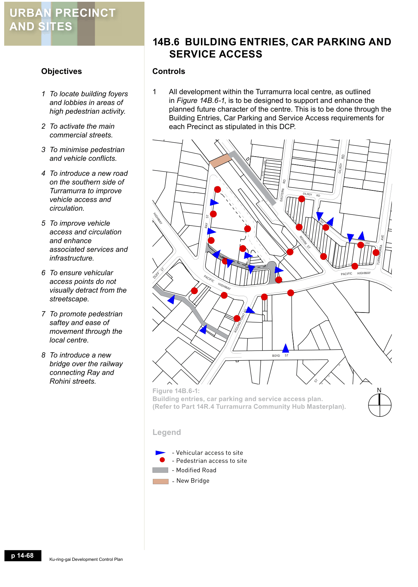

### 14B.5  BUILT FORM

1

3

1A 2C 1A

WINTON 1405

1407

#### Objectives

1482

2

1397

1395

1391

HIGHWAY

1389

RD

1 All development within the Turramurra local centre, as outlined

in Figure 14B.5-1, is to be designed to support and enhance the

planned future character of the centre. This is to be done through the

Built Form requirements for each Precinct as stipulated in this DCP.

1	 To maintain a consistent

street wall height with

reference to existing

7

2	 To ensure consistent

building forms that

‘main street’ facades of the

strip shops. 3	 To conserve early facades

which are contributory

to the character of the

streetscape.

6

21

23

19

7-9

11

### * *

### *

36

ST

17

15

25

### *

ST 4

10A

6A

1 10

5

9 15

7

10 17

8

11

19

ALLAN

91

80

4	 To encourage new infill

development along the

Pacific Highway which

respects the existing

and rhythm of facades,

and is sympathetic to the

AVE

6

18

12

8

20

16

22

14

2

74A

41A 74

15

9

5

7

17

81

85

87

83

19

76

72

78

32A

30A

26

AVE

KU-RING-GAI

21

39

37

35

29

47 45

ST 32B

32

70

39

43 41 37 35 35A

41

5	 To ensure building

reserves. ST

MERANG

34A

43

28

79

AVE

34

42

40

38

36A

6	 To provide active frontages

to all streets, lanes and

public open spaces.

49 44

69

77

71

73

#### Legend

46

ST

WONGA

48

50

30

34

32

45

7	 To minimise the visual bulk

and scale of new buildings

when viewed from any

public domain area.

28

52

DUFF

24

26

8	 To create north facing public

domain areas.

43-47

35

37

41

43

39

59

AVE

CORNWALL

### * -

### *

ST

LLA

31

37

41

51

51A53 53A

55

61

49

29

9	 To ensure that buildings are

the street level 25

KU-RING-GAI

KU-RING-GAI

6

### TURRAMURRA LOCAL CENTRE

TURUGA

-GAI

10	To encourage design

excellenace in all new

development.

33 31 29 27 25

> [Picture on page 8: a map, saved as a picture (images/part-14b-turramurra-local-centre-page-8-2.gif, 150 dpi); the street names and other small labels are on the picture.]
> Words printed on the picture (title and legend, copied from the PDF):
> high pedestrian activity.
> 3	 To minimise pedestrian
> and vehicle conflicts.
> 80 KIRAWA     CLOSE 35 37
> ALIGNMENT AND SETBACKS
> Turramurra to improve
> vehicle access and
> 41 37 35 35A
> 5	 To improve vehicle
> access and circulation
> associated services and
> - 10m setback
> - 6m setback
> - 5m setback
> - 3m setback
> - 2m setback
> - Nil setback
> - Land dedication
> - Alternate deep soil requirement
> 6	 To ensure vehicular
> access points do not
> visually detract from the
> streetscape. 66 67
> KISSING POINT RD
> 7	 To promote pedestrian
> saftey and ease of
> movement through the
> - Primary active frontage
> - Secondary active frontage
> - 3 storey street wall
> - 2m upper level setback above street
> - 4m upper level setback above street
> PUBLIC DOMAIN AND PEDESTRIAN
> bridge over the railway
> connecting Ray and
> Building entries, car parking and service access plan.
> (Refer to Part 14R.4 Turramurra Community Hub Masterplan).
> 9 7 5 3
> - Through site link
> - Entry plaza/forecourt
> - Continuous awnings
> - Continuous awnings where possible
> - Continuous colonnade
> 8 6 4
> BERRILLEE 23 A
> BUILDING ENTRIES AND CARPAT
> access to site
> - Vehicular access to site
> - Modified Road
> - New Bridge

Figure 14B.6-1:

BOO
