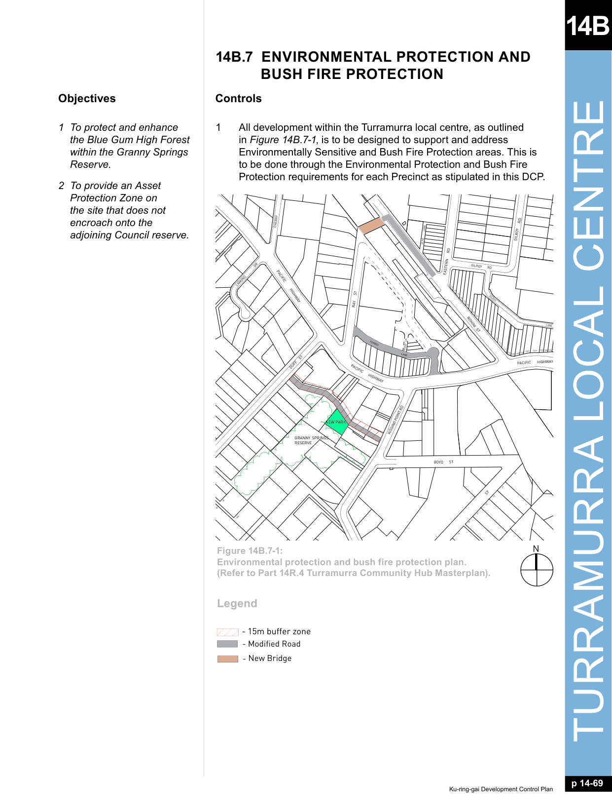

### 14B.6  BUILDING ENTRIES, CAR PARKING AND

### SERVICE ACCESS

#### Objectives

#### Controls

WONGA

1	 To locate building foyers

and lobbies in areas of

1 All development within the Turramurra local centre, as outlined

in Figure 14B.6-1, is to be designed to support and enhance the

planned future character of the centre. This is to be done through the

Building Entries, Car Parking and Service Access requirements for

each Precinct as stipulated in this DCP.

2	 To activate the main

NU

4	 To introduce a new road

on the southern side of

KU-RING

PACIFIC

1312

1310 1

4

8	 To introduce a new

#### Legend

11

9

7

4

TERRIG

HIGHW

EAST

EULBERTIE

57 55 53 49 45 43

BRENTWOOD

> [Picture on page 9: a map, saved as a picture (images/part-14b-turramurra-local-centre-page-9-5.gif, 150 dpi); the street names and other small labels are on the picture.]
> Words printed on the picture (title and legend, copied from the PDF):
> within the Granny Springs
> 25 27 31
> 29 33 35 37
> ALIGNMENT AND SETBACKS
> ALIGNMENT AND SETBACKS
> Protection Zone on
> encroach onto the
> adjoining Council reserve.
> 23 35 37
> 16 42 40
> 3 41 37 35 35A 33
> 43 41 37 35 35A BOOMERANG
> ALIGNMENT AND SETBACKS
> 74A 24A 24A
> - 10m setback
> - 6m setback
> - 5m setback
> - 3m setback
> - 2m setback
> - Nil setback
> - Land dedication
> - Alternate deep soil requirement
> - 10m setback
> - 6m setback
> - 5m setback
> - 3m setback
> - 2m setback
> - Nil setback
> - Land dedication
> - Alternate deep soil requirement
> 43 41 37 35 35A
> 66 65 67
> 24A 66 67
> - 10m setback
> - 6m setback
> - 5m setback
> - 3m setback
> - 2m setback
> - Nil setback
> - Land dedication
> - Alternate deep soil requirement
> KISSING POINT RD
> - Primary active frontage
> - Secondary active frontage
> - 3 storey street wall
> - 2m upper level setback above street
> - 4m upper level setback above street
> - Primary active frontage
> - Secondary active frontage
> - 3 storey street wall
> - 2m upper level setback above street
> - 4m upper level setback above street
> PUBLIC DOMAIN AND PEDESTRIAN
> PUBLIC DOMAIN AND PEDESTRIAN
> - Primary active frontage
> - Secondary active frontage
> - 3 storey street wall
> - 2m upper level setback above street
> - 4m upper level setback above street
> PUBLIC DOMAIN AND PEDESTRIAN
> 9 7 5 3 1
> - Through site link
> - Entry plaza/forecourt
> - Continuous awnings
> - Continuous awnings where possible
> - Continuous colonnade
> 9 7 5 3 1
> - Through site link
> - Entry plaza/forecourt
> - Continuous awnings
> - Continuous awnings where possible
> - Continuous colonnade
> 8 6 4
> 8 6 4
> ST 2 4
> BUILDING ENTRIES AND CARPAT
> BUILDING ENTRIES AND CARPAT
> 7 9 38
> Environmental protection and bush fire protection plan.
> (Refer to Part 14R.4 Turramurra Community Hub Masterplan).
> 9 7 5 3 1
> - Through site link
> - Entry plaza/forecourt
> - Continuous awnings
> - Continuous awnings where possible
> - Continuous colonnade
> - Vehicular access to site
> - Pedestrian access to site
> 8 6 4
> - Vehicular access to site
> - Pedestrian access to site
> BUILDING ENTRIES AND CARPAT
> access to site
> - 15m buffer zone
> - 15m buffer zone
> 17 11 9
> 59 34A 28 33
> - Vehicular access to site
> - Modified Road
> - New Bridge
> 1197 1185 WARRANGI

Figure 14B.7-1:

2
