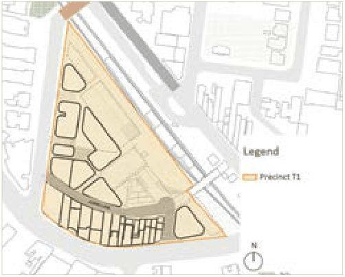
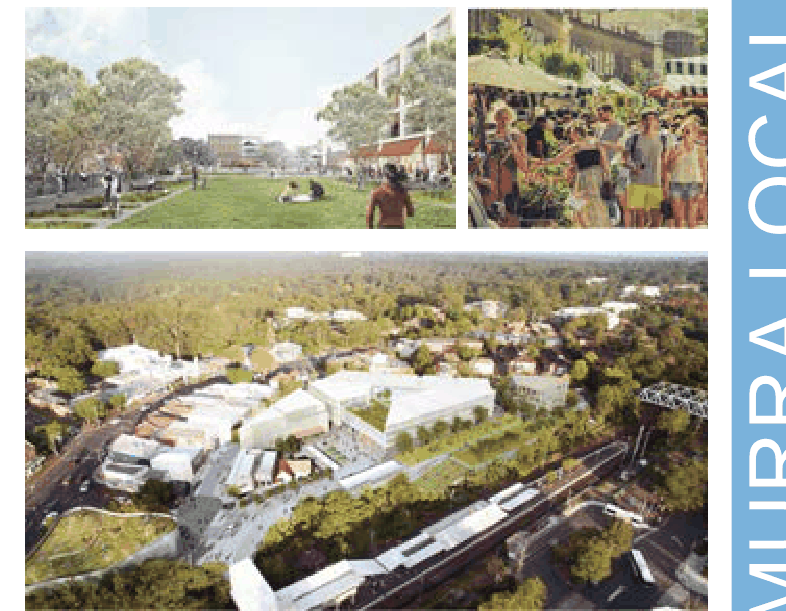
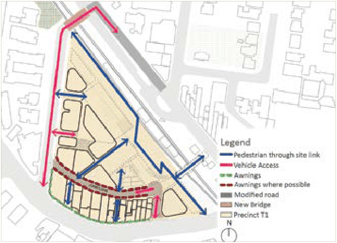
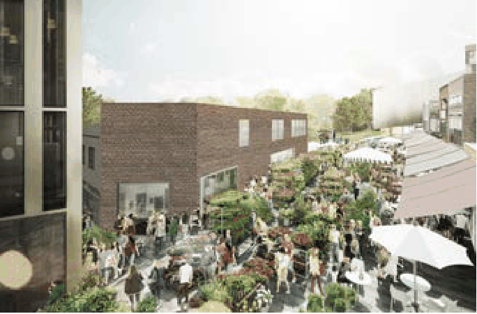
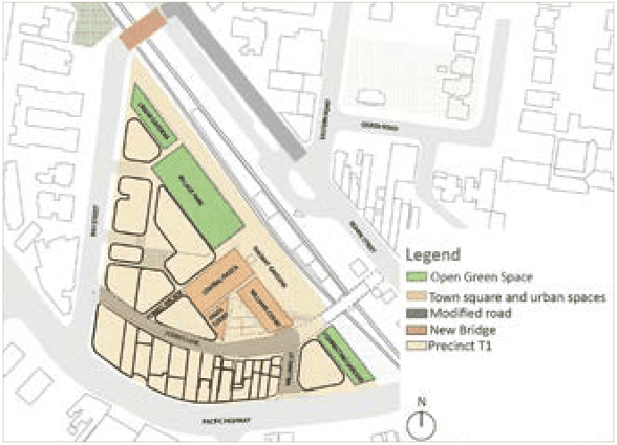

### 14B.7  ENVIRONMENTAL PROTECTION AND

### BUSH FIRE PROTECTION

#### Objectives

#### Controls

W

1	 To protect and enhance

the Blue Gum High Forest

5

1 All development within the Turramurra local centre, as outlined

in Figure 14B.7-1, is to be designed to support and address

Environmentally Sensitive and Bush Fire Protection areas. This is

to be done through the Environmental Protection and Bush Fire

Protection requirements for each Precinct as stipulated in this DCP.

2	 To provide an Asset

the site that does not

G

#### Legend

### TURRAMURRA LOCAL CENTRE

### 14B.8  PRECINCT T1:

### PACIFIC HIGHWAY AND RAY STREET

### RETAIL AREA

#### Controls Planned Future Character

> [Picture on page 10: a picture, saved as a picture (images/part-14b-turramurra-local-centre-page-10-6.gif, 150 dpi).]

Refer to

Objectives and Controls

#### PART 14B.1

Urban Precincts

### T1

Refer to

#### PART 14R.4

Turramurra Community

Hub Masterplan

#### Objectives

1	 To ensure development

is consistent with the

Turramurra Community

Hub Masterplan.

#### Figure 14B.8-1:

#### Precinct T1

(Refer to Part 14R.4 Turramurra Community Hub Masterplan).

2	 To provide a vibrant

community hub with a

mix of retail, residential,

commerical and

community facilities. 3	 To provide a large flexible

public open space for the

community.

Precinct T1 is a triangular parcel of land bound by the Pacific Highway,

the North Shore railway line and Ray Street. The area currently

comprises a small freestanding supermarket, a Council library, a small

group of privately owned shops on Higgs Lane, and a strip of privately

owned shops fronting the Pacific Highway. The remainder of the area

is occupied by public car parking and serviced by Forbes Lane, Higgs

Lanes and William Street road reserves. A large part of William Street

road reserve is currently used for car parking.

4	 To improve vehicular

movement through the

area. 5	 To retain the existing

number of Council car

parking spaces.

The Turramurra Community Hub is to become a revitalised area

with retail, residential and community facilities. Refer to the

adopted Turramurra Community Hub Masterplan in part 14R.4 for a

comprehensive collection of illustrations, plans and design principals.

Where there is an inconsistency between the controls in this Part 14B.8

and the Turramurra Community Hub Masterplan, then the latter prevails to

the extent of the inconsistency.

6	 To provide adequate

parking associated

with the new land uses

developed on the site.

1 Development is to be designed in accordance with the Turramurra

Community Hub Masterplan at part 14R.4 and is to support and

enhance the planned future character of this Precinct by providing

the following:

i) Community Building: New public building comprising a multi-

purpose community centre and a branch library;

ii)	 Open Space: New public park and a town square;

7	 To provide enhanced

vehicular and pedestrian

connectivity between

the railway station,

Pacific Highway and the

Turramurra Community

Hub site.

iii)	 Retail 1: A major full-line supermarket and complimentary

speciality shops located in a partly-sunken podium and linked

seamlessly to the Ray Street level above;

8	 To provide a civic plaza

that connects the site to

Pacific Highway.

### PACIFIC HIGHWAY AND RAY STREET

### RETAIL AREA (continued)

#### Controls

iv)	 Retail 2: A range of quality destination retail along Forbes

Arcade and adjacent the town square and park with outdoor

dining opportunities;

v)	 Residential: Residential Apartments providing a mix of 1, 2 and

3 bedroom units;

vi)	 Car Parking: Parking requirements for the whole development

accommodated in a new basement parking;

Refer to Figures 14B.8-1 and 14B.8-2 (see Turramurra Community Hub

Masterplan at Part 14R.4 for complete illustrations).

> [Picture on page 11: a picture, saved as a picture (images/part-14b-turramurra-local-centre-page-11-13.gif, 150 dpi).]

#### Figure 14B.8-2:

Turramurra Community Hub with open spaces including retail mix,

community facilities and a variety of public urban spaces

(Refer to Part 14R.4 Turramurra Community Hub Masterplan).

### TURRAMURRA LOCAL CENTRE

### PACIFIC HIGHWAY AND RAY STREET

### RETAIL AREA (continued)

#### Controls Access

> [Picture on page 12: a picture, saved as a picture (images/part-14b-turramurra-local-centre-page-12-5.gif, 150 dpi).]

Refer to

#### PART 14B.2

Public Domain and Pedestrian Access

Refer to

#### PART 14B.6

Building Entries, Car-Park-

ing and Service Access

Refer to

#### PART 14R.4

Turramurra Community

Hub Masterplan

#### Objectives

#### Figure 14B.8-3:

#### Pedestrian access plan.

(Refer to Part 14R.4 Turramurra Community Hub Masterplan).

9	 To maximise and

enhance landscape

quality and leafy outlook

on all streetscapes.

2 Pedestrian access is to be in accordance with the Turramurra Community Hub Masterplan at Part 14R.4, including the provision of the following:

10 To provide for a pleasant

pedestrian experience

through, around and to

the site.

i) Internal new shopping arcades linking the Pacific Highway and

Forbes Lane;

ii)	 An open air shopping arcade linking Forbes Lane with the new

Town Square;

11 To maximise pedestrian

connectivity and

circulation (vertical

and horiztonal) around

and through the site.

iii)	 Major through-site pedestrian links between Ray Street and

the train station through both the park and along Forbes Lane

with clear demarcation of pedestrian entry and exceptional

wayfinding;

12 To improve and

enhance pedestrian

connection from the

railway station to site.

iv)	 Awnings to Forbes Lane to support active frontages;

v)	 A colonnade around the proposed town square;

vi)	 A continuous shared pedestrian cycle path from the northern

13 To allow for ease of

access and circulation for

the mobility impaired.

edge of the precinct through to the Pacific Highway;

vii)	 A new bridge over the rail line connecting Ray Street with Rohini

14 To retain a cohesive

streetscape character.

Street with separated lanes for vehicles, cyclists and pedestrians

and and associated road works on Rohini Street.

viii)	Clear lines of sight for pedestrians generally including between

15 To minimise vehicular

entry points to the site.

the podium/residential entry on the town square and the western

landing of train station pedestrian bridge and along the NW axis

through the site.

### PACIFIC HIGHWAY AND RAY STREET

### RETAIL AREA (continued)

#### Controls

#### Objectives

3 Vehicular access is to be in accordance with the Turramurra Community Hub Masterplan at Part 14R.4, including provision of the following:

16 To minimise conflicts

between vehicular,

pedestrian and service

entry points.

i) Modifications to Forbes Lane making it a narrow one-way

(westbound) share-way catering for pedestrians, cyclists and

vehicles, with provision of on-street parking on one side of the

lane.

ii)	 Retention of existing roundabout on William Street and pick-up/

17 To provide unambigious

and clearly marked

building entry points.

drop-off area adjoining the train station as well as on-street

parking (wherever possible).

iii)	 Pick up and drop off areas are to be provided on William Street

and Forbes Lane.

iv)	 A new bridge connecting Ray and Rohini streets.

18 To provide a clear distinction between commercial, retail and residential building entry points

v)	 Access for loading off Ray Street.

Refer to Figures 14B.8-3 and 14B.8-4 (see Turramurra Community Hub

Masterplan at Part 14R.4 for complete illustrations.)

> [Picture on page 13: a picture, saved as a picture (images/part-14b-turramurra-local-centre-page-13-33.gif, 150 dpi).]

#### Figure 14B.8-4:

#### Forbes Lane Shared Way

(Refer to Part 14R.4 Turramurra Community Hub Masterplan).

### TURRAMURRA LOCAL CENTRE

### PACIFIC HIGHWAY AND RAY STREET

### RETAIL AREA (continued)

#### Controls Public Domain & Open Space

> [Picture on page 14: a picture, saved as a picture (images/part-14b-turramurra-local-centre-page-14-5.gif, 150 dpi).]

Refer to

#### PART 14B.2

Public Domain and Pedestrian Access

Refer to

#### PART 14R.4

Turramurra Community Hub Masterplan

#### Objectives

19 To provide a new

community public park located in a sunny location away from the Pacific Highway. 20 To maximise and

enhance the landscape

character of all

streetscapes.

#### Figure 14B.8-5:

#### Public domain and open space plan.

(Refer to Part 14R.4 Turramurra Community Hub Masterplan).

4 Public domain areas are to be in accordance with the Turramurra Community Hub Masterplan at Part 14R.4, including the following:

21 To provide open spaces

that cater for a range of

uses, including day and

night activities.

i) All existing and upgraded streets within and surrounding the

precinct are to provide pedestrian and cycle facilities, generous

footpaths, on-street parking, public seating, high quality

pedestrian lighting and street trees.

22 To provide open spaces

that cater for different age

groups.

5 Open space and urban space areas are to be in accordance with the Turramurra Community Hub Masterplan at Part 14R.4, including provision of the following:

23 To create accessible,

comfortable and safe

open spaces.

i) A town square as the focal point of the precinct;

ii)	 A park with a minimum area of 2,000sqm located centrally and

24 To maximise pedestrian

connections to open

spaces.

adjoining the town square;

iii)	 A suite of interconnected outdoor rooms and gardens linking the

northern end of Ray Street with the Pacific Highway along the

western side of the rail corridor; and

25 To provide open

green spaces for passive

recreation.

iv)	 Protection of the existing mature trees adjacent the rail corridor

26 To ensure solar access to

onsite open spaces,

community facilities and

residential dwellings

Refer to Figures 14B.8-5, 14B.8-6, 14B.8-7 and 14B.8-8 (see

Turramurra Community Hub Masterplan at Part 14R.4 for complete

illustrations.)
