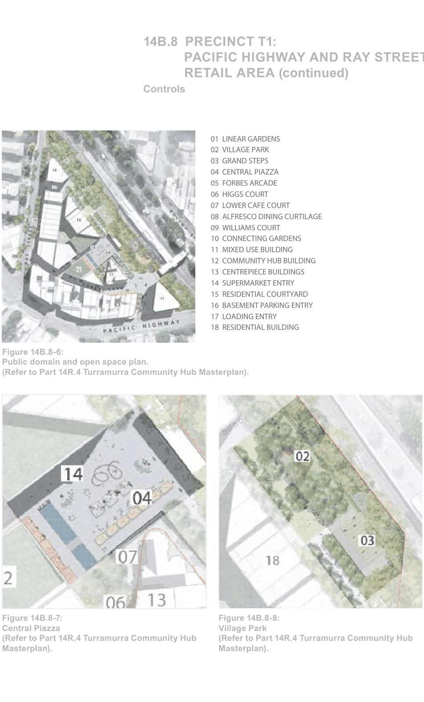
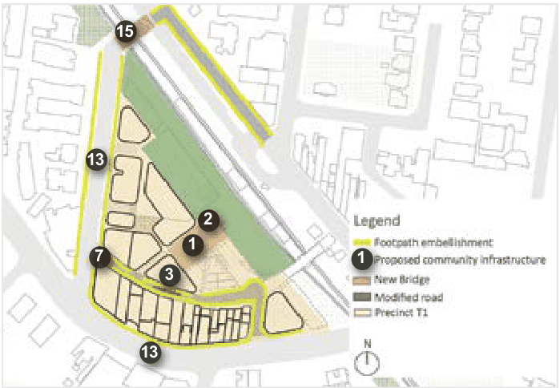
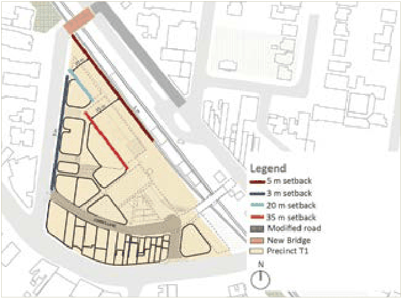

### 6.0 LANDSCAPE

#### MASTERPLAN

### PACIFIC HIGHWAY AND RAY STREET

### RETAIL AREA (continued)

> [Picture on page 15: a picture, saved as a picture (images/part-14b-turramurra-local-centre-page-15-6.gif, 150 dpi).]
> Words printed on the picture (title and legend, copied from the PDF):
> Public domain and open space plan.
> (Refer to Part 14R.4 Turramurra Community Hub Masterplan).
> Central Piazza
> (Refer to Part 14R.4 Turramurra Community Hub
> Masterplan).

Figure 14B.8-6:

Figure 14B.8-7:

#### Controls

01  LINEAR GARDENS 02  VILLAGE PARK 03  GRAND STEPS 04  CENTRAL PIAZZA 05  FORBES ARCADE 06  HIGGS COURT 07  LOWER CAFE COURT 08  ALFRESCO DINING CURTILAGE 09  WILLIAMS COURT 10  CONNECTING GARDENS 11  MIXED USE BUILDING 12  COMMUNITY HUB BUILDING 13  CENTREPIECE BUILDINGS 14  SUPERMARKET ENTRY 15  RESIDENTIAL COURTYARD 16  BASEMENT PARKING ENTRY 17  LOADING ENTRY 18  RESIDENTIAL BUILDING

© CHROFI : NOVEMBER 2016

#### Figure 14B.8-8:

#### Village Park

(Refer to Part 14R.4 Turramurra Community Hub

#### Masterplan).

### TURRAMURRA LOCAL CENTRE

### PACIFIC HIGHWAY AND RAY STREET

### RETAIL AREA (continued)

#### Controls Proposed Community Infrastructure

> [Picture on page 16: a picture, saved as a picture (images/part-14b-turramurra-local-centre-page-16-5.gif, 150 dpi).]
> Words printed on the picture (title and legend, copied from the PDF):
> 15
> 13
> 2
> 1
> 7
> 1
> 3
> 13

Refer to

Objectives and Controls

#### PART 14B.3

Proposed Community Infrastructure

Refer to

#### PART 14R.4

Turramurra Community

Hub Masterplan

#### Objectives

27 To provide for public open

space in the local centre.

28 To create a vibrant mixed-

use precinct.

#### Figure 14B.8-9:

#### Key community infrastructure plan

(Refer to Part 14R.4 Turramurra Community Hub Masterplan).

29 To facilitate community

interaction.

30 To provide quality space

for gatherings and events.

6 The following development is to be designed to support and compliment the provision of Key Community Infrastructure through Ku-ring-gai Contributions Plan 2010, Voluntary Planning Agreement (VPA)or other delivery mechanism: A town square (minimum dimensions of 25 metres by 40 metres);

#### 1

31 To enhance and improve

road and road related

infrastructure.

2 Public open space with a total area of 2,800 sqm 3 A new community building comprising a branch library and

community centre with a total GFA of 3,000sqm 7 An upgraded and improved Forbes Lane

32 To showcase leadership

in design excellence and

Ecologically Sustainable

Development (ESD)

provisions.

13 Embellishment of all the footpath areas along the Pacific Highway,

Ray Street and Forbes Lane.

33 To create a high quality

live-work precinct.

15 A new bridge over the railway connecting Ray Street and Rohini

Street with separate lanes for for pedestrians, cyclists and

vehicles and associated road works on Rohini Street.

Refer to Figure 4B.8-9 (see Turramurra Community Hub Masterplan

at Part 14R.4 for complete illustrations).

34To consider opportunities for provision of commuter car parking spaces located in new

developments.

35 To promote urban ‘green

living.’

### PACIFIC HIGHWAY AND RAY STREET

### RETAIL AREA (continued)

#### Controls Setbacks

> [Picture on page 17: a picture, saved as a picture (images/part-14b-turramurra-local-centre-page-17-5.gif, 150 dpi).]

Refer to

Objectives and Controls

#### PART 14B.4

Setbacks

Refer to

#### PART 14R.4

Turramurra Community

Hub Masterplan

#### Objectives

36 To adequately service

the community

infrastructure

requirements of the local

community.

37 To provide streetscapes

with a leafy outlook and

high quality landscape character

#### Figure 14B.8-10

#### Building alignment and setbacks plan.

(Refer to Part 14R.4 Turramurra Community Hub Masterplan).

38 To maintain and enhance

a leafy outlook along all

streetscapes.

7 Building setbacks are to be in accordance with Figure 14B.8-9, and all buildings in the B2 zone are to have a zero setback to all lot boundaries with the following exceptions:

39 To provide for a pleasant

pedestrian experience

within the local centre.

i) Provide minimum 5m building setback from the railway corridor

boundary to the building podium for a landscape zone and to

protect existing mature trees;

ii)	 Provide a minimum 3m building setback to Ray Street for a

landscaped zone.

iii)	 Provide a 20m setback from the rail corridor boundary to new

40 To enhance the landscape character of Ku-ring-gai.

residential/mixed use building adjoining Linear Gardens.

iv)	 Provide a 35m setback from rail corridor boundary to new

residential/mixed use buildings adjoining Village Park.

Refer to Figure 14B.8-10 (see Turramurra Community Hub

Masterplan at Part 14R.4 for complete illustrations).

### TURRAMURRA LOCAL CENTRE
